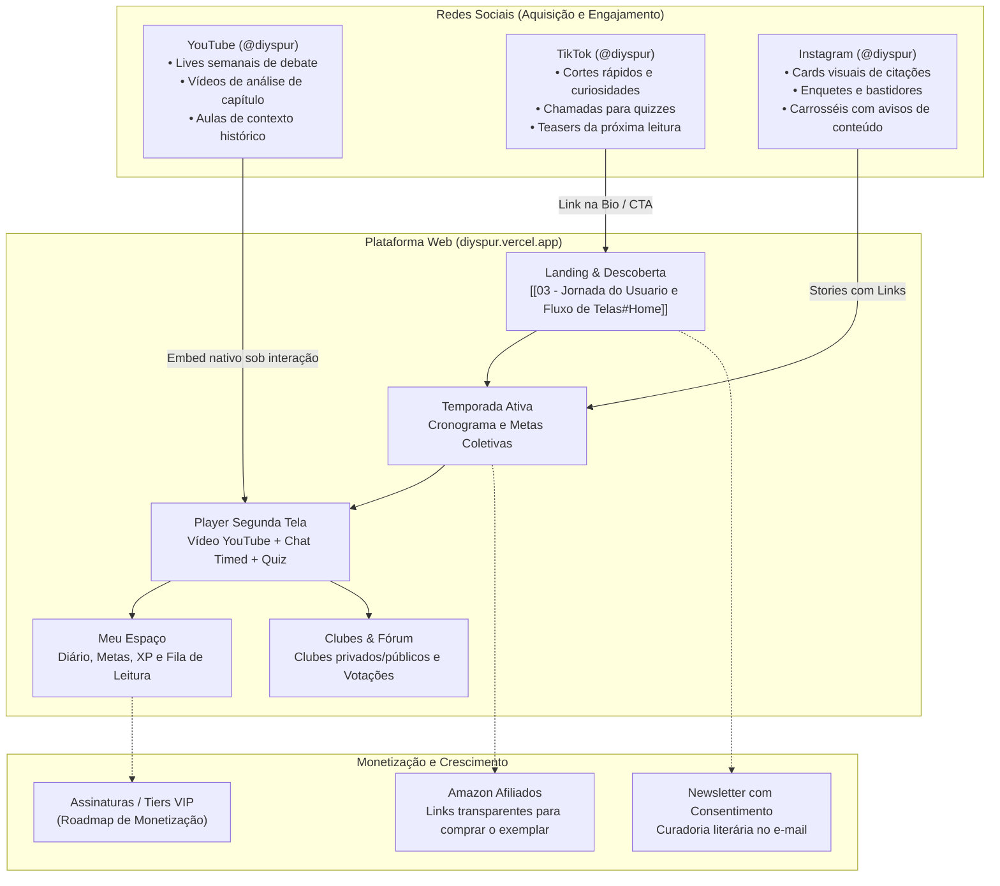

# 00 — Visão Geral do Projeto (Overview)

> **Documento:** Visão Geral, Propósito e Ecossistema  
> **MOC Principal:** [[DIYSpur - Master Index]]  
> **Tags:** `#overview` `#produto` `#ecossistema` `#segunda-tela`

---

## 1. O Conceito DIYSpur: A "Segunda Tela" da Leitura

O **DIYSpur** é uma plataforma digital projetada para atuar como a **segunda tela do leitor contemporâneo**. 

### 1.1 O Que o DIYSpur É
- Um clube de leitura inteligente, assíncrono e comunitário.
- Uma plataforma que estrutura a leitura coletiva em **temporadas**, **semanas/encontros** e **capítulos**.
- Um ambiente de discussão protegida contra spoilers, sincronizado temporalmente com videoaulas, análises e encontros gravados no YouTube.
- Uma ferramenta de gamificação focada no hábito (XP por quizzes compreensivos, streaks de leitura, diário de bordo e metas anuais).
- Um espaço que respeita o tempo e a concentração do leitor, oferecendo uma interface contemplativa, sem ruídos e com acessibilidade total.

### 1.2 O Que o DIYSpur NÃO É
- **Não é uma biblioteca de downloads piratas:** O DIYSpur não hospeda nem distribui PDFs, ePubs ou o texto integral dos livros. O usuário lê seu próprio exemplar físico ou e-book em seu dispositivo de preferência (Kindle, Kobo, livro físico).
- **Não é uma rede social rasa de dopamina:** Não há feeds infinitos desconexos ou algoritmos voltados à distração. Todo o engajamento é contextualizado ao redor de obras literárias, capítulos específicos e clubes de leitores.

---

## 2. Ecossistema Integrado (Omnichannel)

O DIYSpur transcende a aplicação web, operando como um ecossistema unificado onde redes sociais e produto se retroalimentam:

---

## 3. Arquitetura Geral de Alto Nível

O sistema foi arquitetado para ser resiliente, estritamente tipado de ponta a ponta e server-centric, minimizando a execução de lógica crítica no navegador do cliente:

| Componente | Tecnologia | Papel Arquitetural |
|---|---|---|
| **Frontend Web** | Next.js 16 (App Router) + React 19 + TypeScript | Renderização Server-Side (RSC/SSR), rotas dinâmicas, Server Actions para mutações e proxy edge de cookies de sessão. |
| **Design System** | Nimble Tokens (CSS Vanilla com variáveis nativas) | Identidade visual contemplativa, suporte nativo aos modos Light e Dark, estritamente Mobile-First. |
| **Backend & Banco de Dados** | Supabase (PostgreSQL 15) | Fonte única de verdade. 82 tabelas com Row Level Security (RLS) habilitada, views anti-spoiler, RPCs transacionais e constraints estritas. |
| **Funções Serverless** | Supabase Edge Functions (Deno) | Tarefas sensíveis assíncronas ou isoladas: `quiz-validate`, `award-xp`, `vote-next-book`, geração de embeddings de leitores e webhooks. |
| **Storage de Mídia** | Supabase Storage Buckets | Armazenamento de capas de livros (`covers`) e avatares (`avatars`), isolados por policies de leitura pública e escrita autenticada. |
| **Observabilidade & Métricas** | Sentry + PostHog (opt-in) + `/api/health` | Rastreamento distribuído de erros, captura de métricas vitais e telemetria respeitando estritamente a LGPD. |
| **Hospedagem & CDN** | Vercel (Edge Network) + GitHub Actions | Deploy contínuo automatizado, verificações de lint, typecheck, suítes de testes unitários (Vitest) e testes end-to-end (Playwright). |

---

## 4. Princípios e Diretrizes Norteadoras

1. **Zero Trust no Cliente:**  
   O frontend nunca calcula scores de quizzes, pontuações de XP, papéis de usuário ou flags de permissão. Toda mutação de estado sensível passa por funções seguras no Postgres ou Edge Functions que autenticam via `auth.uid()`.
2. **Respeito ao Tempo e à Atenção:**  
   Zero interfaces poluídas. O leitor encontra o trecho da semana, o vídeo de contextualização, as discussões da comunidade e o quiz em poucos cliques.
3. **Privacidade e Proteção de Dados (LGPD/GDPR):**  
   Telemetria do PostHog apenas após consentimento expresso do leitor. Nenhuma informação de identificação pessoal (PII) é enviada a ferramentas terceiras. Mecanismos nativos para exportação de dados do titular e anonimização de conta.
4. **Proteção Anti-Spoiler por Design:**  
   Comentários de capítulos avançados ou com a flag `is_spoiler = true` são mascarados por padrão. O banco de dados oferece views com regras de revelação condicional para evitar vazamento acidental de enredo.

---

## 5. Navegação Relacionada
- Prosseguir para a arquitetura detalhada: [[01 - Arquitetura Frontend e Backend]]
- Conhecer o banco de dados e políticas: [[01.1 - Modelo de Dados e Seguranca RLS]]
- Consultar o catálogo completo de recursos: [[02 - Mapeamento de Funcionalidades]]
- Analisar a experiência do usuário tela a tela: [[03 - Jornada do Usuario e Fluxo de Telas]]
- Entender as diretrizes de conteúdo: [[04 - Estrategia de Conteudo e Redes Sociais]]
