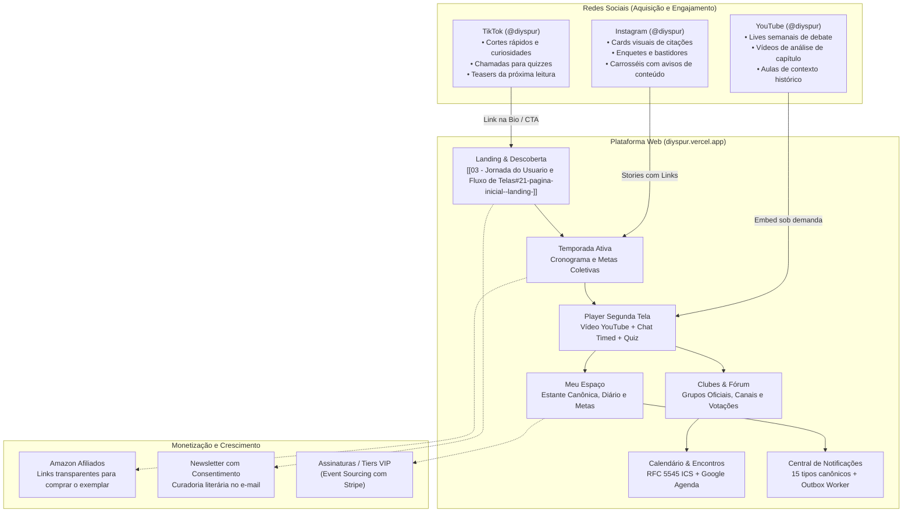

# 00 — Visão Geral do Projeto (Overview)

> **Documento:** Visão Geral, Propósito, Ecossistema e Especificação v1.0 da Comunidade de Leitura Integrada  
> **MOC Principal:** [[DIYSpur - Master Index]]  
> **Tags:** `#overview` `#produto` `#ecossistema` `#segunda-tela` `#v1-0` `#reading-hub`

---

## 1. O Conceito DIYSpur: A "Segunda Tela" da Leitura

O **DIYSpur** é uma plataforma digital projetada para atuar como a **segunda tela do leitor contemporâneo**. 

### 1.1 O Que o DIYSpur É
- Um clube de leitura inteligente, assíncrono e comunitário.
- Uma plataforma que estrutura a leitura coletiva em **temporadas**, **semanas/encontros**, **capítulos** e **clubes de leitura oficiais e independentes**.
- Um ecossistema de canais temáticos (`#geral`, `#spoilers`, `#capitulos`) com mensageria em tempo real, proteção ativa contra spoilers e barreiras de consentimento explícito.
- Uma ferramenta de acompanhamento canônico de leitura vinculada à edição específica do leitor (ISBN, páginas, formato).
- Um motor de gamificação pedagógica (XP por quizzes compreensivos, streaks de leitura, diário de bordo e ranking comunitário de temporada vs livros mais lidos).
- Um sistema integrado de eventos literários com confirmação de presença (RSVP), exportação direta para o Google Agenda e download de arquivos `.ics` em total conformidade com a norma **RFC 5545**.

### 1.2 O Que o DIYSpur NÃO É
- **Não é uma biblioteca de downloads piratas:** O DIYSpur não hospeda nem distribui PDFs, ePubs ou o texto integral dos livros. O usuário lê seu próprio exemplar físico ou e-book em seu dispositivo de preferência (Kindle, Kobo, livro físico).
- **Não é uma rede social rasa de dopamina:** Não há feeds infinitos desconexos ou algoritmos voltados à distração. Todo o engajamento é contextualizado ao redor de obras literárias, capítulos específicos e clubes de leitores.

---

## 2. Ecossistema Integrado (Omnichannel)

O DIYSpur opera de maneira integrada com as principais redes sociais e hábitos de leitura:

---

## 3. Arquitetura de Alto Nível e Tecnologias

| Componente | Tecnologia | Papel Arquitetural |
|---|---|---|
| **Frontend Web** | Next.js 16 (App Router / Turbopack) + React 19 + TypeScript 5.8 | Renderização híbrida (RSC/SSR/Client), Server Actions tipadas, rotas dinâmicas, Touch Targets $\ge 48\text{px}$ e acessibilidade WCAG 2.2 AA. |
| **Design System** | Nimble Tokens (CSS nativo com variáveis semânticas) | Interface editorial, tipografia Inter, paleta harmonizada e layout mobile-first ($375\text{px}$ a $1440\text{px}$). |
| **Backend & Banco de Dados** | Supabase (PostgreSQL 17 / PGlite WASM) | 82 tabelas relacionais com RLS total, 12 migrações incrementais M01–M12, views anti-spoiler, concorrência otimista (`version`) e RPCs transacionais. |
| **Funções Serverless & Workers** | Supabase Edge Functions (Deno Runtime) | 11 funções ativas: `quiz-validate`, `award-xp`, `vote-next-book`, `scheduled-reminders`, `community-notification-worker`, `stripe-webhook`, `newsletter-dispatch`, recomendações e embeddings. |
| **Mensageria & Realtime** | Supabase Realtime CDC (WebSockets `wss://`) + Outbox Pattern | Atualização instantânea de comentários, reações e notificações; drenagem resiliente de mensageria via `notification_outbox`. |
| **Storage de Mídia** | Supabase Storage Buckets | Buckets `covers`, `avatars` e `feed-media` protegidos por políticas RLS. |
| **Observabilidade & Métricas** | Sentry + PostHog (opt-in estrito) + `/api/health` | Rastreamento distribuído de erros com `request_id`, dicionário tipado de telemetria e respeito rigoroso à LGPD. |

---

## 4. Princípios e Diretrizes Norteadoras

1. **Zero Trust no Cliente:**  
   O frontend nunca calcula scores de quizzes, pontuações de XP, papéis de usuário ou transições ilegítimas de leitura. Toda mutação de estado sensível passa por funções seguras no Postgres ou Edge Functions que autenticam via `auth.uid()`.
2. **Respeito ao Tempo e à Atenção:**  
   Zero interfaces poluídas. O leitor encontra o trecho da semana, o vídeo de contextualização, as discussões da comunidade e o quiz em poucos cliques.
3. **Privacidade e Proteção de Dados (LGPD/GDPR):**  
   Telemetria do PostHog apenas após consentimento expresso do leitor. Nenhuma informação de identificação pessoal (PII) é enviada a ferramentas terceiras. Endpoint `/api/account/export` para portabilidade total do titular.
4. **Proteção Anti-Spoiler por Design:**  
   Canais avançados exigem consentimento prévio registrado no banco; mensagens com spoiler usam máscaras com blur visual reversível ao toque.
5. **Robustez Operacional e Concorrência Otimista:**  
   Edições concorrentes de mensagens e cancelamentos de eventos usam verificação estrita de versão esperada (`version`), prevenindo sobrescritas acidentais.

---

## 5. Navegação Relacionada
- Prosseguir para a arquitetura detalhada: [[01 - Arquitetura Frontend e Backend]]
- Conhecer o modelo de dados e RLS: [[01.1 - Modelo de Dados e Seguranca RLS]]
- Consultar a auditoria de pentest e segurança: [[01.7 - Relatorio de Pentest, Seguranca Ofensiva e Matriz OWASP]]
- Consultar o catálogo completo de recursos: [[02 - Mapeamento de Funcionalidades]]
- Explorar os novos clubes e canais: [[02.4 - Comunidade de Leitura, Clubes e Canais de Discussao]]
- Explorar a leitura canônica e rankings: [[02.5 - Leitura Canonica, Estante Pessoal e Rankings Comunitarios]]
- Explorar a central de notificações e eventos: [[02.6 - Central de Notificacoes, Outbox e Eventos de Calendario]]
- Analisar a experiência do usuário tela a tela: [[03 - Jornada do Usuario e Fluxo de Telas]]
- Verificar a cobertura de testes e QA: [[05.1 - Relatorio de QA, Casos de Teste e Quality Gates]]
- Voltar ao MOC central: [[DIYSpur - Master Index]]
