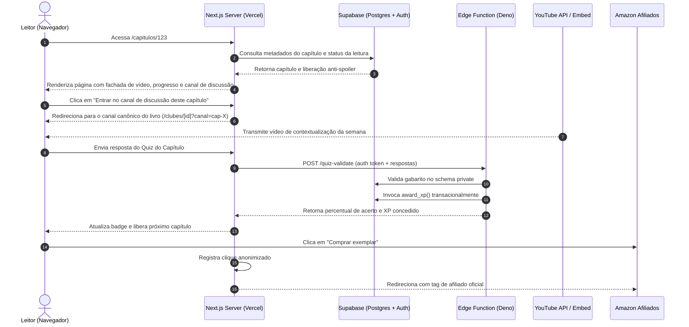

# 01 — Arquitetura Frontend & Backend

> **Documento:** Engenharia de Software, Tecnologias, Padrões e Diretórios  
> **MOC Principal:** [[DIYSpur - Master Index]]  
> **Tags:** `#arquitetura` `#frontend` `#backend` `#nextjs` `#supabase` `#typescript`

---

## 1. Stack Tecnológica Unificada

O ecossistema DIYSpur adota uma stack moderna, estritamente tipada com TypeScript e orientada ao paradigma **Server-First** do Next.js App Router:

```
┌────────────────────────────────────────────────────────────────────────┐
│                        CLIENT / EDGE (Browser / CDN)                   │
│   • Next.js App Router (16.4.0) + React 19.3.0                         │
│   • CSS Modules + Variáveis de Design Tokens (Nimble Tokens)           │
│   • PostHog Analytics (Client-side com Opt-In)                         │
└───────────────────────────────────┬────────────────────────────────────┘
                                    │ HTTPS / Cookies SSR
                                    ▼
┌────────────────────────────────────────────────────────────────────────┐
│                   SERVER RUNTIME (Next.js Node / Edge)                 │
│   • React Server Components (RSC) para fetch SSR seguro                │
│   • Server Actions para mutações com validação Zod (4.1.12)            │
│   • @supabase/ssr (0.12.7) para gestão resiliente de cookies           │
│   • Sentry (@sentry/nextjs 11.6.0) para tracing distribuído            │
└───────────────────────────────────┬────────────────────────────────────┘
                                    │ PostgREST / RPCs / Webhooks
                                    ▼
┌────────────────────────────────────────────────────────────────────────┐
│                  BACKEND SUPABASE (Postgres 15 + Deno)                 │
│   • PostgreSQL com 82 tabelas relacionais em schema public             │
│   • RLS (Row Level Security) em 100% das tabelas privadas              │
│   • Schema private com funções SECURITY DEFINER (search_path = '')     │
│   • Edge Functions em Deno (_shared, quiz-validate, award-xp, etc.)    │
│   • Buckets do Storage com policies de leitura/escrita                 │
└────────────────────────────────────────────────────────────────────────┘
```

---

## 2. Padrões de Código e Diretrizes de Engenharia

### 2.1 Server Components vs. Client Components
- **Server Components (Padrão):** Todas as páginas em `src/app/**/page.tsx` iniciam como Server Components. Elas realizam consultas seguras ao banco de dados via `@supabase/ssr` sem expor segredos nem inflar o bundle JS do navegador.
- **Client Components (`'use client'`):** Restritos a componentes que necessitam de interatividade imediata no DOM:
  - Players de vídeo com captura de timestamps do YouTube.
  - Formulários com feedback otimista e máscaras.
  - Modais interativos, botões de revelação anti-spoiler e seletores de tema.
- **Isolamento de Estado:** A comunicação entre cliente e servidor para escrita de dados ocorre via **Server Actions**, evitando endpoints REST manuais vulneráveis a dessincronização de tipos.

### 2.2 Validação de Entradas com Zod
Nenhum dado oriundo de formulários ou parâmetros de URL é processado sem validação prévia com **Zod**. Exemplos de validação estrita:
- Textos de comentários: 1 a 4000 caracteres, sanitizados contra injeção de tags HTML perigosas.
- Momentos de vídeo: números inteiros estritamente positivos (em segundos, evitando formatos inválidos como `mm:ss` em colunas numéricas).
- Respostas de quizzes: arrays de UUIDs de alternativas válidas associadas ao capítulo em questão.

### 2.3 Sessão, Cookies SSR e Proxy de Autenticação
A persistência de sessão é gerenciada por cookies HTTP-only seguros sincronizados entre o Next.js e o Supabase Auth:
- **`src/proxy.ts` / Middleware:** Intercepta requisições, renova o access token do Supabase silenciosamente antes do vencimento e executa **Safe Redirects** para impedir vulnerabilidades de *Open Redirect*.
- **Helper de Claims (`getClaims`):** Extrai a identidade validada diretamente do JWT assinado, nunca permitindo que o cliente passe `user_id` em payloads.

### 2.4 Design Engine Futurista & Camada de Componentes Core (`src/components/ui/`)
O frontend integra uma camada desacoplada de componentes de alta performance inspirados em benchmarks como GitNimble:
- **`GlassCard`:** Card translúcido com *specular radial spotlight* rastreando o cursor do mouse em tempo real (`pointer-events: none` em camada absoluta acelerada por GPU).
- **`CyberButton`:** Botão ergonômico padronizado com hit targets mínimos de $48\text{px}$, micro-feedback elástico no clique (`scale(0.98)`), anel de foco `focus-visible` e suporte acessível a loading via `aria-live="polite"`.
- **`CyberSkeleton`:** Loader contínuo com varredura laser via `@keyframes shimmer` (sub-150ms).
- **Eixos Tipográficos com Compensação OLED:** Pesos reduzidos no Dark Mode (`380` a `680`) para neutralizar aberração ótica em telas autoluminescentes.
- **Densidade & Acessibilidade:** Suporte nativo a `data-density="compact|spacious"`, modo alto contraste (`data-contrast="high"`, ratio $\ge 7:1$) e paletas adaptativas para daltonismo.

---

## 3. Estrutura de Diretórios do Frontend do Leitor (`app`)

O repositório `diyspur-cloud/app` (ou `diyspur/app`) é focado exclusivamente na experiência pública e comunitária do leitor:

```text
app/
├── public/                 # Assets estáticos (ícones, logos, manifest, llms.txt)
├── src/
│   ├── app/                # Next.js App Router (Rotas do Leitor)
│   │   ├── (public)/       # Rotas abertas: /, /livros, /temporadas, /termos
│   │   ├── (auth)/         # Rotas de acesso: /entrar, /cadastro, /recuperar-senha
│   │   ├── (reading)/      # Rotas de leitura: /capitulos/[id], /diario, /metas
│   │   ├── (community)/    # Rotas sociais: /clubes, /comunidade, /votacao
│   │   ├── (account)/      # Rotas do usuário: /perfil, /historico, /minha-fila
│   │   ├── api/            # Route Handlers técnicos (health, ics, webhooks)
│   │   ├── layout.tsx      # Layout raiz com fontes, tokens e anti-FOUC script
│   │   ├── error.tsx       # Error Boundary da aplicação
│   │   └── global-error.tsx# Fallback de erro crítico de infraestrutura
│   ├── components/         # Componentes UI de interface do usuário:
│   │   ├── ui/             # Core UI futurista (glass-card, cyber-button, cyber-skeleton)
│   │   ├── books/          # Componentes de obras (reading-control, reading-stats)
│   │   ├── chapters/       # Segunda tela (chapter-progress, host-prompt)
│   │   ├── discussions/    # Pílulas e diálogos de debate seguro
│   │   └── site-shell.tsx  # SiteHeader com glassmorphism fosco e SiteFooter
│   ├── features/           # Módulos de domínio de negócio:
│   │   ├── auth/           # Login, cadastro, helpers de sessão
│   │   ├── catalog/        # Queries de livros, temporadas e capítulos
│   │   ├── chapters/       # Ações server-side de leitura, comentários e quiz
│   │   ├── clubs/          # Consulta de clubes oficiais e canais
│   │   ├── diary/          # CRUD e paginação de notas do diário de leitura
│   │   ├── discussions/    # Contrato unificado de canais oficiais e anti-spoiler
│   │   ├── gamification/   # Concessão e cálculo de XP, streaks e badges
│   │   ├── rankings/       # Queries de ranking de temporada (XP) e ranking de livros
│   │   └── profile/        # Preferências de privacidade e exportação LGPD
│   ├── lib/                # Clientes (Supabase, Sentry, PostHog, discussion-contract.ts)
│   ├── styles/             # Tokens CSS (tokens.css com variáveis Nimble e global.css)
│   └── types/              # Definições TypeScript (database.ts)
├── tests/                  # Testes automatizados (31 arquivos / 132 testes unitários + E2E)
├── next.config.mjs         # Configurações do Next.js (Headers de segurança, CSP)
└── package.json            # Dependências e scripts
```

> [!NOTE]
> **Histórico de Arquitetura (Outubro/2026):** As rotas administrativas (`/admin`, `/admin/books`, `/admin/seasons/[id]`, `/admin/moderation`), suas Server Actions e seus controles de interface foram completamente extraídos do repositório `app` para o novo projeto dedicado `diyspur/admin`. Isso eliminou vazamento de código interno no bundle público e reduziu a superfície de ataque web.

---

## 4. Estrutura e Arquitetura do Console Administrativo (`admin`)

O repositório [`diyspur/admin`](https://github.com/diyspur/admin) abriga o console editorial e operacional do clube de leitura:

```text
admin/
├── src/
│   ├── app/                # Next.js App Router (Rotas Administrativas)
│   │   ├── admin/          # Console administrativo central
│   │   │   ├── page.tsx    # /admin (Painel Geral com atalhos de navegação)
│   │   │   ├── actions.ts  # Server Actions administrativas auditadas
│   │   │   ├── books/      # /admin/books (Cadastro e edição de livros)
│   │   │   ├── seasons/    # /admin/seasons (Lista) e /admin/seasons/[id] (Editor de capítulos)
│   │   │   └── moderation/ # /admin/moderation (Fila de denúncias comunitárias)
│   │   ├── api/auth/       # Endpoints dedicados de autenticação
│   │   │   ├── auto-login/ # Auto-login silencioso via cookie e credenciais admin
│   │   │   └── create-admin# Provisionamento de conta admin no Supabase
│   │   ├── entrar/         # Tela de login com auto-login e botão de 1 clique
│   │   ├── layout.tsx      # Layout com barra de navegação persistente e AutoAuth
│   │   └── page.tsx        # Redirecionamento automático para /admin
│   ├── components/admin/   # Componentes do console:
│   │   ├── admin-nav.tsx   # Menu clicável superior com todas as rotas ativas
│   │   ├── admin-controls.tsx # Editores de livro, capítulo, temporada e moderação
│   │   └── auto-auth.tsx   # Disparador cliente de auto-login
│   ├── lib/                # Clientes Supabase SSR com suporte a bypass dev e fallback
│   ├── styles/             # Design tokens e folhas de estilo globais (tokens.css, global.css)
│   └── types/              # Tipagem estrita de banco (database.ts)
├── tests/unit/             # Suíte de testes do admin (admin-book-actions, datetime-local)
├── next.config.mjs         # Otimizações de build Turbopack
└── package.json            # Dependências isoladas
```

### 4.1 Características de Destaque do Projeto Admin
- **Navegação Persistente e Clicável (`AdminNav`):** Todas as rotas de operação (`/admin`, `/admin/books`, `/admin/seasons`, `/admin/moderation`) estão disponíveis no cabeçalho fixo com indicação visual de status ativo e badge de conexão.
- **Autenticação Automática e Resiliente:** Em desenvolvimento e homologação, o middleware e a API `/api/auth/auto-login` configuram automaticamente a identidade editorial, eliminando atrito diário de login sem comprometer o RLS no servidor.
- **Auditoria de Ações:** Todas as alterações editoriais geram registros de auditoria na tabela `editorial_audit_log` via Server Actions protegidas pela RPC `public.is_admin()`.

---

## 5. Estrutura de Diretórios do Backend (`db`)

O repositório `diyspur-cloud/db` abriga a infraestrutura de dados como código:

```text
db/
├── supabase/
│   ├── config.toml         # Configuração local do Supabase CLI
│   ├── migrations/         # Migrations SQL versionadas e imutáveis
│   │   ├── 20260101000000_extensions_enums.sql
│   │   ├── 20260101000100_tables_core_p0.sql
│   │   ├── 20260101000200_tables_community_p0.sql
│   │   ├── 20260101000300_tables_gamification_p1.sql
│   │   ├── 20260101000400_tables_expansion_p2.sql
│   │   ├── 20260101000500_rls_base.sql
│   │   └── ...             # Migrações complementares de RLS, Views e RPCs
│   ├── functions/          # Supabase Edge Functions (Deno Runtime)
│   │   ├── _shared/        # Utilitários compartilhados (cors, supabase-client)
│   │   ├── quiz-validate/  # Validação de gabarito e cálculo de score
│   │   ├── award-xp/       # Concessão transacional de experiência
│   │   ├── next-book-vote/ # Agregação e encerramento de votações
│   │   └── match-readers/  # Recomendação de leitores via pgvector
│   ├── seed.sql            # Massa de testes estruturais (MVP)
│   └── seed_complement.sql # Catálogo editorial rico (Verity, etc.)
├── docs/                   # Especificações técnicas, ADRs e auditorias
└── scripts/                # Scripts de validação e testes de carga k6
```

---

## 5. Integrações Externas



---

## 6. Qualidade, Testes e Pipeline de CI/CD

O pipeline do DIYSpur no GitHub Actions é estruturado em portas estritas de qualidade:
1. **Lint & Análise Estática:** `npm run lint` (ESLint 9 com TypeScript ESLint) e `npm run typecheck` (`tsc --noEmit`).
2. **Testes Unitários e de Integração:** Executados via **Vitest** cobrindo utilitários, cálculo de datas da agenda, sanitização de texto e regras de Zod.
3. **Testes End-to-End (E2E):** Executados com **Playwright** cobrindo fluxos críticos de ponta a ponta: cadastro de usuário, navegação no catálogo, submissão de quiz e controle de visibilidade de spoilers.
4. **Testes de Performance:** Script k6 executado em ambiente de Staging para homologação de latência p95/p99 antes de qualquer promoção a Produção.

---

## 7. Navegação Relacionada
- Aprofundar no modelo de banco e RLS: [[01.1 - Modelo de Dados e Seguranca RLS]]
- Consultar a matriz de funcionalidades: [[02 - Mapeamento de Funcionalidades]]
- Ver os detalhes de cada tela: [[03 - Jornada do Usuario e Fluxo de Telas]]
- Voltar ao início: [[DIYSpur - Master Index]]
