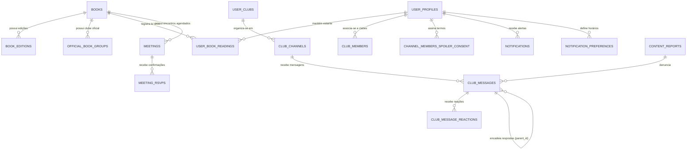

# 01.1 — Modelo de Dados & Segurança RLS

> **Documento:** Modelagem Relacional PostgreSQL, Migrações Incrementais M01–M12, Políticas RLS e RPCs  
> **MOC Principal:** [[DIYSpur - Master Index]]  
> **Documento Pai:** [[01 - Arquitetura Frontend e Backend]]  
> **Tags:** `#database` `#postgresql` `#supabase` `#rls` `#security` `#migrations`

---

## 1. Organização dos Schemas no PostgreSQL

O banco de dados do DIYSpur no Supabase é segregado em quatro schemas fundamentais:

```
┌────────────────────────────────────────────────────────────────────────┐
│                        SCHEMAS POSTGRESQL                              │
├────────────────────────────────────────────────────────────────────────┤
│  auth       │ Gerenciado pelo Supabase Auth. Contém identidades,      │
│             │ credenciais criptografadas, JWT e sessões.               │
├─────────────┼──────────────────────────────────────────────────────────┤
│  public     │ 82 tabelas relacionais, views públicas e RPCs acessadas │
│             │ pelo PostgREST e @supabase/ssr sob políticas RLS.        │
├─────────────┼──────────────────────────────────────────────────────────┤
│  private    │ Funções auxiliares SECURITY DEFINER, predicados de      │
│             │ autorização, outbox runner e gabaritos secretos.         │
├─────────────┼──────────────────────────────────────────────────────────┤
│  storage    │ Objetos binários (buckets covers, avatars, feed-media)   │
│             │ com RLS governando leitura pública e upload restrito.    │
└────────────────────────────────────────────────────────────────────────┘
```

---

## 2. As 12 Migrações Incrementais da Comunidade de Leitura (M01–M12)

Todas as evoluções foram estruturadas de forma aditiva e idempotente, preservando o histórico existente:

```mermaid
flowchart LR
    M01["M01: Grupos Oficiais<br/>(official_book_groups)"] --> M02["M02: Canais & Mensagens<br/>(club_channels, club_messages)"]
    M02 --> M03["M03: Segurança & RLS<br/>(is_channel_accessible, sanções)"]
    M03 --> M04["M04: RPCs de Discussão<br/>(post_message, concorrência)"]
    M04 --> M05["M05: Leitura Canônica<br/>(user_book_readings, edições)"]
    M05 --> M06["M06: Agregações & Rankings<br/>(v_book_community_stats)"]
    M06 --> M07["M07: Encontros por Livro<br/>(meetings com book_id/RFC 5545)"]
    M07 --> M08["M08: 15 Tipos Notificação<br/>(notification_kinds_extension)"]
    M08 --> M09["M09: Central Notificações<br/>(get_user_notifications_v2)"]
    M09 --> M10["M10: Fila Outbox<br/>(notification_outbox, worker)"]
    M10 --> M11["M11: Moderação Integrada<br/>(content_reports, auto-flag)"]
    M11 --> M12["M12: Jobs & Release Guards<br/>(pg_cron, restrições)"]
    M12 --> M13["M13: Security Release Fix<br/>(trigger require_canonical_new_group)"]
    M13 --> M14["M14: Book Rankings View<br/>(v_book_reading_stats, dnf_rate)"]
    M14 --> M15["M15: Multiple Reading Goals<br/>(title, version, flex goals)"]
    M15 --> M16["M16: Book Share Invites<br/>(private.book_share_invitations)"]
```



| Migração | Arquivo SQL | Escopo e Objetos Criados |
|:---:|---|---|
| **M01** | `20261017160100_official_book_groups.sql` | Tabela `official_book_groups`, trigger que auto-cria clube oficial ao cadastrar um livro, invariantes de integridade (DB01, DB02, DB15). |
| **M02** | `20261017160200_club_discussions_schema.sql` | Tabelas `club_channels`, `club_messages`, `club_message_reactions`, `channel_members_spoiler_consent` e `club_member_sanctions`. |
| **M03** | `20261017160300_club_discussions_security.sql` | Função de autorização `is_channel_accessible()`, RLS em canais, mensagens e reações; bloqueio de leitura de canais privados para não-membros (SEC01, SEC02). |
| **M04** | `20261017160400_club_discussions_rpcs.sql` | RPCs `post_club_message`, `edit_club_message` (com concorrência otimista `p_expected_version`), `delete_club_message`, `toggle_message_reaction` e `set_spoiler_consent`. |
| **M05** | `20261017160500_canonical_book_readings.sql` | Tabela `user_book_readings`, enum `book_reading_status`, trigger `trg_validate_book_reading_transition` (impede salto direto para `read`), vinculação com `book_editions`. |
| **M06** | `20261017160600_book_reading_aggregates.sql` | Views públicas `v_book_community_stats`, `v_book_readers_leaderboard` e view materializada no schema privado `private.mv_book_community_stats`. |
| **M07** | `20261017160700_book_scoped_meetings.sql` | Extensão da tabela `meetings` com `book_id`, `chapter_id`, `version`, `duration_min`, RLS atualizada e validação de URLs seguras `https://`. |
| **M08** | `20261017160800_notification_kinds_extension.sql` | Expansão do enum `notification_kind` para contemplar os 15 tipos canônicos de eventos da comunidade. |
| **M09** | `20261017160900_notification_center_rpc.sql` | RPC `get_user_notifications_v2` com filtros por canal e paginação, e `mark_notifications_read`. |
| **M10** | `20261017161000_community_notification_outbox.sql` | Tabela `notification_outbox`, RPCs privilegiadas `claim_notification_outbox` (`FOR UPDATE SKIP LOCKED`) e `resolve_notification_outbox`. |
| **M11** | `20261017161100_community_moderation_integration.sql` | Integração de `content_reports` com mensagens de clubes, trigger de auto-ocultação após 3 denúncias e RPC `moderate_content_report`. |
| **M12** | `20261017161200_community_jobs_and_release_guards.sql` | Configuração de cron jobs para limpeza de outbox, verificação de consistência e guardas de schema. |
| **M13** | `20261018000100_community_security_release_fix.sql` | Revogação de execução pública de `create_user_club`; trigger `require_canonical_new_group` impedindo criação direta de clubes desvinculados de livros; correção de bypass de definer em `confirm_meeting_attendance_safe` exigindo `auth.role() = 'service_role'` ou `public.is_admin()`. |
| **M14** | `20261018000200_book_rankings_and_refresh.sql` | View materializada `private.mv_book_reading_stats_v2`, view pública `public.v_book_reading_stats` com suporte às 4 abas (Mais Lidos, Lendo Agora, Concluídos, Desistências com `dnf_rate`) e função de refresh `refresh_book_reading_stats()`. |
| **M15** | `20261018000500_multiple_personal_reading_goals.sql` | Remoção do índice restritivo `UNIQUE(user_id, year)` em `reading_goals`; adição de colunas `title`, `version` e `archived_at` permitindo múltiplas metas simultâneas por leitor. |
| **M16** | `20261018000800_book_share_invitations.sql` | Tabela `private.book_share_invitations` com hash de token para suporte seguro a convites de leitura por e-mail ou link direto. |
| **OPS** | `clean_database_keep_books_and_admin.sql` | Script operacional de saneamento de dados: preserva 100% dos dados e metadados de livros (`books`, `authors`, `seasons`, `chapters`, avisos, quizzes); trunca em cascata tabelas de atividade/interação; higieniza `auth.users` e `public.profiles` preservando apenas `admin@diyspur.com` com role `admin`. |

---

## 3. Diagrama Entidade-Relacionamento Expandido (Comunidade & Leitura)



---

## 4. Dicionário das Novas Tabelas e Estruturas

### 4.1 `official_book_groups`
- **Chaves:** `id` (PK, uuid), `book_id` (FK `books`, UNIQUE), `club_id` (FK `user_clubs`, UNIQUE).
- **Invariante:** Cada livro possui exatamente um grupo oficial. A deleção de um livro remove o vínculo em cascata (`CASCADE`), enquanto a deleção direta do grupo oficial é bloqueada por trigger.

### 4.2 `club_channels`
- **Chaves:** `id` (PK, uuid), `club_id` (FK `user_clubs`), `name` (text), `slug` (text), `kind` (enum: `general`, `spoiler`, `chapter`), `is_spoiler` (boolean), `chapter_id` (FK `chapters` NULL).
- **Índice Único:** `(club_id, slug)` impede canais com o mesmo slug dentro de um clube.

### 4.3 `club_messages`
- **Chaves:** `id` (PK, uuid), `channel_id` (FK `club_channels`), `user_id` (FK `profiles`), `content` (text), `parent_id` (FK recursiva `club_messages` NULL), `is_spoiler` (boolean), `is_edited` (boolean), `version` (integer DEFAULT 1), `is_deleted` (boolean DEFAULT false).
- **Índice Único Parcial de Idempotência:** `(user_id, idempotency_key)` onde `idempotency_key IS NOT NULL`.

### 4.4 `channel_members_spoiler_consent`
- **Chaves:** `channel_id` (FK `club_channels`), `user_id` (FK `profiles`), PK composta `(channel_id, user_id)`, `consented_at` (timestamptz DEFAULT now()).
- **Segurança:** O leitor só pode inserir ou deletar seu próprio consentimento (`user_id = (SELECT auth.uid())`).

### 4.5 `user_book_readings`
- **Chaves:** `id` (PK, uuid), `user_id` (FK `profiles`), `book_id` (FK `books`), `book_edition_id` (FK `book_editions` NULL), `status` (`book_reading_status`), `current_page` (integer), `percent_completed` (numeric), `started_at` (timestamptz), `finished_at` (timestamptz), `rating` (integer 1..5).
- **Índice Único:** `(user_id, book_id)` assegura uma única linha de status canônico por obra por usuário.

### 4.6 `notification_outbox`
- **Chaves:** `id` (PK, uuid), `recipient_id` (FK `profiles`), `kind` (`notification_kind`), `title` (text), `body` (text), `payload` (jsonb), `status` (text: `pending`, `processing`, `delivered`, `failed`), `scheduled_at` (timestamptz), `retry_count` (integer DEFAULT 0).
- **Índices de Fila:** `(status, scheduled_at)` para consulta em lote rápida com `SKIP LOCKED`.

---

## 5. Invariantes de Segurança e Políticas RLS

1. **Predicado `is_channel_accessible(p_channel_id)`:**
   ```sql
   CREATE OR REPLACE FUNCTION private.is_channel_accessible(p_channel_id uuid) 
   RETURNS boolean AS $$
   BEGIN
     RETURN EXISTS (
       SELECT 1 FROM public.club_channels c
       JOIN public.user_clubs u ON u.id = c.club_id
       WHERE c.id = p_channel_id
       AND (
         u.is_private = false
         OR u.owner_id = (SELECT auth.uid())
         OR EXISTS (
           SELECT 1 FROM public.club_members m
           WHERE m.club_id = u.id 
           AND m.user_id = (SELECT auth.uid())
           AND m.status = 'accepted'
         )
       )
     );
   END;
   $$ LANGUAGE plpgsql SECURITY DEFINER SET search_path = '';
   ```
2. **Prevenção de Injeção de Resposta Cruzada (Cross-Channel):**
   O trigger `trg_validate_club_message_parent` valida se `parent.channel_id = new.channel_id`.
3. **Bloqueio de Autopromoção:**
   Políticas RLS em `club_members` impedem que o usuário altere sua própria coluna `role` ou o status de membros alheios.

---

## 6. Navegação Relacionada
- Consultar o relatório de pentest e segurança: [[01.7 - Relatorio de Pentest, Seguranca Ofensiva e Matriz OWASP]]
- Consultar o catálogo completo de RPCs: [[06.1 - Catalogo Completo de RPCs e Triggers PostgreSQL]]
- Analisar a arquitetura de concorrência e performance: [[01.3 - Engenharia de Performance e Seguranca Avancada]]
- Voltar ao MOC central: [[DIYSpur - Master Index]]
