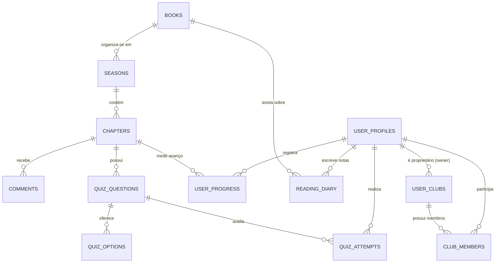

# 01.1 — Modelo de Dados & Segurança RLS

> **Documento:** Modelagem Relacional PostgreSQL, Políticas de Segurança e RPCs  
> **MOC Principal:** [[DIYSpur - Master Index]]  
> **Documento Pai:** [[01 - Arquitetura Frontend e Backend]]  
> **Tags:** `#database` `#postgresql` `#supabase` `#rls` `#security`

---

## 1. Organização dos Schemas no PostgreSQL

O banco de dados do DIYSpur no Supabase é segregado em quatro schemas fundamentais:

```
┌────────────────────────────────────────────────────────────────────────┐
│                        SCHEMAS POSTGRESQL                              │
├────────────────────────────────────────────────────────────────────────┤
│  auth       │ Gerenciado pelo Supabase Auth. Contém identidades,      │
│             │ credenciais criptografadas, JWT e sessões.               │
├─────────────┼──────────────────────────────────────────────────────────┤
│  public     │ 82 tabelas relacionais, views públicas e RPCs acessadas │
│             │ pelo PostgREST e @supabase/ssr sob políticas RLS.        │
├─────────────┼──────────────────────────────────────────────────────────┤
│  private    │ Funções auxiliares SECURITY DEFINER, predicados de      │
│             │ autorização e gabaritos secretos de quizzes.             │
├─────────────┼──────────────────────────────────────────────────────────┤
│  storage    │ Objetos binários (buckets covers, avatars) com RLS       │
│             │ governando leitura e upload de arquivos.                 │
└────────────────────────────────────────────────────────────────────────┘
```

---

## 2. Invariantes de Segurança e Políticas RLS (Row Level Security)

1. **Zero Trust no Cliente:**  
   Em nenhuma hipótese valores como `user_id`, `role`, `score` ou `is_admin` passados no payload do cliente são aceitos. O backend sempre valida a identidade a partir de `(SELECT auth.uid())`.
2. **Cláusulas `WITH CHECK` Obrigatórias:**  
   Todas as políticas de escrita (`INSERT` e `UPDATE`) declaram uma cláusula `WITH CHECK` espelhada para impedir que um usuário autenticado forje a propriedade de um recurso ou modifique registros alheios.
3. **Prevenção de Recursão Infinita em Políticas:**  
   Tabelas que cruzam relações de permissão (ex.: checar se o usuário é membro de um clube em `user_clubs` ou `club_members`) utilizam predicados isolados no schema `private` com caching de transação, evitando loops de recursão no otimizador de queries do Postgres.
4. **Isolamento de Search Path:**  
   Todas as funções com privilégio `SECURITY DEFINER` declaram expressamente `SET search_path = ''`. Isso impede ataques de *search path hijacking* caso extensões ou objetos maliciosos tentem interceptar chamadas internas.

---

## 3. Diagrama Entidade-Relacionamento Simplificado (Core)



---

## 4. Dicionário das Principais Tabelas

### 4.1 Núcleo Editorial (Catálogo e Leitura)
- **`books`**: Catálogo de obras. Contém título, autor, slug canônico, ISBN, sinopse, content warnings (avisos de conteúdo), ano de publicação e URL da capa no bucket de Storage.
- **`seasons`**: Temporadas de leitura coletiva. Vincula uma obra a um período (data de início, término planejado), status (`draft`, `active`, `completed`) e anfitrião responsável.
- **`chapters`**: Etapas sequenciais da temporada. Guarda número da semana/capítulo, trecho de leitura (`reading_range`), resumo editorial, data de liberação programada e `youtube_url` do vídeo de apoio.

### 4.2 Interação, Discussão e Quizzes
- **`comments`**: Comentários comunitários vinculados a um capítulo. Contém flag `is_spoiler` (booleano), `video_timestamp_seconds` (marca temporal para sincronização com o YouTube) e suporte a encadeamento hierárquico (*threading*).
- **`quiz_questions`**: Perguntas de validação de leitura por capítulo. Cada pergunta possui enunciado, explicação pedagógica e peso de pontuação.
- **`quiz_options`**: Alternativas de resposta. *Nota crítica:* a indicação de alternativa correta é isolada ou protegida por RLS de leitura restrita a administradores e funções seguras de correção.
- **`quiz_attempts`**: Tentativas dos leitores. Registra data, alternativas escolhidas, score percentual validado pelo servidor e quantidade de XP concedida.

### 4.3 Comunidade e Clubes
- **`user_clubs`**: Clubes criados por usuários. Possui `owner_id`, nome, slug único, descrição e flag `is_private`.
- **`club_members`**: Associação de membros e clubes com papéis definidos (`owner`, `moderator`, `member`) e status do convite (`pending`, `accepted`, `declined`).

### 4.4 Organização Pessoal e Retenção
- **`reading_diary`**: Anotações particulares do leitor. Nascem com visibilidade estritamente privada (`owner_only`). Podem armazenar páginas lidas, minutos de sessão, percentual atingido e pensamentos reflexivos.
- **`reading_lists` & `reading_list_items`**: Listas temáticas personalizadas (ex.: "Favoritos", "Lendo em 2026"). Suportam ordenação otimista com reordenação transacional no Postgres.
- **`user_goals`**: Metas de leitura anual (quantidade de livros, páginas e horas).

---

## 5. Estratégia Anti-Spoiler no Banco de Dados

Para evitar que leitores recebam spoilers acidentais de capítulos à frente de sua leitura atual, o DIYSpur implementa uma camada arquitetural no banco:

1. **View `v_comments_visible`:**
   Mapeia o progresso do usuário logado contra a ordem sequencial dos capítulos. Comentários marcados com `is_spoiler = true` têm seu corpo substituído por uma string de aviso caso o usuário ainda não tenha atingido a conclusão do capítulo ou optado por revelação expressa no front-end.
2. **Autonomia com Responsabilidade:**  
   O usuário tem a faculdade de revelar o comentário no cliente via interface, porém a proteção padrão é ativa por omissão (*safe by default*).

---

## 6. RPCs e Procedimentos Transacionais Críticos

O sistema evita múltiplas viagens de rede (*round-trips*) e condições de corrida utilizando funções em PL/pgSQL:

| RPC / Função | Objetivo e Garantias |
|---|---|
| `private.validate_quiz_submission()` | Valida as respostas enviadas contra o gabarito protegido, calcula o score com precisão, grava a tentativa em `quiz_attempts` e retorna o resultado sem expor o gabarito. |
| `public.award_user_xp()` | Concede XP ao leitor atomicamente, previne duplicação de pontuação para o mesmo capítulo e incrementa a contagem de ofensiva (*streak*). |
| `public.create_user_club_atomic()` | Cria o clube e insere o criador imediatamente como `owner` na tabela `club_members` dentro de uma transação serializada. |
| `public.reorder_reading_list()` | Reordena os itens de uma lista bloqueando temporariamente a linha pai (`FOR UPDATE`), prevenindo colisões de concorrência. |

---

## 7. Navegação Relacionada
- Explorar as capacidades funcionais do sistema: [[02 - Mapeamento de Funcionalidades]]
- Ver a jornada do usuário e interfaces: [[03 - Jornada do Usuario e Fluxo de Telas]]
- Voltar para a visão geral: [[00 - Visao Geral do Projeto]]
