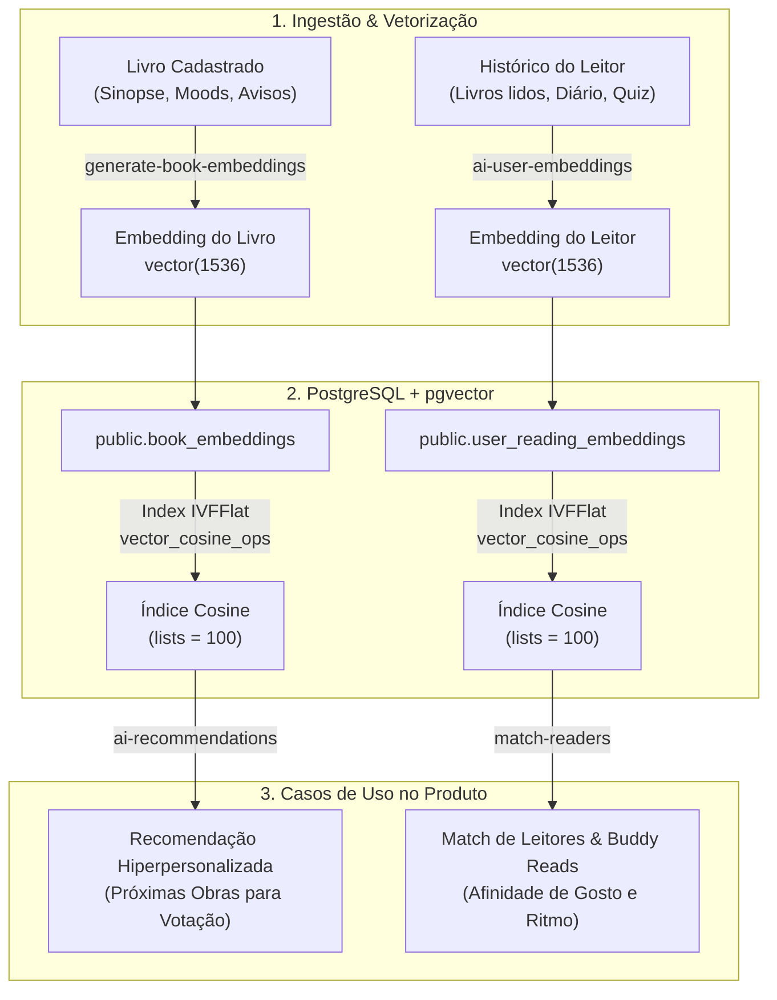

# 01.2 — Inteligência Artificial & Recomendação Semântica

> **Documento:** Engenharia de IA, Vetorização (pgvector), Embeddings e Reader Match  
> **MOC Principal:** [[DIYSpur - Master Index]]  
> **Documento Pai:** [[01 - Arquitetura Frontend e Backend]]  
> **Tags:** `#ia` `#machine-learning` `#pgvector` `#embeddings` `#recomendacao` `#reader-match`

---

## 1. Visão Geral da Camada de IA

Diferente de clubes tradicionais que utilizam recomendações genéricas ou estritamente editoriais, o DIYSpur implementa uma arquitetura de **descoberta semântica e pareamento social de leitores** (*Reader Match*) no nível do banco de dados, utilizando a extensão **`pgvector`** do PostgreSQL integrada a **Edge Functions** em Deno:



---

## 2. Estrutura de Tabelas e Índices Vetoriais

### 2.1 Embeddings de Leitores (`user_reading_embeddings`)
Armazena a representação latente do gosto literário do usuário:

```sql
CREATE TABLE IF NOT EXISTS public.user_reading_embeddings (
  user_id     uuid primary key references public.profiles(id) on delete cascade,
  embedding   vector(1536) not null,
  source_hash text,             -- Hash SHA-256 do snapshot de histórico para evitar reprocessamento
  updated_at  timestamptz not null default now()
);

-- Índice IVFFlat otimizado para busca por similaridade de cosseno
CREATE INDEX IF NOT EXISTS ure_embedding_idx on public.user_reading_embeddings
  using ivfflat (embedding vector_cosine_ops) with (lists = 100);
```

### 2.2 Cache de Similaridade e Match Social (`user_match_cache`)
Para eliminar custos de computação de inferência em tempo de requisição, o sistema mantém uma tabela de cache com pontuações pré-calculadas entre pares de leitores:

```sql
CREATE TABLE IF NOT EXISTS public.user_match_cache (
  user_id      uuid not null references public.profiles(id) on delete cascade,
  matched_id   uuid not null references public.profiles(id) on delete cascade,
  similarity   numeric(5,4) not null,              -- Score de 0.0000 a 1.0000
  shared_books int not null default 0,             -- Obras em comum concluídas
  shared_moods mood_kind[] default '{}',          -- Atmosferas literárias convergentes
  computed_at  timestamptz not null default now(),
  primary key (user_id, matched_id),
  check (user_id <> matched_id)
);

CREATE INDEX IF NOT EXISTS umc_user_sim_idx 
  on public.user_match_cache (user_id, similarity desc);
```

---

## 3. As Edge Functions de IA e Machine Learning

| Edge Function | Runtime | Gatilho / Entrada | Saída / Efeito |
|---|---|---|---|
| `generate-book-embeddings` | Deno | Invocação restrita a Admin via JWT. Processa em lote (1 a 20 livros) com embeddings ainda nulos. | Gera vetor de 1536 dimensões via modelo de embeddings da OpenAI e persiste em `books.embedding`. |
| `ai-user-embeddings` | Deno | Acionada quando um leitor atinge marco de leitura (ex.: 3 capítulos concluídos ou nova nota no diário). | Compara o `source_hash` atual com o snapshot anterior. Se alterado, sintetiza o perfil e gera o vetor. |
| `match-readers` | Deno | Job agendado ou sob demanda na tela `/leituras-compartilhadas`. | Executa busca de vizinhos mais próximos ($k$-NN) via operador `<=>` (distância de cosseno) no Postgres, filtrando afinidades e atualizando `user_match_cache`. |
| `ai-recommendations` | Deno | Executada para alimentar a esteira de votação da próxima temporada (`/votacao`). | Analisa o centróide do clube ativo e recomenda títulos do catálogo que maximizam o interesse coletivo. |

## 4. Motor de Recomendação em Tempo Real com TensorFlow.js

Para além dos embeddings vetoriais de backend (`pgvector`), o DIYSpur implementa um **motor de recomendação e re-ranqueamento em tempo real** baseado em `@tensorflow/tfjs` com execução híbrida (Server e Client):

### 4.1 Vetorização de Atributos e Espaço de Features
- **Tags Temáticas e Gêneros:** Vetor multi-hot normalizado extraído das tags do catálogo (`ficcao`, `suspense`, `romance`, `terror`, etc.).
- **Afinidade de Autor:** Atribuição de peso calibrado (1.5) para o `author_id` correspondente às obras de preferência do usuário.
- **Ponderação por Status e Interação:**
  - `reading` (leitura em andamento): peso `1.25` (engajamento ativo).
  - `read` (concluído): peso `1.00`.
  - `click` / `view` (interação no navegador via `memoryItem`): peso `0.80`.

### 4.2 Similaridade de Cosseno com Gestão de Tensores (`tf.tidy`)
A matriz de candidatos $C \in \mathbb{R}^{N \times D}$ e o vetor de preferências $u \in \mathbb{R}^{1 \times D}$ são normalizados por norma L2 e multiplicados via produto escalar:
$$S = \text{matMul}\left(\frac{C}{\|C\|_2 + \epsilon}, \left(\frac{u}{\|u\|_2 + \epsilon}\right)^T\right)$$

Toda operação vetorial é isolada dentro de blocos `tf.tidy()`. Isso assegura descarte automático de tensores intermediários e **zero vazamento de memória (0 memory leaks)**.

### 4.3 Regras de Particionamento e Ordenação em `/livros`
1. **Topo da Lista (Recomendações):** Candidatos com maior índice de afinidade (score $\ge 0.15$), destacados com badge `★ Recomendado`.
2. **Meio da Lista (Obras Não Lidas):** Candidatos sem afinidade dominante, dispostos por ordenação editorial/cronológica.
3. **Rodapé Obrigatório:** Livros marcados pelo leitor como:
   - `reading` (em andamento) — badge `Lendo`
   - `read` (já concluído) — badge `Já li`
   - `dnf` (desistência/abandono) — badge `Desistiu`
4. **Interações do Navegador (`memoryItem`):**
   - Cliques e visualizações de obras são persistidos localmente (`diyspur_book_memory_items` e `memoryItem`).
   - O componente `<PersonalizedCatalog />` lê essas interações no navegador e re-ranqueia dinamicamente o catálogo com o TensorFlow.js, proporcionando recomendações mesmo para leitores não cadastrados ou deslogados.

---

## 5. Governança e Eficiência de Custo
1. **Minimização de Chamadas de API (Idempotência com Hashes):**  
   O campo `source_hash` armazena a assinatura dos dados que originaram o vetor. Se o usuário apenas alterar informações cadastrais (como e-mail ou avatar), nenhuma chamada à API externa de embeddings é disparada.
2. **Consultas Rápidas no Banco:**  
   O índice `ivfflat` com `lists = 100` particiona o espaço vetorial em centróides, permitindo que o PostgreSQL localize leitores semelhantes em milissegundos, sem percorrer a tabela completa.
3. **Isolamento de Segurança:**  
   A geração de embeddings é restrita a tokens com `service_role` ou validados por claims de Admin no gateway da Edge Function.
4. **Execução Local com TF.js CPU:**  
   O ranqueamento do catálogo roda integralmente no Node.js/navegador do cliente com inferência em CPU (< 2ms), sem custo de tokens de APIs externas e sem latência de rede.

---

## 6. Navegação Relacionada
- Analisar os índices e otimizações de RLS: [[01.3 - Engenharia de Performance e Seguranca Avancada]]
- Conhecer a estante pessoal e leitura canônica: [[02.5 - Leitura Canonica, Estante Pessoal e Rankings Comunitarios]]
- Conhecer a taxonomia de moods e content warnings: [[02.1 - Taxonomia Editorial, Moods e Content Warnings]]
- Voltar ao MOC central: [[DIYSpur - Master Index]]
