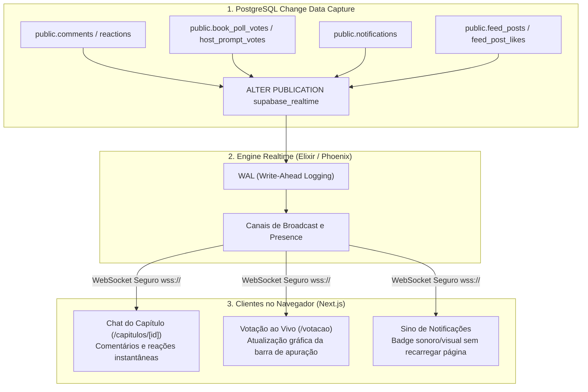

# 01.4 — Arquitetura Realtime, CDC & Mensageria

> **Documento:** Change Data Capture (CDC), WebSockets, Canais de Realtime e Sincronização ao Vivo  
> **MOC Principal:** [[DIYSpur - Master Index]]  
> **Documento Pai:** [[01 - Arquitetura Frontend e Backend]]  
> **Tags:** `#realtime` `#websocket` `#cdc` `#supabase` `#concorrencia` `#eventos`

---

## 1. Visão Geral da Camada Realtime

Para proporcionar uma experiência de "segunda tela" viva durante as transmissões do YouTube e discussões comunitárias, o DIYSpur implementa **Change Data Capture (CDC)** no PostgreSQL através da publicação nativa **`supabase_realtime`** conectada via WebSockets ao cliente Next.js:



---

## 2. Tabelas Publicadas na Engine de CDC

A infraestrutura foi configurada de forma declarativa e idempotente através de migrações SQL dedicadas (`20260101001500_realtime.sql` e `20260101002450_realtime_complement.sql`):

| Tabela Publicada | Eventos Transmitidos | Finalidade na Aplicação Web |
|---|---|---|
| `public.comments` | `INSERT`, `UPDATE` | Comentários surgem em tempo real no feed do capítulo sem necessidade de polling ou recarregar a tela. |
| `public.reactions` | `INSERT`, `DELETE` | Atualização instantânea dos contadores de reações de emojis nos comentários. |
| `public.video_timed_comments` | `INSERT` | Inserção de marcadores temporais sincronizados com o player de vídeo do YouTube. |
| `public.host_prompt_votes` | `INSERT`, `UPDATE` | Permite que o anfitrião da live lance uma pergunta surpresa e veja os gráficos de votos dos espectadores oscilarem ao vivo. |
| `public.book_poll_votes` | `INSERT` | Votação da próxima temporada com apuração em tempo real conforme os leitores votam. |
| `public.notifications` | `INSERT` | Atualiza o contador do sino de notificações do usuário autenticado instantaneamente. |
| `public.feed_posts` & `likes` | `INSERT`, `UPDATE` | Atualização reativa da aba Comunidade quando novos posts e curtidas são emitidos. |
| `public.user_match_cache` | `INSERT` | Dispara notificação imediata quando o algoritmo de IA descobre um leitor com alta similaridade de gosto literário. |

---

## 3. Gestão de Tráfego e Otimização de Banda

1. **Filtros no Servidor (*Row Level Filters*):**  
   Os clientes não recebem um fluxo indiscriminado de todo o banco de dados. O Supabase Realtime inspeciona os canais e aplica filtros por ID de capítulo:
   ```typescript
   // Exemplo de subscrição seletiva no front-end:
   const channel = supabase
     .channel(`chapter:${chapterId}`)
     .on('postgres_changes', {
       event: 'INSERT',
       schema: 'public',
       table: 'comments',
       filter: `chapter_id=eq.${chapterId}`
     }, (payload) => {
       appendNewComment(payload.new);
     })
     .subscribe();
   ```
2. **Respeito à RLS no Realtime:**  
   Mensagens de clubes privados ou comentários com flag de spoiler aplicam as políticas de Row Level Security antes de serem transmitidas pelo canal WebSocket, garantindo que usuários sem autorização não interceptem conteúdo protegido no tráfego de rede.

---

## 4. Navegação Relacionada
- Consultar a engenharia de performance do banco: [[01.3 - Engenharia de Performance e Seguranca Avancada]]
- Conhecer a jornada do capítulo com segunda tela: [[03 - Jornada do Usuario e Fluxo de Telas#4-segunda-tela-do-capitulo-capitulosid--o-nucleo-da-aplicacao]]
- Voltar ao MOC central: [[DIYSpur - Master Index]]
