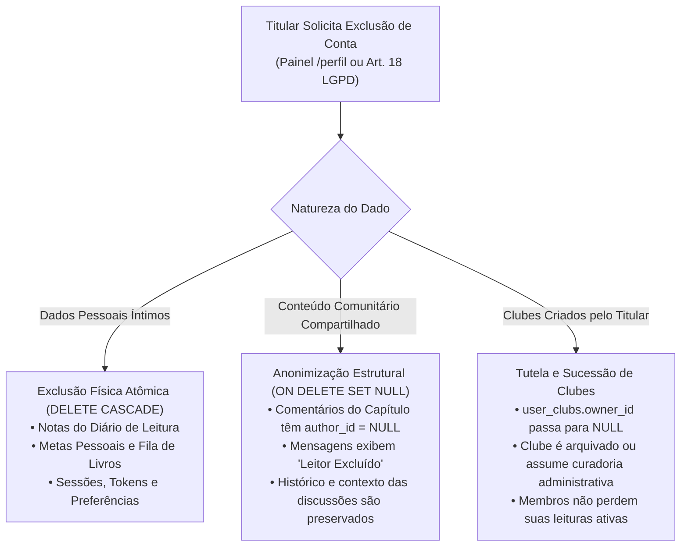
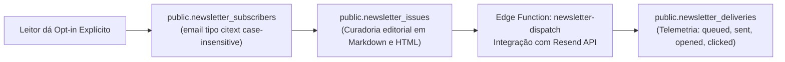

# 01.5 — Governança LGPD, Event Sourcing & Retenção de Dados

> **Documento:** Conformidade Regulatória (LGPD/GDPR), Event Sourcing Financeiro e Ciclo de Vida de Dados  
> **MOC Principal:** [[DIYSpur - Master Index]]  
> **Documento Pai:** [[01 - Arquitetura Frontend e Backend]]  
> **Tags:** `#lgpd` `#privacidade` `#event-sourcing` `#stripe` `#newsletter` `#seguranca`

---

## 1. Engenharia de Privacidade e Conformidade LGPD

O DIYSpur foi projetado sob o princípio de **Privacy by Design**, estruturando o ciclo de vida dos dados em duas políticas distintas de tratamento no momento da exclusão de uma conta:



### 1.1 Matriz de Retenção de Dados

| Entidade | Regime de Retenção | Política de Limpeza pós-Exclusão |
|---|---|---|
| **Identidade e Credenciais** | Ativo durante a existência da conta. | Exclusão definitiva dos schemas `auth` e `public.profiles` em até 15 dias. |
| **Diário de Leitura Privado** | Enquanto o leitor desejar mantê-lo. | Exclusão física imediata via chave estrangeira em cascata (`CASCADE`). |
| **Comentários de Capítulos** | Vida útil da conversa da temporada. | Anonimização: remoção do vínculo com o perfil (`SET NULL`). |
| **Cliques de Afiliados (Amazon)** | Auditoria contábil e prevenção de fraudes. | O IP nunca é salvo em texto claro; armazena-se apenas o `ip_hash` (hash unidirecional com salt). |
| **Logs de Conexão** | 6 meses (Marco Civil da Internet). | Purga automática por rotinas programadas no banco. |

---

## 2. Event Sourcing e Resiliência em Pagamentos (Stripe)

Para processar planos de assinatura e doações (*patrons*) sem risco de inconsistência contábil, o DIYSpur adota o padrão de **Event Sourcing** para webhooks externos:

```sql
CREATE TABLE IF NOT EXISTS public.payment_events (
  id             uuid primary key default gen_random_uuid(),
  provider       payment_provider not null default 'stripe',
  event_id       text not null,                 -- ID oficial do evento do Stripe (ex.: evt_1N...)
  event_type     text not null,                 -- 'customer.subscription.updated', 'invoice.paid'
  user_id        uuid references public.profiles(id) on delete set null,
  payload        jsonb not null,                -- Cópia bruta do payload recebido
  processed_at   timestamptz,
  created_at     timestamptz not null default now(),
  unique (provider, event_id)                   -- Chave única de idempotência
);
```

### 2.1 Garantias do Modelo
1. **Idempotência Absoluta:** Se o Stripe reenviar o mesmo evento devido a um timeout temporário de rede, a restrição `unique (provider, event_id)` aborta a duplicação silenciosamente.
2. **Capacidade de Replay:** Caso uma atualização de schema ou regra tributária mude no futuro, o backend é capaz de reprocessar a tabela `payment_events` do zero e reconstruir o histórico de subscrições com precisão matemática.
3. **Gestão de Benefícios Ativos (`user_membership_perks`):** Benefícios (como desconto em exemplares físicos ou acesso a eventos VIP) são concedidos e revogados de forma granular com data de validade (`expires_at`).

---

## 3. O Subsistema de Newsletter e Mensageria

A captação e o disparo de newsletters são governados por uma infraestrutura dedicada de mensageria:



- **Integridade de E-mail (`citext`):** A coluna de e-mail utiliza a extensão nativa `citext` do PostgreSQL, impedindo que variações de caixa alta e baixa (ex.: `Leitor@Gmail.com` e `leitor@gmail.com`) gerem duplicidade de inscrições.
- **Rastreamento de Desempenho:** A tabela `newsletter_deliveries` audita individualmente o ciclo de entrega de cada edição enviada, monitorando taxas de abertura e prevenindo reenvios acidentais.

---

## 4. Navegação Relacionada
- Analisar a arquitetura de banco de dados e RLS: [[01.1 - Modelo de Dados e Seguranca RLS]]
- Verificar a estratégia de monetização e afiliados: [[04 - Estrategia de Conteudo e Redes Sociais#3-modelo-de-monetizacao-e-sustentabilidade]]
- Voltar ao MOC central: [[DIYSpur - Master Index]]
