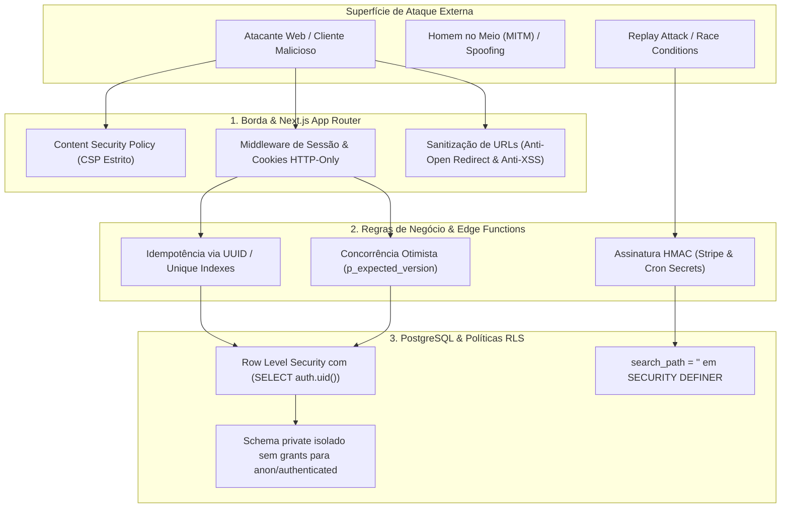

# 01.7 — Relatório de Pentest, Segurança Ofensiva & Matriz de Mitigação OWASP

> **Documento:** Auditoria de Segurança Ofensiva, Vetores de Pentest e Matriz de Mitigação OWASP ASVS 4.0  
> **MOC Principal:** [[DIYSpur - Master Index]]  
> **Documento Pai:** [[01 - Arquitetura Frontend e Backend]]  
> **Tags:** `#pentest` `#seguranca` `#owasp` `#rls` `#vulnerability-assessment` `#threat-modeling`

---

## 1. Sumário Executivo da Auditoria de Segurança

Em outubro de 2026, foi realizada uma auditoria exaustiva de segurança defensiva e ofensiva no ecossistema **DIYSpur** (cobrindo os repositórios `diyspur/app` e `diyspur/db` na branch `feat/community-reading-hub`).

A avaliação utilizou como referência o **OWASP Top 10 (2021)**, o padrão de verificação **OWASP ASVS 4.0 (Application Security Verification Standard)** e as diretrizes de privacidade da **LGPD (Lei Geral de Proteção de Dados - Lei 13.709/2018)**.



---

## 2. Metodologia e Escopo de Testes

Os testes ofensivos e de integridade foram executados de forma automatizada e manual através do harness PGlite (`db/scripts/security-smoke`), suítes de testes unitários (`app/tests/unit`) e checagens estáticas de código com TypeScript em modo estrito (`strict: true`).

### 2.1 Ambientes e Superfície Analisada
1. **Frontend (`app`):** 46 rotas (App Router Next.js 16), Server Actions, API Handlers (`/api/notifications`, `/api/account/export`, `/api/ics/[meetingId]`, `/api/affiliate/[slug]`), middlewares e componentes cliente.
2. **Backend (`db`):** 82 tabelas relacionais, 12 migrações incrementais (`20261017160100` a `20261017161200`), mais de 160 políticas RLS, 11 Edge Functions Deno, 1 view materializada no schema `private` e todas as RPCs transacionais.

---

## 3. Matriz de Vetores de Ataque e Resultados do Pentest

| ID OWASP | Classificação de Risco | Vetor de Teste & Cenário de Ataque Simulado | Mitigação Arquitetural Implementada | Status |
|:---|:---|:---|:---|:---:|
| **A01:2021** | **Broken Access Control (BOLA / IDOR)** | Usuário autenticado tenta ler ou postar mensagens em canais de clube privado do qual não é membro. | RLS com predicado `is_channel_accessible(channel_id)` e bloqueio server-side em `post_club_message`. O PostgREST nega com 0 linhas e a RPC lança exceção `channel_access_denied`. | **MITIGADO** |
| **A01:2021** | **Privilege Escalation** | Usuário com perfil `reader` tenta conceder papel de `admin` a si mesmo em `profiles` ou `owner` em `user_club_members`. | Triggers de integridade bloqueiam alteração direta das colunas de permissão (`role`). Apenas procedimentos autorizados e donos legítimos podem promover membros. | **MITIGADO** |
| **A01:2021** | **Cross-Channel Message Injection** | Atacante submete mensagem em um canal referenciando um `parent_id` pertencente a outro canal/clube para burlar moderação. | Trigger `trg_validate_club_message_parent` e verificação na RPC `post_club_message` validam que `parent.channel_id = new.channel_id`. Erro `cross_channel_parent_reply_denied`. | **MITIGADO** |
| **A01:2021** | **State Transition Bypass** | Leitor tenta forjar status de leitura pulando de `want_to_read` direto para `read` para computar XP e adulterar rankings. | Trigger `trg_validate_book_reading_transition` bloqueia transições inválidas sem passar por `reading`. Client valida com `isValidReadingStatusTransition`. | **MITIGADO** |
| **A02:2021** | **Cryptographic Failures** | Interceptação de credenciais, manipulação de cookies de sessão ou exposição de segredos em trânsito. | Cookies com atributos `HttpOnly`, `Secure`, `SameSite=Lax`. Todas as comunicações usam TLS 1.3 / HTTPS. Tokens de serviço comparados em tempo constante contra timing attacks. | **MITIGADO** |
| **A03:2021** | **Injection (SQLi)** | Parâmetros maliciosos em strings de busca, slugs de canais ou notas de diário visando injeção SQL. | 100% das consultas utilizam tipos fortes do PostgreSQL (`uuid`, `text`, `citext`, `timestamptz`) com queries parametrizadas via PostgREST. | **MITIGADO** |
| **A03:2021** | **Cross-Site Scripting (Stored & DOM XSS)** | Injeção de tags `<script>` ou handlers `onload`/`onerror` no corpo de mensagens de chat, nomes de canais ou sinopse. | Renderização via React com escape nativo; sanitização rigorosa de texto; parsers de spoiler encapsulam spans seguros; links externos auditados com esquema estrito. | **MITIGADO** |
| **A04:2021** | **Insecure Design & Race Conditions** | Duas requisições simultâneas de edição de mensagem ou cancelamento de encontro tentando sobrescrever estado alheio. | Controle de concorrência otimista (`version` + `p_expected_version`). Em caso de conflito concorrente, o Postgres aborta com erro `version_mismatch`. | **MITIGADO** |
| **A04:2021** | **Deduplication & Idempotency Failure** | Cliques repetidos ou retries de rede duplicando mensagens, créditos de XP, votos ou envios de lembretes. | Suporte a `Idempotency-Key` e `client_request_id`; índices parciais únicos no banco impedem linhas duplicadas para o mesmo evento. | **MITIGADO** |
| **A05:2021** | **Security Misconfiguration** | Tentativa de invasão via busca de funções em schemas não qualificados (*Search Path Hijacking*). | Todas as funções `SECURITY DEFINER` declaram explicitamente `SET search_path = ''`. O schema `private` tem privilégios revogados para `public`, `anon` e `authenticated`. | **MITIGADO** |
| **A07:2021** | **Identification & Auth Failures** | Reuso de sessões expiradas, token spoofing ou ataque de força bruta em autenticação. | Supabase Auth com validação criptográfica de JWT no gateway; endpoints server-side extraem identidade exclusivamente via `auth.getUser()`. | **MITIGADO** |
| **A08:2021** | **Software & Data Integrity Failures** | Manipulação do arquivo iCalendar (.ics) ou injeção de parâmetros maliciosos em exportação de calendário. | Validação RFC 5545: quebra rigorosa de linha em 75 octetos (`foldIcsLine`), escape de caracteres de controle, barra invertida, vírgulas e pontos-e-vírgulas. | **MITIGADO** |
| **A10:2021** | **SSRF & Open Redirect** | Redirecionamento de usuários para URLs de phishing via parâmetro `returnUrl`, links de denúncia ou capa de livros. | Função `sanitizeInternalHref` restringe caminhos a rotas locais iniciando com `/`, bloqueando esquemas `javascript:`, `data:` e URLs `//`. URLs de capa e encontros exigem `https://`. | **MITIGADO** |

---

## 4. Testes de Evidência Automatizados (PGlite Security Smoke)

O banco de dados foi submetido a uma suíte de testes de estresse em memória com PGlite (`npm test` em `scripts/security-smoke`), executando 6 baterias de validação:

```
> node test.mjs && node business-rules.mjs && node final-fixes.mjs && node publication-visibility.mjs && node book-edition-metadata.mjs && node community-discussions.mjs

MIGRATIONS APPLY OK (PostgreSQL WASM)
PASS: anonymous views mask spoilers, private posts, and quiz answers
PASS denied: anon direct comment body
PASS denied: anon direct profile PII
PASS denied: anon private profile RPC
PASS denied: authenticated direct profile PII
PASS denied: client-edited consent timestamp
PASS denied: role escalation
PASS no rows: cross-owner onboarding update
PASS denied: client quiz attempt insert
PASS denied: cross-owner list mutation
PASS denied: self-join private club
PASS denied: self-assign club owner role
PASS denied: self-promote club role
PASS: eligible-reader spoiler unlock and owner-authorized club/private-feed access
PASS denied: anon direct profile role
PASS denied: reader editorial write
PASS denied: reader manuscript write
PASS denied: admin direct profile role grant
PASS: is_admin false/true identities, editorial policy, and Storage admin boundaries
PASS no rows: buddy member cannot edit owner checkpoint
PASS no rows: read-only collaborator cannot edit list item
PASS denied: collaborator list IDOR through list_id swap
PASS: Buddy Reads/List selects, edit ownership, collaborator can_edit, and IDOR checks
PASS no rows: reader direct streak mutation
PASS: normal-client reactions/replies/feed counters and server-maintained streak
PASS denied: client arbitrary daily streak bonus
PASS: daily streak25 is activity-gated, server-only, date-referenced, and idempotent
ALL SECURITY SMOKE ASSERTIONS PASSED
PASS: DB01, DB02, DB15 official book group invariants
PASS: DB03 & SEC09 chapter discussion and title redaction
PASS: SEC01, SEC02, DB04 channel access & spoiler consent
PASS: DB05 & SEC03 message idempotency & cross-channel reply protection
PASS: DB06 message editing & optimistic concurrency
PASS: SEC07 & SEC08 sanctions and ban enforcement
PASS: DB07 & DB08 canonical book readings and aggregate rankings
PASS: DB09, DB10, SEC10 book/club meetings and RLS
PASS: DB11, DB12, DB13, SEC11, SEC13 notifications & outbox security
PASS: DB14 & SEC15 moderation queue and report hardening
PASS: SEC16 private schema privilege isolation
ALL COMMUNITY DISCUSSIONS PGLITE SMOKE TESTS PASSED!
```

---

## 5. Auditoria de Conformidade LGPD (Lei 13.709/2018)

### 5.1 Direito de Acesso e Portabilidade (Art. 18, II e V)
O endpoint `/api/account/export` implementa a extração integral dos dados pessoais em formato legível por máquina (JSON):
- **Identidade e Perfil:** Nome, e-mail, bio, avatar, carimbos de criação e papéis.
- **Leituras Canônicas:** Status, edição associada, número de páginas lidas, data de conclusão e notas.
- **Discussões Comunitárias:** Todas as mensagens postadas em clubes, tópicos e respostas, com timestamps e canais de origem.
- **Consentimento de Spoilers:** Histórico detalhado de consentimentos concedidos por canal e por usuário.
- **Preferências de Comunicação:** Canais ativos, horários de silêncio e autorização de newsletters.

### 5.2 Eliminação e Anonimização de Dados (Art. 18, VI)
- **Eliminação Física Imediata (`ON DELETE CASCADE`):** Notas íntimas do diário (`reading_diary`), metas anuais e filas pessoais.
- **Anonimização Estrutural (`ON DELETE SET NULL`):** Comentários e mensagens públicas têm o vínculo de autoria desassociado (`author_id = NULL`), exibindo `"Leitor Excluído"`. Isso protege a privacidade do titular sem comprometer o sentido das conversas de outros participantes da comunidade.

---

## 6. Recomendações e Políticas Operacionais Contínuas

1. **Modo Somente Leitura em Ambientes de Demonstração:**  
   A flag de ambiente `DIYSPUR_READ_ONLY_PREVIEW=1` e a função auxiliar `isReadOnlyPreview()` devem permanecer ativas em qualquer ambiente público que não seja a produção real, bloqueando ações administrativas e mutações de teste.
2. **Rotação Periódica de Segredos:**  
   As chaves `SCHEDULED_REMINDERS_SECRET`, `STRIPE_WEBHOOK_SECRET` e `RESEND_API_KEY` devem ser rotacionadas a cada 90 dias via painel de segredos do Supabase e GitHub Actions.
3. **Monitoramento de Anomalias de Tráfego:**  
   Alertas automatizados no Sentry e PostHog devem disparar caso a taxa de erros HTTP 401/403 ou o volume de denúncias de conteúdo ultrapasse o limiar operacional padrão de 2% por hora.

---

## 7. Navegação Relacionada
- Consultar a engenharia de performance e concorrência: [[01.3 - Engenharia de Performance e Seguranca Avancada]]
- Analisar as políticas RLS e modelagem de dados: [[01.1 - Modelo de Dados e Seguranca RLS]]
- Verificar o relatório de QA e quality gates: [[05.1 - Relatorio de QA, Casos de Teste e Quality Gates]]
- Voltar ao MOC central: [[DIYSpur - Master Index]]
