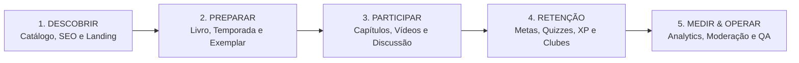

# 02 — Mapeamento de Funcionalidades

> **Documento:** Matriz Completa de Capacidades Funcionais (Baseada no Diagrama Excalidraw)  
> **MOC Principal:** [[DIYSpur - Master Index]]  
> **Tags:** `#funcionalidades` `#excalidraw` `#requisitos` `#produto`

---

## 1. Visão Sistêmica das Macro-Etapas

O mapa funcional do DIYSpur orienta o produto por meio de 5 macro-etapas interligadas que definem o ciclo de vida do usuário na plataforma:

---

## 2. As 6 Colunas Funcionais do Ecossistema

O diagrama de arquitetura do Excalidraw estrutura todas as capacidades do DIYSpur em 6 pilares de engenharia e produto:

---

### Coluna 1: Aquisição e Conteúdo Público

Focada em indexação orgânica, descoberta e conversão sem atrito:

| Funcionalidade | Descrição Técnica & Escopo | Status |
|---|---|---|
| **Home e Temporada em Destaque** | Landing page de alta performance, apresentação do clube, call-to-action (CTA), proposta de valor do modelo "segunda tela" e banner da temporada ativa. | ✅ Documentada / Base Existente |
| **Catálogo e Busca** | Listagem de títulos com debounce de digitação no input, estado vazio (*empty state*) sem quebras e filtros por status editorial. | ✅ Documentada / Base Existente |
| **Ficha Editorial do Livro** | Página com sinopse, metadados da edição (ISBN, páginas, editora), avisos de conteúdo (*content warnings*) e histórico de temporadas associadas. | ✅ Documentada / Base Existente |
| **Temporadas e Capítulos Públicos** | Visualização do cronograma de leitura, semanas ativas e distinção visual entre conteúdo liberado e bloqueado por data. | ✅ Documentada / Base Existente |
| **SEO / GEO / AIO** | Otimização para mecanismos de busca tradicionais e motores de IA generativa (Google Search, Perplexity, ChatGPT). Inclusão de meta tags canônicas, OpenGraph, `robots.txt`, `sitemap.xml` dinâmico e `llms.txt`. | ✅ Documentada / Base Existente |
| **Dados Estruturados** | Injeção de JSON-LD estritamente sanitizado seguindo esquemas da [Schema.org](https://schema.org) para `Book`, `Event` (encontros literários) e `Organization`. | ✅ Documentada / Base Existente |
| **Compartilhamento e Afiliados** | Integração com Web Share API para links sociais e redirecionamento transparente de compra do exemplar via tag de associado Amazon. | ✅ Documentada / Base Existente |
| **Newsletter com Consentimento** | Formulário de captura com opt-in explícito e duplo consentimento para comunicações editoriais e lembretes de ciclo. | ✅ Documentada / Base Existente |

---

### Coluna 2: Conta, Dados e Confiança

Governança de identidade, segurança e privacidade do usuário:

| Funcionalidade | Descrição Técnica & Escopo | Status |
|---|---|---|
| **Autenticação** | Fluxos de cadastro, login por senha, Magic Link sem senha e recuperação de credenciais via Supabase Auth. | ✅ Documentada / Base Existente |
| **Sessão e Retorno Seguro** | Gerenciamento de cookies HTTP-only via `@supabase/ssr`, callbacks autenticados e prevenção de Open Redirect no parâmetro `returnUrl`. | ✅ Documentada / Base Existente |
| **Perfis e Papéis** | Sistema de autorização baseado em perfis: `reader` (leitor comum), `club_owner`, `moderator` e `admin`. | ✅ Documentada / Base Existente |
| **RLS e Validação Server-Side** | PostgreSQL com RLS habilitada em todas as tabelas sensíveis. Server Actions e Zod garantem tipagem e integridade antes do banco. | ✅ Documentada / Base Existente |
| **Privacidade / Consentimento** | Central de preferências de privacidade com banner de cookies e ativação condicional de telemetria (*opt-in*). | ✅ Documentada / Base Existente |
| **Exportação LGPD** | Rotina de exportação dos dados do titular em JSON estruturado, cobrindo perfil, diário, progresso e histórico. | 🟡 Homologação Pendente |
| **Exclusão / Anonimização** | Fluxo para exclusão de conta ou anonimização de comentários do titular preservando a integridade das threads. | 🟡 Homologação Pendente |
| **Hardening e Acessibilidade** | Headers de segurança restritivos (Content Security Policy, X-Frame-Options), conformidade WCAG 2.2, suporte a leitores de tela e navegação por teclado. | ✅ Documentada / Base Existente |

---

### Coluna 3: Operação Editorial

Ferramentas internas para a equipe de conteúdo gerenciar o clube:

| Funcionalidade | Descrição Técnica & Escopo | Status |
|---|---|---|
| **Gestão do Catálogo** | Interface administrativa restrita para cadastrar obras, vincular autores, ISBN e capas no Supabase Storage. | ✅ Documentada / Base Existente |
| **Gestão de Temporadas** | Criação de ciclos de leitura, definição de datas de início/fim e marcação de temporada ativa em destaque. | ✅ Documentada / Base Existente |
| **Capítulos e Publicação** | Máquina de estados para capítulos: `draft` (rascunho), `scheduled` (agendado), `published` (publicado) e `archived` (arquivado). | ✅ Documentada / Base Existente |
| **Vídeo e Replay** | Associação de vídeos do YouTube a capítulos, com carregamento do iframe apenas sob interação intencional do leitor. | ✅ Documentada / Base Existente |
| **Quiz Editorial** | Cadastro de perguntas pedagógicas de múltipla escolha com gabarito secreto gravado no schema `private`. | ✅ Documentada / Base Existente |
| **Validação de Publicação** | Regras de validação que impedem a publicação de capítulos sem cronograma ou com quizzes incompletos. | ✅ Documentada / Base Existente |
| **Avisos de Conteúdo / Spoilers** | Tagging editorial de gatilhos psicológicos e controle de restrição por capítulo. | ✅ Documentada / Base Existente |
| **Console Editorial Completo** | Dashboard unificado para administradores acompanharem métricas de engajamento por capítulo e gerenciarem conteúdos pendentes. | 🟡 Homologação Pendente |

---

### Coluna 4: Jornada de Leitura

Experiência interativa do leitor enquanto progride no livro:

| Funcionalidade | Descrição Técnica & Escopo | Status |
|---|---|---|
| **Progresso por Capítulo** | Registro de percentual estimado de leitura com trava que impede regressão involuntária de avanço. | ✅ Documentada / Base Existente |
| **Quiz e Tentativas** | Execução de quizzes com validação de gabarito estritamente no servidor via Edge Function, pontuação percentual e rate-limiting. | ✅ Documentada / Base Existente |
| **XP e Ranking** | Atribuição de experiência (XP) por metas e quizzes concluídos, garantindo idempotência e atualização no ranking da temporada. | ✅ Documentada / Base Existente |
| **Perfil e Histórico** | Visão agregada do leitor: livros lidos, capítulos finalizados, histórico de quizzes e pontuação total. | ✅ Documentada / Base Existente |
| **Diário Privado** | Notas de leitura com privacidade estrita (`owner_only`), contadores opcionais de páginas e minutos lidos. | ✅ Documentada / Base Existente |
| **Listas de Leitura** | Criação de listas personalizadas com ordenação protegida por controle otimista de versão. | ✅ Documentada / Base Existente |
| **Metas Anuais e Fila** | Metas anuais (livros/páginas) e priorização dos próximos 5 livros na estante (*minha fila*). | ✅ Documentada / Base Existente |
| **Desafios e Continuidade** | Trilha de desafios temáticos para estimular o hábito contínuo de leitura ao longo dos meses. | ✅ Documentada / Base Existente |

---

### Coluna 5: Comunidade e Eventos

Socialização protegida e espaços comunitários:

| Funcionalidade | Descrição Técnica & Escopo | Status |
|---|---|---|
| **Clubes Públicos e Privados** | Criação de clubes independentes por usuários com gestão de membros, convites e papéis (`owner`, `moderator`, `member`). | ✅ Documentada / Base Existente |
| **Livro + Temporada no Clube** | Assistente para o líder do clube selecionar uma obra do catálogo e definir um cronograma próprio. | ✅ Documentada / Base Existente |
| **Convites e Notificações** | Envio de convites para outros leitores por `@username` e central de notificações pessoais. | ✅ Documentada / Base Existente |
| **Feed e Comentários** | Discussões focadas por capítulo com encadeamento de respostas e suporte a formatação básica. | ✅ Documentada / Base Existente |
| **Comentários Temporizados** | Comentários vinculados ao timestamp do vídeo do YouTube (ex.: segundo 90 = 1min30s) e mascaramento de spoilers. | ✅ Documentada / Base Existente |
| **Denúncia e Moderação** | Mecanismo de denúncia de conteúdo inadequado com fila para revisão e aprovação/remoção por moderadores. | ✅ Documentada / Base Existente |
| **Calendário e Presença (RSVP)** | Agenda de encontros com confirmação de presença, exportação para Google Calendar e download de arquivos `.ics`. | ✅ Documentada / Base Existente |
| **Votação da Próxima Leitura** | Enquetes democráticas com votação única por usuário para escolha da próxima obra da temporada. | ✅ Documentada / Base Existente |
| **Leitura Compartilhada (Buddy Reads)** | Grupos de leitura simultânea em duplas ou pequenos círculos com checkpoints sincronizados. | 🔵 Evolução Proposta |

---

### Coluna 6: Retenção, Negócio e Operação

Sustentação operacional, monetização e infraestrutura de suporte:

| Funcionalidade | Descrição Técnica & Escopo | Status |
|---|---|---|
| **Notificações e Lembretes** | Disparo de alertas agendados por e-mail sobre novos capítulos abertos e encontros ao vivo iminentes. | ✅ Documentada / Base Existente |
| **Monetização Atual (Afiliados)** | Links comissionados da Amazon para os exemplares recomendados, com rastreamento anônimo de cliques. | ✅ Documentada / Base Existente |
| **Assinaturas / Pagamentos** | Estrutura preliminar de webhooks do Stripe no backend para planos de membros e recursos exclusivos. | 🔵 Evolução Proposta |
| **Recomendações por IA** | Edge Functions preparadas para matching de gostos literários utilizando embeddings de texto e `pgvector`. | 🟡 Homologação Pendente |
| **Sentry e Logs Operacionais** | Monitoramento de erros em tempo real com rastreamento distribuído, `request_id` e sanitização de dados confidenciais. | ✅ Documentada / Base Existente |
| **PostHog Analytics** | Métricas de uso de produto, funis de ativação e retenção ativados somente após consentimento do leitor. | ✅ Documentada / Base Existente |
| **QA Automatizado** | Suíte de testes com Vitest (unitários) e Playwright (E2E) integrados ao GitHub Actions. | ✅ Documentada / Base Existente |
| **Carga e Segurança** | Procedimentos de testes com k6 e validação contínua de integridade de políticas RLS em Staging. | ✅ Documentada / Base Existente |

---

## 3. Navegação Relacionada
- Analisar os fluxos tela a tela: [[03 - Jornada do Usuario e Fluxo de Telas]]
- Conhecer o alinhamento com mídias sociais: [[04 - Estrategia de Conteudo e Redes Sociais]]
- Voltar ao MOC central: [[DIYSpur - Master Index]]
