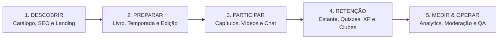

# 02 — Mapeamento de Funcionalidades

> **Documento:** Matriz Completa de Capacidades Funcionais (Baseada no Diagrama Excalidraw e SDD v1.0)  
> **MOC Principal:** [[DIYSpur - Master Index]]  
> **Tags:** `#funcionalidades` `#excalidraw` `#requisitos` `#produto` `#homologado`

---

## 1. Visão Sistêmica das Macro-Etapas

O mapa funcional do DIYSpur orienta o produto por meio de 5 macro-etapas interligadas que definem o ciclo de vida do usuário na plataforma:

---

## 2. As 6 Colunas Funcionais do Ecossistema

O ecossistema DIYSpur estrutura todas as capacidades em 6 pilares de engenharia e produto homologados:

---

### Coluna 1: Aquisição e Conteúdo Público

Focada em indexação orgânica, descoberta e conversão sem atrito:

| Funcionalidade | Descrição Técnica & Escopo | Status |
|---|---|:---:|
| **Home e Temporada em Destaque** | Landing page de alta performance, apresentação do clube, call-to-action (CTA), proposta de valor do modelo "segunda tela" e banner da temporada ativa. | ✅ **Homologado & Ativo** |
| **Catálogo e Busca** | Listagem de títulos com debounce de 300ms na digitação, estado vazio (*empty state*) sem quebras e filtros por status editorial. | ✅ **Homologado & Ativo** |
| **Ficha Editorial do Livro** | Página com sinopse, metadados da edição (ISBN, páginas, editora), avisos de conteúdo (*content warnings*) e histórico de temporadas associadas. | ✅ **Homologado & Ativo** |
| **Temporadas e Capítulos Públicos** | Visualização do cronograma de leitura, semanas ativas e distinção visual entre conteúdo liberado e bloqueado por data. | ✅ **Homologado & Ativo** |
| **SEO / GEO / AIO** | Otimização para mecanismos de busca tradicionais e motores de IA generativa (Google Search, Perplexity, ChatGPT). Inclusão de meta tags canônicas, OpenGraph, `robots.txt`, `sitemap.xml` dinâmico e `llms.txt`. | ✅ **Homologado & Ativo** |
| **Dados Estruturados** | Injeção de JSON-LD estritamente sanitizado seguindo esquemas da [Schema.org](https://schema.org) para `Book`, `Event` (encontros literários) e `Organization`. | ✅ **Homologado & Ativo** |
| **Compartilhamento e Afiliados** | Integração com Web Share API para links sociais e redirecionamento seguro com tracking anônimo via tag de associado Amazon. | ✅ **Homologado & Ativo** |
| **Newsletter com Consentimento** | Formulário de captura com opt-in explícito e duplo consentimento para comunicações editoriais e lembretes de ciclo. | ✅ **Homologado & Ativo** |

---

### Coluna 2: Conta, Dados e Confiança

Governança de identidade, segurança e privacidade do usuário:

| Funcionalidade | Descrição Técnica & Escopo | Status |
|---|---|:---:|
| **Autenticação Segura** | Fluxos de cadastro, login por senha, Magic Link sem senha e recuperação de credenciais via Supabase Auth. | ✅ **Homologado & Ativo** |
| **Sessão e Retorno Seguro** | Gerenciamento de cookies HTTP-only via `@supabase/ssr`, callbacks autenticados e prevenção de Open Redirect no parâmetro `returnUrl`. | ✅ **Homologado & Ativo** |
| **Perfis e Papéis** | Sistema de autorização baseado em perfis: `reader` (leitor comum), `club_owner`, `moderator` e `admin`. | ✅ **Homologado & Ativo** |
| **RLS e Validação Server-Side** | PostgreSQL com RLS habilitada em todas as 82 tabelas. Server Actions e Zod garantem tipagem e integridade antes do banco. | ✅ **Homologado & Ativo** |
| **Privacidade / Consentimento** | Central de preferências de privacidade com banner de cookies e ativação condicional de telemetria (*opt-in*). | ✅ **Homologado & Ativo** |
| **Exportação LGPD** | Endpoint `/api/account/export` que gera dossiê completo em JSON estruturado com leituras, discussões, quizzes e consentimentos. | ✅ **Homologado & Ativo** |
| **Exclusão / Anonimização** | Fluxo para exclusão de conta via cascata para notas privadas e anonimização de comentários preservando o histórico da comunidade. | ✅ **Homologado & Ativo** |
| **Hardening e Acessibilidade** | Headers de segurança restritivos (CSP, HSTS, X-Frame-Options), conformidade WCAG 2.2 AA e Touch Targets $\ge 48\text{px}$. | ✅ **Homologado & Ativo** |

---

### Coluna 3: Operação Editorial

Ferramentas internas para a equipe de conteúdo gerenciar o clube:

| Funcionalidade | Descrição Técnica & Escopo | Status |
|---|---|:---:|
| **Gestão do Catálogo** | Interface administrativa restrita (`/admin/books`) para cadastrar obras, vincular autores, ISBN e capas com verificação estrita de HTTPS. | ✅ **Homologado & Ativo** |
| **Gestão de Temporadas** | Criação de ciclos de leitura (`/admin/seasons`), definição de datas de início/fim e marcação de temporada ativa em destaque. | ✅ **Homologado & Ativo** |
| **Capítulos e Publicação** | Máquina de estados para capítulos: `draft`, `scheduled`, `published` e `archived`. | ✅ **Homologado & Ativo** |
| **Vídeo e Replay** | Associação de vídeos do YouTube a capítulos com carregamento do iframe apenas sob demanda via `YouTubeFacade`. | ✅ **Homologado & Ativo** |
| **Quiz Editorial** | Cadastro de perguntas pedagógicas de múltipla escolha com gabarito secreto gravado no schema `private`. | ✅ **Homologado & Ativo** |
| **Avisos de Conteúdo / Spoilers** | Tagging editorial de gatilhos psicológicos e controle de restrição por capítulo. | ✅ **Homologado & Ativo** |
| **Fila de Moderação Integrada** | Console `/admin/moderation` integrado à RPC `moderate_content_report` para ocultação e revisão de denúncias comunitárias. | ✅ **Homologado & Ativo** |

---

### Coluna 4: Jornada de Leitura & Estante Canônica

Experiência interativa do leitor enquanto progride no livro:

| Funcionalidade | Descrição Técnica & Escopo | Status |
|---|---|:---:|
| **Leitura Canônica da Obra** | Controle unificado de status (`user_book_readings`): `want_to_read`, `reading`, `read`, `paused`, `abandoned`. | ✅ **Homologado & Ativo** |
| **Transição com Trava Anti-Fraude** | Gatilho `trg_validate_book_reading_transition` que impede saltos diretos para `read` sem passar por `reading`. | ✅ **Homologado & Ativo** |
| **Metadados de Edição** | Associação com `book_editions` (ISBN, editora, total de páginas) com cálculo dinâmico de percentual lido. | ✅ **Homologado & Ativo** |
| **Quiz e Tentativas** | Execução de quizzes com validação de gabarito no servidor via Edge Function, pontuação percentual e rate-limiting. | ✅ **Homologado & Ativo** |
| **XP e Ranking Duplo** | Rota `/ranking` com abas para XP da Temporada (`?tipo=xp`) e Livros Mais Lidos da Comunidade (`?tipo=livros`). | ✅ **Homologado & Ativo** |
| **Estante no Histórico** | Rota `/historico` com filtros de estante (*Lendo*, *Quero Ler*, *Lidos*) e touch targets táteis $\ge 48\text{px}$. | ✅ **Homologado & Ativo** |
| **Diário Privado** | Notas de leitura com privacidade estrita (`owner_only`), contadores de páginas e minutos lidos. | ✅ **Homologado & Ativo** |
| **Metas Anuais e Minha Fila** | Metas anuais com barra de progresso em tempo real e priorização dos Top 5 próximos livros. | ✅ **Homologado & Ativo** |

---

### Coluna 5: Comunidade, Discussões e Eventos

Socialização protegida e espaços comunitários:

| Funcionalidade | Descrição Técnica & Escopo | Status |
|---|---|:---:|
| **Clubes Oficiais do Livro** | Tabela `official_book_groups` auto-criada ao cadastrar obras, vinculando clubes e canais temáticos aos livros. | ✅ **Homologado & Ativo** |
| **Clubes Independentes** | Criação de clubes públicos e privados (`user_clubs`), convites por `@username` e cargos (`owner`, `moderator`, `member`). | ✅ **Homologado & Ativo** |
| **Canais Temáticos de Chat** | Estrutura de canais (`club_channels`): `#geral`, `#spoilers` e `#capitulos` com auto-scroll e atalhos rápidos. | ✅ **Homologado & Ativo** |
| **Proteção Anti-Spoiler & Consentimento** | Máscara de blur visual em mensagens com spoiler e barreira de consentimento formal (`channel_members_spoiler_consent`). | ✅ **Homologado & Ativo** |
| **Respostas Encadeadas Seguras** | Suporte a replies no chat com validação de que pai e resposta pertencem ao mesmo canal (`cross_channel_parent_reply_denied`). | ✅ **Homologado & Ativo** |
| **Edição com Concorrência Otimista** | Edição de mensagens com verificação de versão (`p_expected_version`), evitando sobrescritas acidentais. | ✅ **Homologado & Ativo** |
| **Central de Notificações Completa** | Sino com badge reativo no header, popover rápido, página `/notificacoes` paginada e filtros por canal. | ✅ **Homologado & Ativo** |
| **Calendário & Encontros Literários** | Encontros associados a livros e clubes em `/calendario`, com confirmação de presença (RSVP) e página `/eventos/[id]`. | ✅ **Homologado & Ativo** |
| **Exportação RFC 5545 e Google Agenda** | Download de arquivo `.ics` com dobra estrita em 75 octetos (`/api/ics/[meetingId]`) e link para Google Agenda. | ✅ **Homologado & Ativo** |
| **Denúncia e Moderação Comunitária** | Botão `ReportButton` em mensagens com auto-ocultação após 3 denúncias até resolução administrativa. | ✅ **Homologado & Ativo** |

---

### Coluna 6: Retenção, Negócio e Operação

Sustentação operacional, mensageria e infraestrutura de suporte:

| Funcionalidade | Descrição Técnica & Escopo | Status |
|---|---|:---:|
| **Fila Outbox de Notificações** | Tabela `notification_outbox` e Edge Function `community-notification-worker` com processamento `SKIP LOCKED`. | ✅ **Homologado & Ativo** |
| **Lembretes Agendados de Encontros** | Edge Function `scheduled-reminders` disparada por cron job para avisos de 24h e 1h antes do evento. | ✅ **Homologado & Ativo** |
| **Monetização via Afiliados** | Links rastreados da Amazon com proteção de privacidade (`ip_hash`) em `/api/affiliate/[slug]`. | ✅ **Homologado & Ativo** |
| **Event Sourcing no Stripe** | Tabela `payment_events` com idempotência por `event_id` para subscrições e benefícios. | ✅ **Homologado & Ativo** |
| **Observabilidade e Telemetria** | Sentry para rastreamento de erros e PostHog com dicionário estrito `ProductEventMap` ativado sob consentimento. | ✅ **Homologado & Ativo** |
| **Quality Gates de CI/CD** | 100% de aprovação em TypeScript strict, ESLint, 132 testes unitários no Vitest e 6 suítes PGlite. | ✅ **Homologado & Ativo** |

---

## 3. Navegação Relacionada
- Analisar os novos clubes e canais: [[02.4 - Comunidade de Leitura, Clubes e Canais de Discussao]]
- Conhecer a leitura canônica e rankings: [[02.5 - Leitura Canonica, Estante Pessoal e Rankings Comunitarios]]
- Verificar a central de notificações e calendário: [[02.6 - Central de Notificacoes, Outbox e Eventos de Calendario]]
- Analisar a jornada do usuário tela a tela: [[03 - Jornada do Usuario e Fluxo de Telas]]
- Consultar o relatório de pentest e segurança: [[01.7 - Relatorio de Pentest, Seguranca Ofensiva e Matriz OWASP]]
- Voltar ao MOC central: [[DIYSpur - Master Index]]
