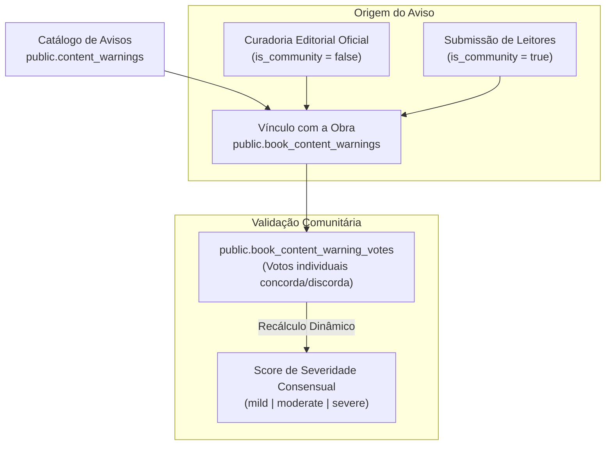

# 02.1 — Taxonomia Editorial, Moods & Content Warnings

> **Documento:** Modelagem Conceitual de Obras, Avisos de Conteúdo e Metadados Psicológicos  
> **MOC Principal:** [[DIYSpur - Master Index]]  
> **Documento Pai:** [[02 - Mapeamento de Funcionalidades]]  
> **Tags:** `#editorial` `#content-warnings` `#moods` `#livros` `#verity` `#taxonomia`

---

## 1. Segurança Psicológica: A Camada de Content Warnings

Para garantir que o leitor participe do clube com total transparência sobre temas sensíveis, o DIYSpur implementa um subsistema avançado de **Avisos de Conteúdo Estruturados**:



### 1.1 Categorias e Severidades
- **Categorias Base:** `mental_health`, `violence`, `abuse`, `identity`, `substance`, `grief`.
- **Níveis de Severidade:**
  - `mild`: Menção pontual ou periférica na narrativa.
  - `moderate`: Ocorrência frequente ou elemento relevante da trama.
  - `severe`: Descrição gráfica explícita, cena central ou tema condutor do enredo.
- **Proteção Contra Spam:** A tabela `book_content_warning_votes` registra votos únicos por `(warning_row_id, user_id)`, recalculando democraticamente se o aviso deve permanecer visível na ficha da obra.

---

## 2. A Métrica de Leitura: Moods, Pacing e Plot-vs-Character

Além dos tradicionais dados bibliográficos (autor, páginas, editora), o DIYSpur cataloga o comportamento da obra nas seguintes dimensões:

```
┌────────────────────────────────────────────────────────────────────────┐
│                   METADADOS DE ATMOSFERA (MOOD STATS)                  │
├────────────────────────────────────────────────────────────────────────┤
│  MOODS (Array GIN)     │ 'dark', 'emotional', 'reflective', 'tense',   │
│                        │ 'mysterious', 'cozy', 'hopeful', 'sad'        │
├────────────────────────┼───────────────────────────────────────────────┤
│  PACING                │ Percentual de distribuição:                   │
│                        │ • Slow (contemplativo, detalhista)            │
│                        │ • Medium (ritmo equilibrado)                  │
│                        │ • Fast (ação contínua, reviravoltas rápidas)  │
├────────────────────────┼───────────────────────────────────────────────┤
│  PLOT VS. CHARACTER    │ Métrica contínua normalizada de 0.00 a 1.00:  │
│                        │ • 0.00: Foco total no enredo (Plot-driven)    │
│                        │ • 0.50: Equilíbrio perfeito entre ambos       │
│                        │ • 1.00: Foco total no personagem (Character)  │
└────────────────────────────────────────────────────────────────────────┘
```

Essas métricas são computadas pelo PostgreSQL e armazenadas em formato JSONB em `book_mood_stats`, alimentando simultaneamente a exibição visual na ficha do livro e a distância de similaridade vetorial do algoritmo de *Reader Match*.

---

## 3. Estudo de Caso Real: A Edição Piloto de *Verity*

O catálogo de produção do DIYSpur foi validado com a edição brasileira da obra *Verity*, de Colleen Hoover:

| Metadado | Especificação Cadastrada | Fonte de Proveniência |
|---|---|---|
| **Obra e Autora** | *Verity* — Colleen Hoover | Página oficial da autora |
| **ISBN-13** | `9788501117847` | Editora Record / Catálogo Nacional |
| **Selo Editorial** | Galera Record (22ª edição, capa comum) | Casa Vamos Ler / Ficha Técnica |
| **Tradução** | Thaís Britto | Edição oficial brasileira |
| **Extensão** | 320 páginas / 25 capítulos principais | Editora Record |
| **Classificação** | 18 anos | Classificação indicativa oficial |
| **Gênero Editorial** | Suspense psicológico / Thriller romântico | Ficha catalográfica |
| **Ciclo da Temporada** | Janela de 8 de outubro a 12 de novembro de 2026 | Cronograma do clube DIYSpur |

### 3.1 Mapeamento Multimídia dos Capítulos Iniciais
Os três primeiros capítulos foram vinculados a videoaulas gravadas para a temporada:
- **Capítulo 1:** URL do YouTube `youtu.be/zyJkEg09nbo` (apresentação dos personagens e ambientação).
- **Capítulo 2:** URL do YouTube `youtu.be/RQKB4AdTEKc` (primeiro contato com o manuscrito).
- **Capítulo 3:** URL do YouTube `youtu.be/WThFSwoxpc8` (análise de confiabilidade da narradora).

---

## 4. Navegação Relacionada
- Consultar a matriz geral de funcionalidades: [[02 - Mapeamento de Funcionalidades]]
- Ver o motor de recomendação semântica: [[01.2 - Inteligencia Artificial e Recomendacao Semantica]]
- Entender como esses dados aparecem na tela da obra: [[03 - Jornada do Usuario e Fluxo de Telas#2-ficha-do-livro--catalogo-livros-e-livrosslug]]
- Voltar ao MOC central: [[DIYSpur - Master Index]]
