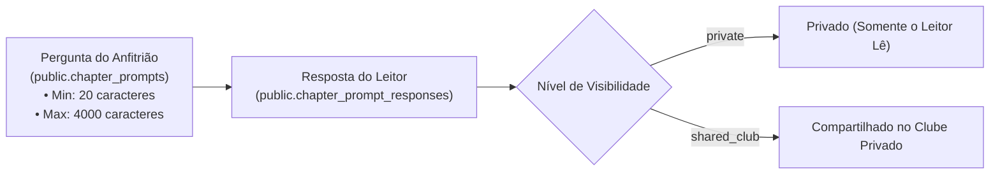

# 02.2 — Gamificação por Regras, Caderno Interativo & Materiais Extras

> **Documento:** Motor Declarativo de Conquistas, Exercícios Reflexivos e Atividades Pedagógicas  
> **MOC Principal:** [[DIYSpur - Master Index]]  
> **Documento Pai:** [[02 - Mapeamento de Funcionalidades]]  
> **Tags:** `#gamificacao` `#achievements` `#atividades` `#caderno-interativo` `#pedagogia`

---

## 1. Motor Declarativo de Gamificação (Regras JSONB)

Ao contrário de sistemas rígidos que exigem código customizado para cada medalha, o DIYSpur opera um **motor de regras declarativas baseadas em JSONB**:

```sql
CREATE TABLE IF NOT EXISTS public.achievements (
  id           uuid primary key default gen_random_uuid(),
  code         text unique not null,          -- 'first_book', 'streak_4w', 'quiz_flawless'
  title        text not null,
  description  text not null,
  icon_url     text,
  xp_reward    int default 0,
  rule         jsonb not null                 -- Regra de validação em predicado JSON
);

CREATE TABLE IF NOT EXISTS public.user_achievements (
  user_id         uuid not null references public.profiles(id) on delete cascade,
  achievement_id  uuid not null references public.achievements(id) on delete cascade,
  unlocked_at     timestamptz not null default now(),
  primary key (user_id, achievement_id)      -- Idempotência garantida pela PK composta
);
```

### 1.1 Exemplos de Regras Declarativas Mapeadas no Banco

| Código da Conquista | Título e Descrição | Predicado JSONB (`rule`) | Recompensa |
|---|---|---|---|
| `first_book` | **Primeiro Passo:** Concluiu seu primeiro livro no clube. | `{"type":"count", "source":"finish_book", "gte":1}` | +100 XP |
| `streak_4w` | **Hábito de Ferro:** Manteve 4 semanas consecutivas de leitura. | `{"type":"streak", "source":"weekly_reading", "gte":4}` | +150 XP |
| `quiz_flawless` | **Mente Brilhante:** Obteve 100% de acerto no quiz de um capítulo. | `{"type":"score", "source":"quiz_attempt", "eq":100}` | +50 XP |
| `machado_master` | **Especialista em Machado:** Completou todos os capítulos de uma temporada de Machado de Assis. | `{"type":"author_season", "author_id":"...", "completed":true}` | +300 XP + Insígnia Especial |

---

## 2. O "Caderno Interativo": Exercícios de Escrita e Reflexão

Inspirado em metodologias ativas de leitura e cadernos de bordo, o DIYSpur inclui um espaço onde o anfitrião do livro lança provocações reflexivas para os membros:



- **Garantia de Qualidade Reflexiva:** O sistema impõe uma barreira mínima de caracteres (`min_chars = 20`) para evitar comentários monossilábicos ("legal", "gostei"), fomentando argumentos construídos.
- **Privacidade Intocável:** Respostas marcadas como `private` são protegidas por RLS, permanecendo inacessíveis mesmo para administradores da plataforma.

---

## 3. Atividades Cronometradas e Desafios Interativos

Além dos quizzes tradicionais de múltipla escolha, o schema `chapter_activities` suporta mini-jogos literários:
- **Desafios com Tempo Limite (`time_limit_sec`):** O leitor tem, por exemplo, 90 segundos para associar personagens aos seus respectivos papéis na trama.
- **Telemetria de Resolução:** A tabela `chapter_activity_attempts` audita o tempo exato de resposta em milissegundos (`duration_ms`), a pontuação obtida e um payload `result` em JSONB com o mapa de acertos.

---

## 4. Repositório de Materiais Complementares Editoriais

O aprendizado é enriquecido por materiais de apoio cadastrados em `chapter_extra_content`:
- **Documentos Técnicos:** Árvores genealógicas de personagens em PDF, mapas geográficos da época em que a narrativa se passa e ensaios críticos.
- **Armazenamento e Acesso:** Arquivos binários são hospedados no bucket `chapter-extras` do Supabase Storage ou vinculados a recursos colaborativos externos (Figma, Notion, Google Docs).

---

## 5. Navegação Relacionada
- Analisar a arquitetura de banco de dados: [[01.1 - Modelo de Dados e Seguranca RLS]]
- Conhecer a jornada do usuário e telas: [[03 - Jornada do Usuario e Fluxo de Telas]]
- Retornar ao índice mestre: [[DIYSpur - Master Index]]
