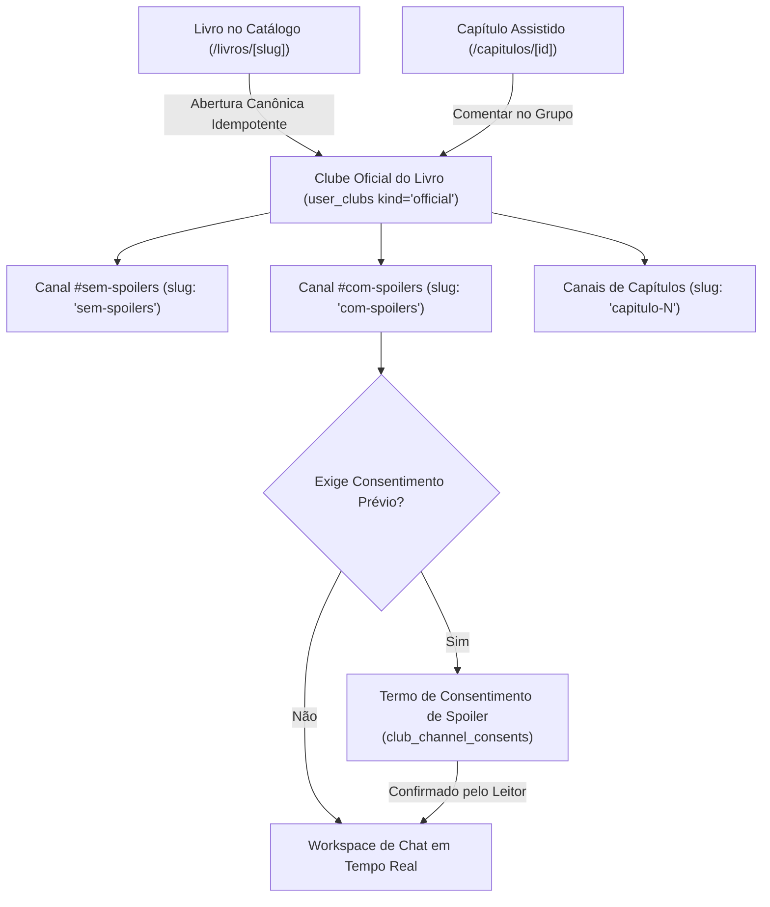

# 02.4 — Comunidade de Leitura, Clubes Canônicos & Canais de Discussão

> **Documento:** Engenharia de Clubes Oficiais por Livro, Canais Temáticos e por Capítulo, Mensageria em Tempo Real e Proteção Anti-Spoiler  
> **MOC Principal:** [[DIYSpur - Master Index]]  
> **Documento Pai:** [[02 - Mapeamento de Funcionalidades]]  
> **Tags:** `#clubes` `#discussoes` `#canais` `#spoilers` `#realtime` `#moderacao` `#excalidraw`

---

## 1. Visão Geral da Comunidade Canônica de Leitura (Versão 1.1)

A comunidade DIYSPUR opera sob a regra de ouro: **1 Livro = 1 Clube Oficial Canônico**. 

Não existem clubes avulsos sem livro e nem múltiplos sistemas paralelos de comentários. Toda a interação e debate sobre uma obra é centralizada no grupo oficial do livro (`user_clubs` com `kind = 'official'`), estruturado em canais de discussão especializados:

---

## 2. Invariantes do Modelo de Clubes e Grupos Oficiais

### 2.1 Unicidade Canônica
- Cada livro cadastrado no catálogo (`books`) possui no máximo um grupo oficial ativo (`kind = 'official'`).
- A criação é **sob demanda no clique explícito do usuário** (`ensure_official_book_group`), garantindo que navegações e web crawlers não criem registros no banco de dados.
- O grupo nasce automaticamente com **2 canais padrão**:
  1. `sem-spoilers` (Política: `none`) — Para impressões iniciais, ritmo de leitura e dúvidas sem revelações.
  2. `com-spoilers` (Política: `whole_book`) — Exige consentimento explícito no servidor antes de descriptografar/entregar as mensagens.
- **Canais de Capítulos:** Criados sob demanda via `ensure_chapter_discussion`, vinculando o canal ao `chapter_id`.

### 2.2 Descontinuação de Clubes Avulsos sem Livro
- A função legada `create_user_club(text, text, boolean, uuid)` teve suas permissões de execução revogadas para `PUBLIC`, `anon` e `authenticated`.
- Um trigger no PostgreSQL (`private.require_canonical_new_group`) impede a inserção de clubes sem `official_book_id` ou com `is_private = true`.
- A rota `/clubes/novo` atua como um resolvedor contextual: se receber `?livro=<UUID>`, busca ou cria o clube oficial daquele livro; se não receber parâmetro, orienta o usuário a selecionar uma obra no catálogo.

---

## 3. Arquitetura de Canais (`club_channels`)

| Campo | Tipo | Descrição & Regra de Comportamento |
|---|---|---|
| `id` | `uuid` | Chave primária única do canal. |
| `club_id` | `uuid` | Referência ao clube oficial (`user_clubs.id`). |
| `kind` | `text` | Tipo do canal: `'general'` (padrão) ou `'chapter'` (capítulo específico). |
| `slug` | `text` | Identificador na URL (`sem-spoilers`, `com-spoilers`, ou derivado do capítulo). |
| `chapter_id` | `uuid` (opcional) | Referência obrigatória quando `kind = 'chapter'`, validada contra o livro da temporada. |
| `spoiler_policy` | `text` | `'none'` (sem spoilers), `'chapter'` (spoiler do capítulo), `'whole_book'` (spoiler do livro). |

---

## 4. Mensageria em Tempo Real e Ciclo de Vida (`club_messages`)

Todas as mensagens de bate-papo utilizam a tabela `club_messages`, conectada via Supabase Realtime CDC (Change Data Capture):

1. **Envio Idempotente:** O cliente gera um `client_message_id` (UUIDv4) e o envia com o payload. O servidor previne mensagens duplicadas via constraint `UNIQUE(channel_id, client_message_id)`.
2. **Timestamp de Vídeo:** Mensagens enviadas a partir do contexto de um capítulo podem incluir `video_sec` opcional (inteiro entre 0 e 86400 segundos), permitindo que outros leitores cliquem e saltem diretamente para o instante exato do vídeo do YouTube.
3. **Edição e Exclusão com Versionamento:** Edições utilizam controle de concorrência otimista (`version = version + 1`).
4. **Moderação Integrada:** Leitores podem denunciar mensagens através de `content_reports`. Moderadores e administradores têm acesso à ação atômica `apply_club_sanction` para silenciar (`mute`) ou banir (`ban`) usuários infratores.
