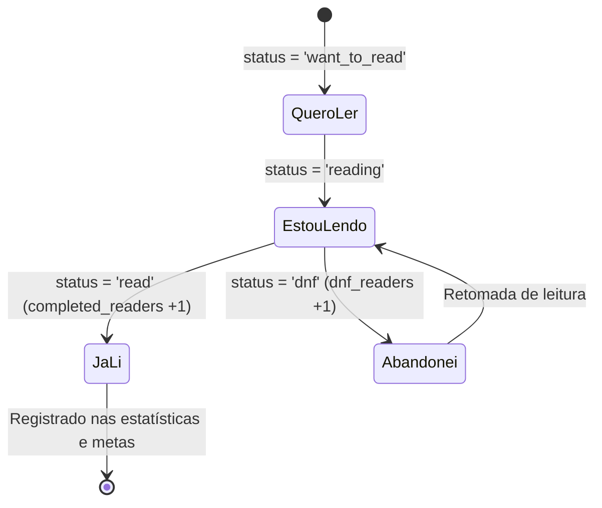

# 02.5 — Leitura Canônica, Estante Pessoal & Rankings Comunitários

> **Documento:** Máquina de Estados de Leitura, Estante Pessoal, Materialized Views e Rankings de Audiência e Desistência  
> **MOC Principal:** [[DIYSpur - Master Index]]  
> **Documento Pai:** [[02 - Mapeamento de Funcionalidades]]  
> **Tags:** `#leitura-canonica` `#estante` `#rankings` `#metricas` `#desistencias` `#xp` `#excalidraw`

---

## 1. Visão Geral da Leitura Canônica

No DIYSPUR, a experiência do leitor é ancorada na tabela canônica **`user_book_readings`**, com chave primária composta `(user_id, book_id)`.

A alteração de status é realizada pelo controle **Sua Leitura** (`BookReadingControl`) na ficha do livro (`/livros/[slug]`), que reflete instantaneamente em:
1. **Histórico Pessoal (`/historico`):** O livro marcado como *Estou lendo* passa a figurar imediatamente no topo da estante pessoal (satisfazendo a conexão **F24** do Excalidraw).
2. **Rankings de Livros (`/ranking/livros`):** Contabilizado na Materialized View `private.mv_book_reading_stats_v2` e exposto via `public.v_book_reading_stats`.



---

## 2. Contrato da Tabela `public.user_book_readings`

| Coluna | Tipo | Restrição | Finalidade |
|---|---|---|---|
| `user_id` | `uuid` | PK, FK `auth.users(id)` ON DELETE CASCADE | Identificador do leitor. |
| `book_id` | `uuid` | PK, FK `public.books(id)` ON DELETE CASCADE | Identificador do livro no catálogo. |
| `status` | `text` | NOT NULL | `'want_to_read'`, `'reading'`, `'read'`, `'dnf'`. |
| `source` | `text` | NOT NULL DEFAULT `'manual'` | Origem do registro (`'manual'` ou `'sync'`). |
| `started_at` | `timestamptz` | NULL | Data em que o livro foi marcado pela primeira vez como `reading`. |
| `completed_at` | `timestamptz` | NULL | Data em que o status mudou para `read`. |
| `first_started_at` | `timestamptz` | NULL | Timestamp original do primeiro início (imutável para métricas históricas). |
| `version` | `bigint` | NOT NULL DEFAULT 1 | Controle de concorrência otimista. |
| `created_at` | `timestamptz` | DEFAULT now() | Data de inserção. |
| `updated_at` | `timestamptz` | DEFAULT now() | Data da última alteração. |

---

## 3. Rankings Comunitários e Métricas de Audiência

Os rankings são divididos em duas rotas canônicas:

### 3.1 Ranking de XP da Temporada (`/ranking`)
Mede o engajamento dos membros no ciclo atual. Regras de pontuação transcritas do Bloco **B18** do Excalidraw:
- **Concluir um capítulo:** 20 XP por capítulo.
- **Publicar uma mensagem em canal de capítulo:** 30 XP por mensagem válida.
- **Responder ao quiz:** 50 XP, uma única vez por capítulo.
- **Bônus diário de atividade:** 25 XP mediante atividade real registrada no dia.
- **Presença confirmada em encontro:** 30 XP, concedido com autorização da moderação via `confirm_meeting_attendance_safe`.

### 3.2 Ranking de Livros (`/ranking/livros`)
Consulta a view `public.v_book_reading_stats` com 4 abas e paginação:
1. **Mais Lidos (`aba=mais-lidos`):** Ordenado pela soma `reading_audience = reading + read`. Cada usuário conta no máximo uma vez por livro.
2. **Lendo Agora (`aba=lendo`):** Ordenado por `active_readers = count(status='reading')`.
3. **Concluídos (`aba=concluidos`):** Ordenado por `completed_readers = count(status='read')`.
4. **Desistências (`aba=desistencias`):** Ordenado por `dnf_readers = count(status='dnf')`, exibindo a taxa percentual `dnf_rate = (dnf / (reading + read + dnf)) * 100`.

---

## 4. Atualização Agendada e Monitoramento

A Materialized View `private.mv_book_reading_stats_v2` é atualizada a cada 5 minutos pelo job do `pg_cron` através da função `private.refresh_book_reading_stats()`, que emprega advisory locks para prevenir execuções concorrentes travadas:

```sql
SELECT cron.schedule(
  'diyspur-book-reading-stats',
  '*/5 * * * *',
  'select private.refresh_book_reading_stats();'
);
```
