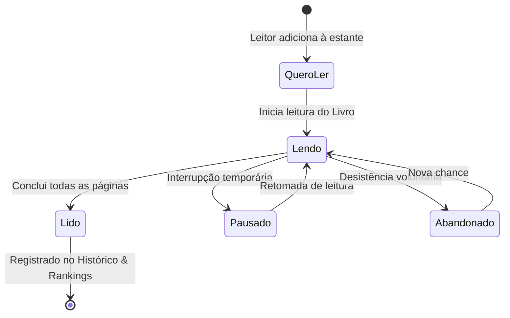

# 02.5 — Leitura Canônica, Estante Pessoal & Rankings Comunitários

> **Documento:** Máquina de Estados de Leitura, Metadados de Edição, Estatísticas Comunitárias e Rankings  
> **MOC Principal:** [[DIYSpur - Master Index]]  
> **Documento Pai:** [[02 - Mapeamento de Funcionalidades]]  
> **Tags:** `#leitura-canonica` `#estante` `#rankings` `#edicoes` `#metricas` `#gamificacao`

---

## 1. Visão Geral da Leitura Canônica

No DIYSpur, a experiência do leitor é ancorada na tabela central **`user_book_readings`**, que unifica o acompanhamento do exemplar físico/digital com o progresso pedagógico da temporada.

Diferente de sistemas legados onde o progresso ficava fragmentado por capítulos avulsos, a leitura canônica estabelece a obra como entidade agregadora de status, edição específica e tempo investido.



---

## 2. Máquina de Estados e Invariantes no PostgreSQL

Para manter a integridade dos dados e evitar fraudes em gamificação, as transições de estado são fiscalizadas por gatilhos no banco e validadas no cliente:

### 2.1 Tabela `public.user_book_readings`

| Coluna | Tipo | Restrição | Finalidade |
|---|---|---|---|
| `id` | `uuid` | PK (default `gen_random_uuid()`) | Identificador único do registro de leitura. |
| `user_id` | `uuid` | FK `profiles(id)` NOT NULL | Identificador do leitor (proprietário). |
| `book_id` | `uuid` | FK `books(id)` NOT NULL | Livro sendo acompanhado. |
| `book_edition_id` | `uuid` | FK `book_editions(id)` NULL | Edição física ou digital específica escolhida pelo leitor. |
| `status` | `book_reading_status` | NOT NULL | Enum: `want_to_read`, `reading`, `read`, `paused`, `abandoned`. |
| `current_page` | `integer` | DEFAULT 0 | Página atual no exemplar físico. |
| `percent_completed` | `numeric(5,2)` | DEFAULT 0.00 | Percentual calculado da leitura (0.00 a 100.00%). |
| `started_at` | `timestamptz` | NULL | Data em que o status mudou para `reading`. |
| `finished_at` | `timestamptz` | NULL | Data em que o status mudou para `read`. |
| `rating` | `integer` | CHECK (1..5) | Avaliação editorial pessoal (1 a 5 estrelas). |
| `review_text` | `text` | NULL | Resenha íntima ou pública da obra. |
| `created_at` | `timestamptz` | DEFAULT now() | Data de inserção do registro. |
| `updated_at` | `timestamptz` | DEFAULT now() | Data da última atualização de progresso. |

### 2.2 Gatilho de Validação de Transição (`trg_validate_book_reading_transition`)
- **Regra R1:** Não é permitido pular de `want_to_read` direto para `read` sem ter passado pelo estado intermediário `reading` (a leitura deve ter sido iniciada).
- **Regra R2:** Ao transitar para `read`, `finished_at` é automaticamente preenchido com `now()`, e `percent_completed` é ajustado para 100%.
- **Regra R3:** Ao transitar para `reading` a partir de `want_to_read`, `started_at` é registrado caso esteja nulo.
- **Regra R4:** Uma tentativa de saltar estados não autorizados lança a exceção SQL `invalid_book_reading_transition`.

---

## 3. Metadados de Edição (`book_editions`)

Um livro pode possuir múltiplas tiragens e formatos com paginações divergentes. O subsistema `book_editions` permite a precisão do progresso:

- **Campos Principais:** `isbn10`, `isbn13`, `publisher` (editora), `total_pages` (total de páginas), `format` (`hardcover`, `paperback`, `ebook`), `cover_url`.
- **Cálculo Dinâmico:** Quando o leitor seleciona sua edição e digita a página atual (ex.: página 165 de uma edição de 330 páginas), a aplicação atualiza `percent_completed = 50.00%` automaticamente.

---

## 4. Agregações Comunitárias & Views em Tempo Real

Para fornecer inteligência coletiva sem sobrecarregar o banco, o DIYSpur utiliza uma combinação de views dinâmicas e views materializadas no schema `private`:

### 4.1 View Pública `v_book_community_stats`
Expõe dados consolidados por obra com `security_invoker = true`:
- `total_readers`: Total de membros que possuem o livro na estante em qualquer status.
- `active_readers`: Leitores atualmente no status `reading`.
- `completed_readers`: Leitores que finalizaram a obra (`read`).
- `average_rating`: Média das notas de resenha da comunidade.
- `average_progress_percent`: Progresso médio dos leitores ativos.

### 4.2 View de Liderança `v_book_readers_leaderboard`
Ranqueia os leitores mais assíduos com dados anônimos ou públicos de acordo com a preferência de privacidade:
- Livros concluídos no ano corrente.
- Páginas totais acumuladas.
- Streak ativo de dias consecutivos com sessões registradas.

---

## 5. Arquitetura da Tela de Ranking (`/ranking`)

A rota `/ranking` foi desenhada com arquitetura de abas acionadas via URL query params (`?tipo=...`), garantindo que o estado possa ser compartilhado e indexado:

```
┌────────────────────────────────────────────────────────────────────────┐
│                        TELA DE RANKING COMUNITÁRIO                     │
├────────────────────────────────────────────────────────────────────────┤
│  [ Aba 1: Ranking da Temporada (?tipo=xp) ]                            │
│  - Total de XP acumulado nas semanas ativas                            │
│  - Conquistas pedagógicas desbloqueadas e pontuação de quizzes         │
│  - Posição do usuário logado destacada no rodapé                       │
├────────────────────────────────────────────────────────────────────────┤
│  [ Aba 2: Livros Mais Lidos (?tipo=livros) ]                           │
│  - Obras com maior número de leituras concluídas pela comunidade       │
│  - Cards com capa, autor, média de avaliação e botão "Quero Ler"       │
│  - Indicador de ritmo de leitura (páginas lidas nas últimas 24h)       │
└────────────────────────────────────────────────────────────────────────┘
```

---

## 6. Estante Canônica no Histórico (`/historico`)

A página `/historico` oferece a visualização completa da estante pessoal do leitor:
- **Filtros por Status:** Abas para *Lendo Agora*, *Quero Ler*, *Lidos*, *Pausados* e *Abandonados*.
- **Cards com Touch Targets $\ge 48\text{px}$:** Acesso imediato para atualizar a página atual, abrir a discussão oficial do livro ou baixar o certificado de leitura.

---

## 7. Navegação Relacionada
- Consultar os fluxos de telas da aplicação: [[03 - Jornada do Usuario e Fluxo de Telas#22-ficha-do-livro--catalogo-livros-e-livrosslug]]
- Analisar a arquitetura de gamificação e XP: [[02.2 - Gamificacao por Regras, Caderno Interativo e Materiais Extras]]
- Verificar a governança de privacidade LGPD: [[01.5 - Governanca LGPD, Event Sourcing e Retencao de Dados]]
- Voltar ao MOC central: [[DIYSpur - Master Index]]
