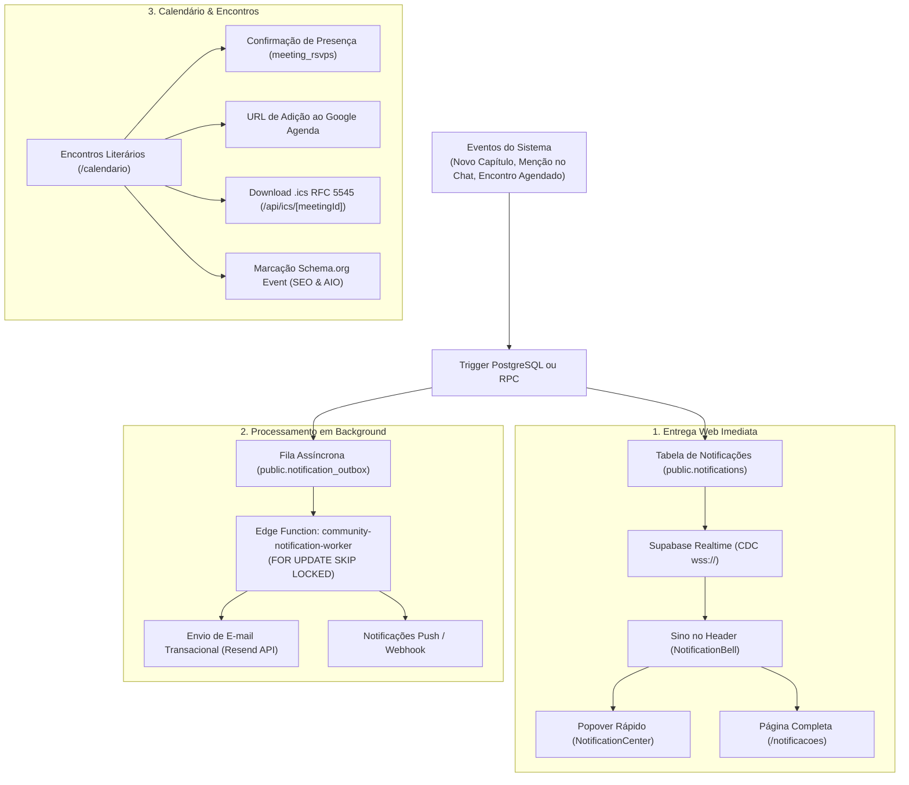

# 02.6 — Central de Notificações, Outbox & Eventos de Calendário

> **Documento:** Engenharia de Notificações, Fila Outbox Assíncrona, Calendário Comunitário e Padrão RFC 5545  
> **MOC Principal:** [[DIYSpur - Master Index]]  
> **Documento Pai:** [[02 - Mapeamento de Funcionalidades]]  
> **Tags:** `#notificacoes` `#outbox` `#calendario` `#ics` `#rfc5545` `#schema-org` `#agendamento`

---

## 1. Visão Sistêmica de Notificações e Agendamento

O ecossistema de comunicação do DIYSpur combina entrega em tempo real na interface web com mensageria assíncrona tolerante a falhas (Outbox Pattern) e integração profunda com agendas pessoais (Google Calendar e arquivos `.ics`):



---

## 2. O Subsistema de Notificações (15 Tipos Canônicos)

As notificações do leitor são governadas pelo tipo ENUM `notification_kind`:

| Categoria | Tipo de Notificação | Gatilho Disparador | Destino & Rota de Redirecionamento |
|---|---|---|---|
| **Editorial** | `chapter_published` | Novo capítulo liberado na temporada. | `/capitulos/[id]` |
| **Editorial** | `season_started` | Início de uma nova temporada de leitura. | `/temporadas/[slug]` |
| **Editorial** | `season_completed` | Conclusão do ciclo de leitura do livro. | `/temporadas/[slug]` |
| **Comunidade** | `club_invite_received` | Usuário convidado para um clube de leitura. | `/clubes/[slug]` |
| **Comunidade** | `club_invite_accepted` | Convidado aceitou o convite do clube. | `/clubes/[slug]` |
| **Discussões** | `club_message_mention` | Leitor mencionado com `@username` no chat. | `/clubes/[slug]/canais/[channelSlug]` |
| **Discussões** | `club_message_reply` | Resposta encadeada a uma mensagem do usuário. | `/clubes/[slug]/canais/[channelSlug]` |
| **Eventos** | `meeting_created` | Novo encontro literário agendado no clube. | `/eventos/[id]` |
| **Eventos** | `meeting_reminder_1h` | Lembrete de encontro começando em 1 hora. | `/eventos/[id]` |
| **Eventos** | `meeting_cancelled` | Cancelamento formal de um encontro. | `/calendario` |
| **Gamificação**| `streak_at_risk` | Sequência diária de leitura em risco de perda. | `/diario` |
| **Gamificação**| `achievement_unlocked`| Desbloqueio de medalha ou marco pedagógico. | `/perfil` |
| **Gamificação**| `season_ranked` | Atualização semanal de posição no ranking de XP. | `/ranking?tipo=xp` |
| **Moderação** | `report_resolved` | Denúncia submetida foi analisada e concluída. | `/` |
| **Sistema** | `system_announcement` | Comunicação geral de manutenção ou novidade. | URL customizada interna sanitizada |

---

## 3. Padrão Outbox e Worker de Infraestrutura

Para evitar que falhas de rede com serviços de terceiros (como a API do Resend) afetem as transações do banco, o DIYSpur utiliza a tabela **`notification_outbox`**:

### 3.1 Consumo com Concorrência Segura
A Edge Function `community-notification-worker` drena itens pendentes usando a cláusula `FOR UPDATE SKIP LOCKED`, garantindo que múltiplos pods de workers não processem a mesma notificação:

```sql
-- Drenagem atômica de notificações pendentes:
SELECT id, recipient_id, kind, title, body, payload 
FROM public.notification_outbox
WHERE status = 'pending' AND scheduled_at <= now()
ORDER BY scheduled_at ASC
LIMIT 50
FOR UPDATE SKIP LOCKED;
```

---

## 4. Encontros Literários e Calendário (`/calendario` e `/eventos/[id]`)

Os encontros virtuais e presenciais são armazenados na tabela `meetings` com vínculo contextual ao livro e capítulo em debate:

### 4.1 Estrutura do Encontro (`meetings`)
- `book_id`: Associação direta à obra sendo lida.
- `chapter_id`: Capítulo específico em debate (opcional).
- `club_id`: Clube anfitrião responsável pelo encontro.
- `scheduled_at`: Data e hora de início no fuso UTC.
- `duration_min`: Duração estimada em minutos (padrão 60).
- `meeting_url`: Link de videoconferência seguro (validação estrita de protocolo `https://`).
- `location`: Endereço físico ou identificador da sala virtual.
- `version`: Controle de versão para concorrência otimista.

### 4.2 Marcação Rica Schema.org Event (SEO-01)
Cada página de evento `/eventos/[id]` injeta um script JSON-LD com metadados estruturados:
```json
{
  "@context": "https://schema.org",
  "@type": "Event",
  "name": "Debate Semanal — Capítulos 1 a 4 de Verity",
  "startDate": "2026-10-22T23:00:00.000Z",
  "endDate": "2026-10-23T00:30:00.000Z",
  "eventAttendanceMode": "https://schema.org/OnlineEventAttendanceMode",
  "eventStatus": "https://schema.org/EventScheduled",
  "description": "Encontro virtual do clube de leitura DIYSPUR.",
  "location": {
    "@type": "VirtualLocation",
    "url": "https://meet.google.com/xyz-abcd-efg"
  },
  "organizer": {
    "@type": "Organization",
    "name": "DIYSPUR",
    "url": "https://diyspur.vercel.app"
  }
}
```

---

## 5. Exportação iCalendar em Conformidade RFC 5545

O endpoint `/api/ics/[meetingId]` gera dinamicamente arquivos de calendário com adesão estrita à especificação da Internet **RFC 5545**:

### 5.1 Regras de Formatação Obrigatórias
1. **Quebra de Linha em 75 Octetos (`foldIcsLine`):**  
   Nenhuma linha do arquivo `.ics` ultrapassa 75 bytes. Linhas mais longas são divididas com CRLF seguido de um espaço em branco (`\r\n `).
2. **Escape de Caracteres Especiais (`escapeIcs`):**  
   Barra invertida (`\`), quebras de linha (`\n`), vírgulas (`,`) e ponto-e-vírgula (`;`) são devidamente escapados com `\`. Caracteres de controle ASCII não imprimíveis são expurgados.
3. **Formatação de Datas em UTC ISO:**  
   As propriedades `DTSTART`, `DTEND` e `DTSTAMP` utilizam o formato canônico `YYYYMMDDTHHMMSSZ`.

---

## 6. Navegação Relacionada
- Consultar a modelagem de dados no PostgreSQL: [[01.1 - Modelo de Dados e Seguranca RLS]]
- Verificar a jornada de telas de eventos: [[03 - Jornada do Usuario e Fluxo de Telas#25-calendario-e-presenca-calendario]]
- Consultar o contrato da API de ICS: [[06.2 - Contrato de APIs HTTP, Edge Functions e Webhooks]]
- Voltar ao MOC central: [[DIYSpur - Master Index]]
