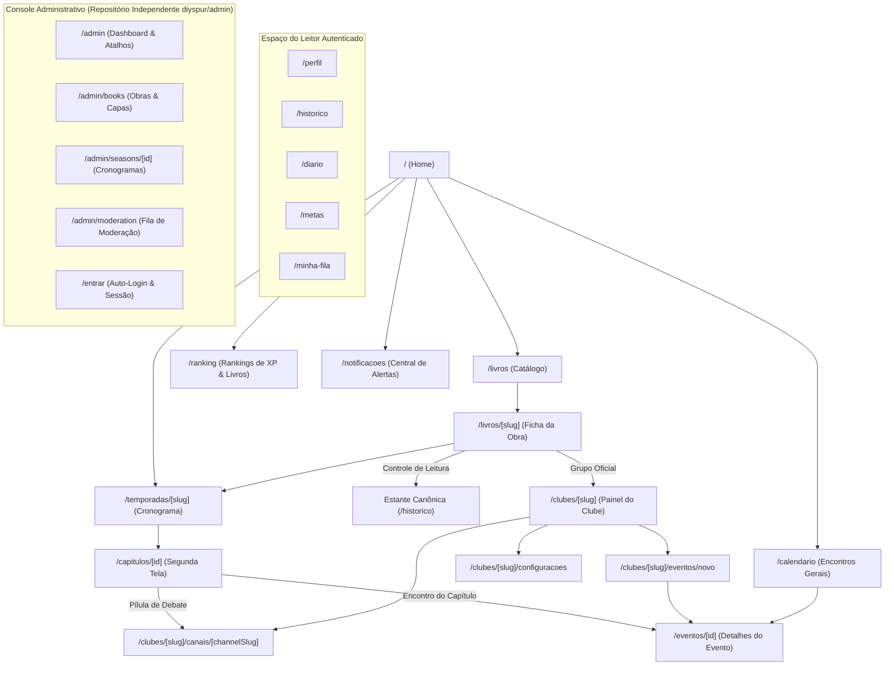

# 03 — Jornada do Usuário & Fluxo de Telas

> **Documento:** Engenharia de Telas, Transições de Estado, Interações do Usuário e Design Nimble  
> **MOC Principal:** [[DIYSpur - Master Index]]  
> **Tags:** `#ux` `#user-journey` `#telas` `#frontend` `#nextjs` `#design-nimble`

---

## 1. Fluxo Geral de Navegação da Aplicação

O ecossistema DIYSpur possui uma malha de navegação interconectada que orienta o leitor através de rotas intuitivas sem caminhos sem saída (*dead ends*):

---

## 2. Detalhamento Tela a Tela

### 2.1 Página Inicial / Landing (`/`)
- **Propósito:** Apresentar a proposta de segunda tela, destacar a leitura coletiva ativa e fornecer chamadas para ação (CTA) claras.
- **Componentes Nimble:** Hero com alto contraste, card da temporada ativa com capas com aspect-ratio preservado, agenda de encontros próximos e depoimentos de membros.
- **Touch Targets:** Botões principais com altura mínima de $48\text{px}$ e padding ergonômico.

---

### 2.2 Catálogo & Ficha da Obra (`/livros` e `/livros/[slug]`)
- **Propósito:** Descoberta de títulos e engajamento direto com a obra.
- **Recursos Integrados:**
  - **`BookReadingControl`:** Seletor de status canônico (`Quero Ler`, `Lendo`, `Lido`), seleção da edição específica (`book_edition_id`) e controle de página atual com cálculo instantâneo de percentual.
  - **`BookReadingStats`:** Contadores comunitários de leitores ativos, concluídos e ritmo coletivo de leitura.
  - **`BookCommunityPanel`:** Atalho direto para o Clube Oficial da obra (`official_book_groups`) e avisos de conteúdo (*content warnings*).

---

### 2.3 Segunda Tela do Capítulo (`/capitulos/[id]`)
- **Propósito:** Acompanhamento interativo do trecho da semana.
- **Componentes:**
  1. **`YouTubeFacade`:** Embed sob demanda que não consome dados até a interação do leitor, suportando salto temporal direto via parâmetro `?t=`.
  2. **`DiscussionEntryButton`:** Pílula contextual que guia o leitor diretamente para o canal de discussão correspondente ao capítulo.
  3. **Comentários Sincronizados:** Linha do tempo de comentários atrelados a segundos específicos do vídeo.
  4. **Quiz do Capítulo:** Perguntas de fixação pedagógica com correção segura no servidor.

---

### 2.4 Clubes & Canais de Discussão (`/clubes`, `/clubes/[slug]`, `/clubes/[slug]/canais/[channelSlug]`)
- **Propósito:** Espaço de diálogo comunitário e socialização literária.
- **Dinâmica do Workspace de Chat:**
  - **`ChannelDirectory`:** Navegação lateral entre `#geral`, `#spoilers` e `#capitulos`.
  - **`SpoilerConsent`:** Barreira modal para canais com spoiler, exigindo aceite registrado no banco.
  - **`ChannelChat`:** Feed de mensagens em tempo real com auto-scroll inteligente, suporte a respostas encadeadas (`reply`), bolhas de spoiler com blur e composer com atalho `Cmd/Ctrl + Enter`.

---

### 2.5 Calendário & Eventos (`/calendario`, `/eventos/[id]`, `/clubes/[slug]/eventos/novo`)
- **Propósito:** Agendamento e participação em debates virtuais ou presenciais.
- **Recursos:**
  - Cards com badges de livro e clube associados.
  - Página `/eventos/[id]` com marcação rica Schema.org Event (`JsonLd`).
  - Confirmação de presença em tempo real (RSVP).
  - Botão "Adicionar ao Google Agenda" e download de arquivo `.ics` rigorosamente compatível com a **RFC 5545**.

---

### 2.6 Ranking Comunitário (`/ranking`)
- **Propósito:** Reconhecimento e estímulo ao hábito de leitura.
- **Arquitetura de Abas via URL Query:**
  - `?tipo=xp`: Ranking da temporada com pontuação de quizzes e metas cumpridas.
  - `?tipo=livros`: Ranking dos livros mais lidos pela comunidade.

---

### 2.7 Estante do Leitor no Histórico (`/historico`)
- **Propósito:** Centralizar a vida literária do leitor.
- **Estrutura:** Abas com filtros por status de leitura (*Lendo*, *Quero Ler*, *Lidos*, *Pausados*) com acesso rápido à atualização de progresso e resenhas.

---

### 2.8 Central de Notificações (`/notificacoes`)
- **Propósito:** Gerenciamento unificado de alertas e avisos da comunidade.
- **Funcionalidades:**
  - Popover rápido no header (`NotificationCenter`) + página completa paginada.
  - Filtros por canal (`discussions`, `editorial`, `events`, `gamification`).
  - Ação em lote: "Marcar todas como lidas".
  - Configuração de canais ativos e horários silenciosos.

---

### 2.9 Console Administrativo & Moderação (Repositório Independente `diyspur/admin`)
- **Separação Arquitetural:** O console administrativo foi completamente desacoplado da aplicação do leitor (`diyspur-cloud/app`) e reside em seu próprio repositório dedicado ([diyspur/admin](https://github.com/diyspur/admin)), com deploy independente em `admin.diyspur.com` (ou Vercel isolado).
- **Propósito:** Operação editorial, governança de comunidade, gerenciamento do catálogo e curadoria de conteúdo com privilégios de `service_role` e isolamento total de pacotes e rotas.
- **Navegação Global:** O admin possui cabeçalho persistente (`AdminNav`) com menu clicável em todas as telas para alternância ágil entre Dashboard (`/admin`), Livros (`/admin/books`), Temporadas (`/admin/seasons`) e Moderação (`/admin/moderation`), além de seletor de tema.
- **Autenticação e Auto-Login:**
  - Conta administrativa dedicada pré-configurada no Supabase Auth.
  - Endpoint `/api/auth/auto-login` e componente `AutoAuth` para autenticação silenciosa de desenvolvedores e operadores autorizados, com persistência via cookie seguro `diyspur_admin_session`.
  - Endpoint `/api/auth/create-admin` para provisionamento automático do usuário `admin@diyspur.com` na inicialização do serviço.
- **Telas Principais:**
  - `/admin`: Dashboard executivo com contadores de livros cadastrados, temporadas ativas, pendências de moderação e atalhos rápidos.
  - `/admin/books`: Catálogo com upload de capas via HTTPS obrigatório e criação rápida de obras.
  - `/admin/seasons`: Listagem de temporadas canônicas cadastradas.
  - `/admin/seasons/[id]`: Gestão de capítulos, cronograma semanal e pílulas de debate.
  - `/admin/moderation`: Fila de denúncias comunitárias (`content_reports`) com ações imediatas de ocultar conteúdo, resolver ou dispensar.

---

## 3. Padrões de Acessibilidade & Usabilidade Nimble

- **Áreas Táteis $\ge 48\text{px}$:** Aplicadas em botões, links, seletores de abas e ícones.
- **Marco Único `<main id="main-content">`:** Garantido em todas as páginas para navegação acessível.
- **Feedback Auditivo:** Regiões dinâmicas utilizam `aria-live="polite"` para leitores de tela.
- **Tratamento de Estados:** Todas as telas possuem estados de carregamento (*skeleton loaders*), estados vazios com ilustrações semânticas e mensagens claras de erro.

---

## 4. Navegação Relacionada
- Consultar os componentes e tokens de design: [[06.3 - Dicionario de Telas, Componentes e Design Tokens Nimble]]
- Conhecer a arquitetura dos canais de discussão: [[02.4 - Comunidade de Leitura, Clubes e Canais de Discussao]]
- Voltar ao MOC central: [[DIYSpur - Master Index]]
