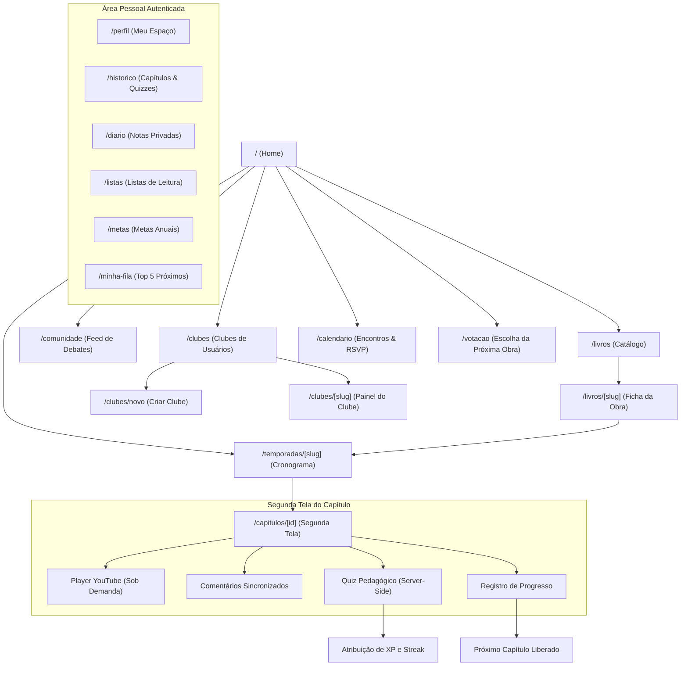

# 03 — Jornada do Usuário & Fluxo de Telas

> **Documento:** Engenharia de Telas, Transições de Estado e Interações do Usuário  
> **MOC Principal:** [[DIYSpur - Master Index]]  
> **Tags:** `#ux` `#user-journey` `#telas` `#frontend` `#nextjs`

---

## 1. Fluxo Geral de Navegação da Aplicação

O ecossistema DIYSpur possui uma navegação fluida que guia o leitor da descoberta inicial até a rotina regular de leitura:

---

## 2. Detalhamento Passo a Passo das Telas

### 2.1 Página Inicial / Landing (`/`)
- **Propósito:** Apresentar a proposta do clube, exibir a leitura coletiva atual e direcionar o leitor sem atrito.
- **Nível de Acesso:** Público.
- **Componentes Principais:**
  - Header com atalhos de navegação (*Explorar*, *Comunidade*, *Entrar* / *Meu Espaço*).
  - Hero com proposta de valor ("A segunda tela do seu livro").
  - Card da temporada ativa com capa da obra, autor, anfitrião e botão "Começar a ler junto".
  - Demonstração interativa da segunda tela (prévia do vídeo, quiz e comentários).
  - Agenda dos próximos encontros virtuais com botão de exportação.
  - Seção de depoimentos e rodapé com links institucionais e preferências de privacidade.
- **Transição:** O botão "Começar a ler junto" rola a tela até a âncora da temporada ativa, de onde o usuário clica para abrir `/temporadas/[slug]`.

---

### 2.2 Ficha do Livro & Catálogo (`/livros` e `/livros/[slug]`)
- **Propósito:** Permitir a descoberta de títulos no catálogo e fornecer a ficha técnica completa da edição.
- **Nível de Acesso:** Público.
- **Regras & Interações:**
  - Busca instantânea com *debounce* de 300ms prevenindo requisições desnecessárias.
  - A ficha da obra exibe sinopse, dados da edição (ISBN, número de páginas, editora recomendada) e **Avisos de Conteúdo** (*content warnings*) explícitos para garantir uma leitura confortável.
  - Botão de compra afiliada: redirecionamento transparente para a Amazon com tag oficial do clube.
  - Histórico de temporadas em que o livro já foi lido e botão "Adicionar à Minha Fila".

---

### 2.3 Cronograma da Temporada (`/temporadas/[slug]`)
- **Propósito:** Apresentar o plano de leitura estruturado semana a semana.
- **Nível de Acesso:** Público com liberação progressiva.
- **Regras & Interações:**
  - Lista de capítulos organizados por semana com indicação de páginas a serem lidas no exemplar físico/digital.
  - Indicador de status por capítulo: *Liberado*, *Bloqueado por Data* ou *Concluído* (para usuários logados).
  - Acesso direto ao primeiro capítulo ativo.

---

### 2.4 Segunda Tela do Capítulo (`/capitulos/[id]`) — *O Núcleo da Aplicação*
- **Propósito:** Acompanhar uma etapa de leitura com suporte multimídia, debate e fixação pedagógica.
- **Nível de Acesso:** Leitura pública / Ações exigem autenticação.
- **Componentes e Dinâmica:**
  1. **Player de Vídeo YouTube:** Não inicia automaticamente. O leitor clica em "Assistir vídeo" para carregar o player sob demanda, economizando dados e banda.
  2. **Comentários Sincronizados:** O leitor pode pausar o vídeo e publicar uma reflexão associada ao segundo exato da reprodução (ex.: segundo 150 = 2m30s).
  3. **Proteção Anti-Spoiler:**
     - Comentários sinalizados com a flag de spoiler aparecem com o texto borrado/mascarado.
     - Botão "Revelar comentário" permite que o leitor destrave a leitura caso deseje.
  4. **Controle de Progresso:** Seletor de percentual lido. Ao clicar em "Concluir capítulo", o sistema grava 100% no banco de dados e impede regressão acidental.
  5. **Quiz do Capítulo:** 
     - Exibe 3 a 5 perguntas elaboradas pela equipe editorial.
     - O botão de envio permanece desabilitado até que todas as questões sejam respondidas.
     - A correção ocorre exclusivamente no servidor via Edge Function, devolvendo o score e concedendo os pontos de XP correspondentes.
  6. **Navegação de Encerramento:** Card que felicita a conclusão e oferece link direto para o próximo capítulo liberado.

---

### 2.5 Calendário e Presença (`/calendario`)
- **Propósito:** Divulgar as datas dos encontros semanais ao vivo de discussão.
- **Nível de Acesso:** Público para visualização; confirmação de presença (RSVP) requer login.
- **Funcionalidades:**
  - Visualização cronológica com links de transmissão (YouTube Live / Google Meet).
  - Botão "Adicionar ao Google Agenda".
  - Download de arquivo `.ics` para integração com Apple Calendar e Outlook.

---

### 2.6 Votação da Próxima Leitura (`/votacao`)
- **Propósito:** Permitir que a comunidade decida democraticamente a obra da temporada seguinte.
- **Nível de Acesso:** Requer autenticação para votar; resultados públicos após o encerramento.
- **Regras:**
  - Cada leitor tem direito a 1 voto por enquete ativa.
  - A apuração dos votos é agregada pelo PostgreSQL sem expor o voto individual de cada participante.

---

### 2.7 Gestão de Clubes de Leitores (`/clubes`, `/clubes/novo`, `/clubes/[slug]`)
- **Propósito:** Permitir que usuários criem seus próprios clubes de leitura independentes.
- **Nível de Acesso:** 
  - Listagem de clubes públicos: aberta a todos.
  - Criação de clube: usuários autenticados.
  - Ficha e fórum de clube privado: restrito a membros autorizados por convite.
- **Regras de Autoridade:**
  - O criador é o `owner` definitivo.
  - Convites para outros membros são enviados por `@username`.

---

### 2.8 Espaço Pessoal do Leitor (`/perfil`, `/diario`, `/metas`, `/minha-fila`)
- **Propósito:** Centralizar a vida literária do leitor e promover a retenção a longo prazo.
- **Sub-telas:**
  - **`/perfil`:** Resumo de medalhas conquistadas, nível de leitor, total de XP, capítulos lidos e atalho para exportação LGPD.
  - **`/diario`:** Diário íntimo com notas de leitura privadas (`owner_only`), anotação de páginas e minutos investidos.
  - **`/metas`:** Metas anuais (ex.: ler 24 livros no ano) com barra de progresso em tempo real baseada nos capítulos e livros finalizados.
  - **`/minha-fila`:** Lista estrita com os próximos 5 livros da fila de prioridade de leitura.

---

### 2.9 Console Administrativo (`/admin/**`)
- **Propósito:** Operação editorial, moderação de comentários e gestão de catálogo.
- **Nível de Acesso:** Estritamente restrito a usuários com `role = 'admin'`.
- **Módulos:**
  - `/admin/books`: Cadastro e edição de títulos e metadados.
  - `/admin/seasons`: Configuração de novas temporadas, datas e uploads de capas.
  - `/admin/moderation`: Fila de denúncias de comentários com ações de manter ou remover.

---

## 3. Navegação Relacionada
- Consultar o modelo de dados que suporta essas telas: [[01.1 - Modelo de Dados e Seguranca RLS]]
- Verificar a estratégia de conteúdo multimídia: [[04 - Estrategia de Conteudo e Redes Sociais]]
- Voltar ao MOC central: [[DIYSpur - Master Index]]
