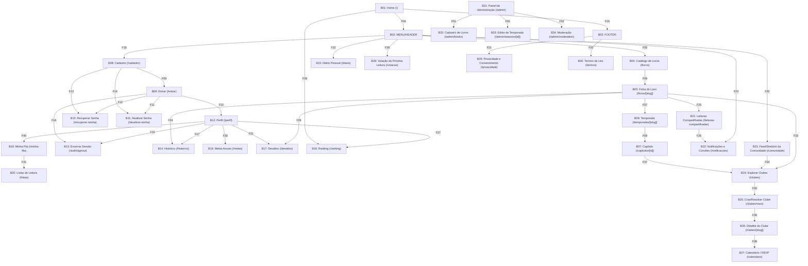

# 03 — Jornada do Usuário & Fluxo de Telas (Matriz Excalidraw 34 Blocos / 41 Setas)

> **Documento:** Mapeamento Integral dos 34 Blocos, 41 Conexões, Transições de Estado e Navegação  
> **MOC Principal:** [[DIYSpur - Master Index]]  
> **Fonte Visual:** [Diagrama Excalidraw](https://excalidraw.com/#json=tYaSpTqmPhVCEgYXJNKaC,dm9gQqoyh7phc89WMtSBBg)  
> **Tags:** `#ux` `#user-journey` `#telas` `#frontend` `#nextjs` `#excalidraw`

---

## 1. Grafo Integral de Navegação

A arquitetura de telas do DIYSPUR implementa estritamente os **34 blocos funcionais** e as **41 conexões (setas)** do diagrama oficial:

---

## 2. Inventário dos 34 Blocos e Comportamento Funcional

| Bloco | Rota / Superfície | Descrição e Especificação Técnica |
|---|---|---|
| **B01** | `/` (Home) | Entrada da aplicação com exibição da temporada ativa, catálogo e acesso ao ranking da temporada (**F28**). |
| **B02** | Header / Menu | Barra de navegação global com links diretos para Catálogo, Cadastro, Diário, Notificações, Comunidade e Votação. |
| **B03** | Footer | Rodapé global com links institucionais (Termos, Privacidade, Suporte) e redes sociais (Instagram, TikTok, YouTube). |
| **B04** | `/livros` | Catálogo de livros completo com busca por título e paginação. |
| **B05** | `/livros/[slug]` | Ficha detalhada do livro com controle único "Sua leitura" (`BookReadingControl`), CTA único "Grupo do livro" (`DiscussionEntryButton`), link para temporada (**F07**), histórico (**F24**), convite por e-mail (**F25**) e desafios (**F29**). |
| **B06** | `/temporadas/[slug]` | Cronograma da temporada do livro com capítulos publicados e bloqueados. |
| **B07** | `/capitulos/[id]` | Segunda tela de vídeo, controle de progresso (`ChapterProgress`), botão "Comentar no grupo" e quiz. |
| **B08** | `/cadastro` | Criação de conta de usuário com confirmação por e-mail. |
| **B09** | `/entrar` | Login com suporte a `redirect` para retorno ao contexto prévio do leitor. |
| **B10** | `/recuperar-senha` | Solicitação de link de redefinição de credenciais. |
| **B11** | `/atualizar-senha` | Formulário seguro para nova senha sob token de recuperação verificado. |
| **B12** | `/perfil` | Central do leitor: links para Histórico, Metas, Desafios, Minha Fila, Rankings e Logout. |
| **B13** | `/auth/signout` | Endpoint HTTP POST para encerramento atômico de sessão. |
| **B14** | `/historico` | Estante sincronizada: exibe instantaneamente os livros marcados como "Estou lendo" na ficha do livro e o avanço capítulo a capítulo. |
| **B15** | `/diario` | Notebook pessoal para anotações privadas de livros, com suporte a múltiplos registros sem obrigatoriedade de métricas de páginas/minutos. |
| **B16** | `/metas` | Gestão de metas pessoais flexíveis por usuário, atualizadas automaticamente a cada livro concluído. |
| **B17** | `/desafios` | Desafios editoriais publicados pelos administradores para incentivar a leitura e conceder XP após ações completadas. |
| **B18** | `/ranking` & `/ranking/livros` | Ranking da Temporada (XP) e Rankings de Livros (Mais lidos, Lendo agora, Concluídos, Desistências). |
| **B19** | `/minha-fila` | Playlist pessoal contínua para priorização de leitura (sem restrição artificial de 5 itens) e link para listas (**F41**). |
| **B20** | `/listas` | Listas de leitura pessoais, públicas ou compartilhadas com colaboradores autorizados. |
| **B21** | `/leituras-compartilhadas` | Espaço de leitura em grupo com convite de livros por e-mail para amigos. |
| **B22** | `/notificacoes` | Central de notificações: convites recebidos, datas de encontros e lançamento de temporadas dos livros em leitura. |
| **B23** | `/comunidade` | Diretório geral de clubes oficiais por livro ("Tem a lista de todos os clubes"). |
| **B24** | `/clubes` | Exploração de clubes oficiais com busca e paginação. |
| **B25** | `/clubes/novo` | Resolvedor contextual: recebe `?livro=<UUID>`, entra no clube existente ou cria o grupo com os canais `sem-spoilers` e `com-spoilers`. |
| **B26** | `/clubes/[slug]` | Hub do clube oficial com canais padrão, canais por capítulo e agenda de encontros. |
| **B27** | `/calendario` | Agenda de encontros com confirmação de presença (RSVP). |
| **B28** | `/votacao` | Enquetes da comunidade para escolha das próximas obras a serem debatidas. |
| **B29** | `/privacidade` | Política de privacidade e governança de dados pessoais (LGPD). |
| **B30** | `/termos` | Termos de uso e diretrizes comunitárias. |
| **B31** | `/admin` | Painel de administração geral com atalhos para Livros, Temporadas e Moderação. |
| **B32** | `/admin/books` | Gestão do catálogo editorial de livros e metadados. |
| **B33** | `/admin/seasons/[id]` | Editor da temporada e capítulos do livro. |
| **B34** | `/admin/moderation` | Painel de revisão de denúncias e sanções de moderação. |

---

## 3. Especificações Visuais e Micro-Interações Next-Gen (Refatoração UI/UX)

A refatoração visual e funcional do ecossistema DIYSpur elevou a experiência de navegação e retenção, adotando a linguagem de design futurista e minimalista com aceleração por GPU (60fps P99):

### 3.1 B01 — Home Mission Control (`/`)
- **Aura Atmosférica Dinâmica:** Radial gradient no topo (`from-brand-500/10 via-brand-600/5 to-transparent`) com `pointer-events-none` sem repintura do layout.
- **Badge Operacional em Tempo Real:** Indicador com animação contínua `animate-pulse-glow` e ponto de status verde esmeralda (`bg-emerald-500`), informando a temporada e capítulos ativos.
- **Hero Foco e Fitts/Hick:** Título responsivo com destaque em gradiente futurista (`bg-gradient-to-r from-white via-zinc-200 to-zinc-400 bg-clip-text text-transparent`), subtítulo em densidade tipográfica compensada (380/480) e ações primárias/secundárias claras com `CyberButton`.
- **Bento-Grid de Descoberta:** Cards de destaque operacional encapsulados em `GlassCard` com micro-bordas de 1px e backdrop blur de 12px.

### 3.2 B02 — Sticky Frosted Glass Header (`SiteHeader`)
- **Profundidade Adaptativa:** Efeito de vidro jateado (`backdrop-blur-md bg-white/70 dark:bg-black/80`) com borda inferior de 1px (`border-zinc-200/80 dark:border-white/10`).
- **Navegação com Press States GPU:** Micro-interações táteis nos links (`active:scale-95 transition-transform duration-200`).
- **Menu Mobile com Animações Nativas:** Drawer responsivo sem flickering, bloqueio de scroll de fundo e foco acessível.

### 3.3 B04 & B05 — Catálogo e Ficha do Livro (`BookCard` e `DiscussionEntryButton`)
- **Cards com Specular Glow:** Efeito visual no hover com `scale-[1.01]` e transição de box-shadow (`shadow-brand-500/10`) executada estritamente via GPU.
- **Otimização de Imagens:** `next/image` com dimensões intrínsecas e `priority` opcional no Hero para evitar Layout Shifts (CLS = 0.000).
- **Ações Rápidas sem Atrito:** CTA contextual único para leitura (`BookReadingControl`) e entrada instantânea no grupo do livro (`DiscussionEntryButton`).

### 3.4 B07 — Segunda Tela do Capítulo HUD (`/capitulos/[id]`)
- **Controle de Leitura e Foco:** Barra de progresso do capítulo (`ChapterProgress`) com transição fluida, player de apoio e botão de entrada direta no canal de discussão do capítulo no clube oficial (`DiscussionEntryButton`).
- **Skeleton Screens Futuristas:** Substituição de spinners convencionais por `CyberSkeleton` com animação angular de `shimmer` a 60fps durante requisições assíncronas.

