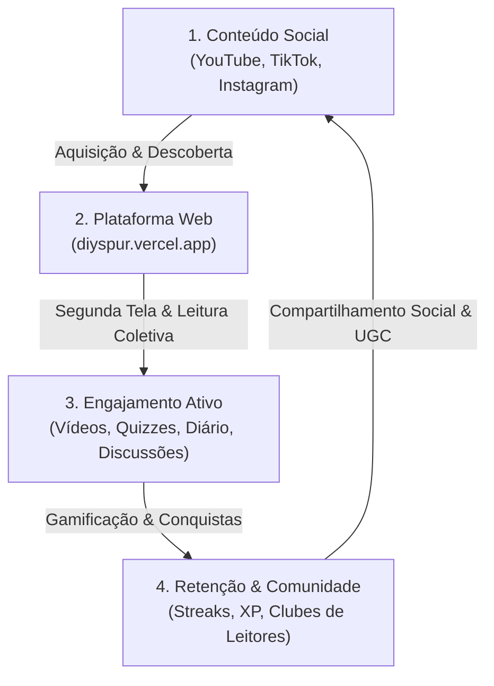

# 04 — Estratégia de Conteúdo & Redes Sociais

> **Documento:** Alinhamento Omnicanal, Produção Multimídia e Monetização  
> **MOC Principal:** [[DIYSpur - Master Index]]  
> **Tags:** `#conteudo` `#redes-sociais` `#youtube` `#tiktok` `#instagram` `#monetizacao`

---

## 1. O Flywheel de Conteúdo e Retenção do DIYSpur

A estratégia de crescimento do DIYSpur opera através de um ciclo contínuo (*flywheel*) onde a produção de conteúdo em mídias sociais e a experiência técnica da plataforma web se complementam e se impulsionam mutuamente:



---

## 2. Diretrizes Técnicas por Canal de Mídia

### 2.1 YouTube (Canal Oficial)
- **URL Oficial:** [YouTube Channel](https://www.youtube.com/channel/UC71Z6wmNZSuuMbC0_mHm6iw)
- **Formato:** Vídeos longos de contextualização (15 a 45 min) e transmissões ao vivo semanais (lives de debate).
- **Integração Técnica com a Plataforma:**
  - **Player sob Demanda:** A aplicação web não carrega o script pesado do player do YouTube de imediato. Ela renderiza uma fachada leve com a miniatura do vídeo; ao clicar em "Assistir vídeo", o iframe oficial é instanciado, preservando a performance do Core Web Vitals (LCP/CLS).
  - **Sincronização Temporal (`video_timestamp_seconds`):** A equipe editorial anota os momentos-chave do vídeo (ex.: introdução ao capítulo aos 01:30, análise de personagem aos 12:45). No chat do capítulo (`/capitulos/[id]`), comentários podem ser vinculados ao segundo exato, permitindo que outros membros naveguem diretamente para o ponto relevante do vídeo.
  - **Replays e Encontros Gravados:** Encontros ao vivo transmitidos no canal têm seus links de replay automaticamente associados à agenda em `/calendario`.

---

### 2.2 TikTok (`@diyspur`)
- **Perfil Oficial:** [@diyspur](https://www.tiktok.com/@diyspur)
- **Formato:** Vídeos verticais ultracurtos (30 a 90 segundos) focados em retenção rápida e alta taxa de repetição.
- **Linhas Editoriais:**
  1. *Cortes Provocativos:* Trechos dos melhores debates da live do YouTube com ganchos fortes sobre reviravoltas do enredo.
  2. *Desafio de Quiz:* "Você conseguiria acertar esse quiz do Capítulo 5 de Dom Casmurro?" — exibindo perguntas reais cadastradas na plataforma.
  3. *Recomendações Rápidas:* Destaques de livros com avisos de conteúdo e o motivo para ler em grupo.
- **Chamada para Ação (CTA):** Todos os vídeos direcionam para o link na bio (`diyspur.vercel.app`), convidando o usuário a responder o quiz completo e acompanhar o cronograma na web.

---

### 2.3 Instagram (`@diyspur`)
- **Perfil Oficial:** [@diyspur](https://www.instagram.com/diyspur/?hl=en)
- **Formato:** Carrosséis estéticos, Stories diários e Reels dinâmicos.
- **Alinhamento Visual:**
  - Uso estrito das diretrizes visuais do **Nimble Design System** (paleta suave, tipografia legível, fundo limpo, sem poluição de elementos genéricos).
- **Estratégia de Publicação:**
  - *Início da Temporada:* Carrossel com capa da obra, sinopse, perfil do anfitrião e **Avisos de Conteúdo** (*trigger warnings*) para garantir uma leitura acolhedora e informada.
  - *Durante a Semana:* Stories com enquetes interativas sincronizadas com as votações do site (`/votacao`), lembretes dos encontros virtuais com link direto para o Google Calendar e stickers de contagem regressiva para a live.

---

## 3. Modelo de Monetização e Sustentabilidade

A plataforma foi planejada com um modelo de negócio híbrido, ético e sustentável:

```
┌────────────────────────────────────────────────────────────────────────┐
│                        MODELO DE MONETIZAÇÃO                           │
├────────────────────────────────────────────────────────────────────────┤
│  FASE ATUAL: AFILIADOS TRANSPARENTES                                   │
│  • Integração com o Programa de Associados da Amazon.                 │
│  • Redirecionamento através de links rastreados de forma anônima.      │
│  • Conformidade legal: aviso claro em /termos informando que compras   │
│    realizadas geram uma pequena comissão que mantém o projeto sem      │
│    cobrança adicional ao leitor.                                       │
├────────────────────────────────────────────────────────────────────────┤
│  FASE ATUAL: CAPTAÇÃO DE AUDIÊNCIA (NEWSLETTER)                        │
│  • Captação de e-mails via opt-in explícito.                           │
│  • Curadoria editorial semanal com resumos e links dos encontros.      │
├────────────────────────────────────────────────────────────────────────┤
│  ROADMAP: PLANOS DE ASSINATURA / CLUBE VIP                             │
│  • Estrutura de webhooks do Stripe já prevista no schema do backend.   │
│  • Acesso a encontros fechados com autores, emblemas exclusivos no    │
│    perfil e clubes privados ilimitados.                                │
└────────────────────────────────────────────────────────────────────────┘
```

---

## 4. Matriz de Alinhamento Conteúdo-Plataforma

| Etapa da Jornada | Ação nas Redes Sociais | Resposta na Aplicação Web |
|---|---|---|
| **Lançamento de Temporada** | Anúncio em vídeo no YouTube + Carrossel no Instagram com dados da edição e avisos de conteúdo. | Obra em destaque na Home (`/`), botão de compra com afiliado e liberação do cronograma em `/temporadas/[slug]`. |
| **Leitura Semanal** | Vídeo de contexto no YouTube + Cortes dinâmicos no TikTok provocando sobre o tema do trecho. | Desbloqueio da semana em `/capitulos/[id]`, discussão no chat com timestamps do vídeo e quiz de validação. |
| **Encontro Virtual** | Live aberta no YouTube com chat ao vivo. | Agenda com confirmação de presença (RSVP) em `/calendario` e sincronização automática com Google Agenda e Apple Calendar (.ics). |
| **Fechamento de Ciclo** | Vídeo de encerramento no YouTube e enquetes preliminares nos Stories do Instagram. | Enquete democrática com apuração agregada no servidor em `/votacao` para definir a próxima leitura coletiva. |

---

## 5. Navegação Relacionada
- Consultar a jornada do usuário no app: [[03 - Jornada do Usuario e Fluxo de Telas]]
- Conhecer a arquitetura de software completa: [[01 - Arquitetura Frontend e Backend]]
- Retornar ao índice mestre: [[DIYSpur - Master Index]]
