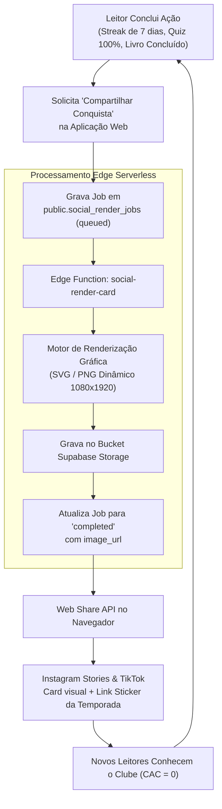

# 04.1 — Motor de Compartilhamento Social & Viral Loops

> **Documento:** Pipeline Assíncrono de Cartões Sociais, Formatos Verticais e UGC  
> **MOC Principal:** [[DIYSpur - Master Index]]  
> **Documento Pai:** [[04 - Estrategia de Conteudo e Redes Sociais]]  
> **Tags:** `#social-media` `#growth` `#ugc` `#social-render` `#stories` `#tiktok`

---

## 1. O Loop Viral de Conteúdo Gerado pelo Usuário (UGC)

O DIYSpur não depende de anúncios pagos para crescer. Sua estratégia de aquisição é impulsionada por um **motor de renderização de cartões visuais** que transforma cada conquista do leitor em uma peça de conteúdo compartilhável nas redes sociais:



---

## 2. Modelagem do Banco e Fila de Jobs

A tabela `public.social_render_jobs` atua como a fila assíncrona de geração de imagens:

```sql
CREATE TABLE IF NOT EXISTS public.social_render_jobs (
  id           uuid primary key default gen_random_uuid(),
  user_id      uuid not null references public.profiles(id) on delete cascade,
  kind         social_template_kind not null,     -- 'streak_milestone', 'quiz_mastery', 'book_completion'
  payload      jsonb not null default '{}'::jsonb, -- Dados dinâmicos (título, dias, pontuação)
  status       social_render_status not null default 'queued', -- 'queued','rendering','completed','failed'
  image_url    text,
  error        text,
  created_at   timestamptz not null default now(),
  rendered_at  timestamptz
);

-- Políticas RLS estritas de isolamento
ALTER TABLE public.social_render_jobs ENABLE ROW LEVEL SECURITY;

CREATE POLICY "srj_own_read" ON public.social_render_jobs 
  FOR SELECT USING (user_id = (SELECT auth.uid()) OR public.is_admin());

CREATE POLICY "srj_own_insert" ON public.social_render_jobs 
  FOR INSERT WITH CHECK (user_id = (SELECT auth.uid()));
```

---

## 3. Catálogo de Modelos Visuais (*Templates*)

| Template Kind | Dimensões | Objetivo e Composição Visual | Gatilho no Produto |
|---|---|---|---|
| `streak_milestone` | 1080 × 1920 (Vertical 9:16) | Exibe número de semanas consecutivas lendo, ícone de fogo/chama e citação provocativa sobre constância. | Atingir 4, 8 ou 12 semanas de ofensiva ativa. |
| `quiz_mastery` | 1080 × 1920 (Vertical 9:16) | "Gabaritei o Quiz do Capítulo X de *Verity*". Exibe a pontuação de 100%, XP conquistado e avatar do leitor. | Submissão com nota máxima na tela `/capitulos/[id]`. |
| `book_completion` | 1080 × 1350 (Retrato 4:5) | Capa oficial do livro, nota de estrelas pessoal, data de término e resumo da reflexão final. | Marcar obra como concluída na estante. |
| `quote_highlight` | 1080 × 1080 (Quadrado 1:1) | Trecho sublinhado pelo leitor no diário com tipografia clássica e assinatura DIYSpur. | Opção "Exportar citação" no `/diario`. |

---

## 4. Integração Nativa com Dispositivos Móveis

Quando a Edge Function conclui a renderização do card em PNG de alta resolução:
1. **No Navegador Mobile (iOS/Android):** O botão "Compartilhar no Instagram" aciona a **Web Share API** nativa (`navigator.share({ files: [blob] })`), abrindo a folha nativa de compartilhamento direto para os Stories ou feed do TikTok.
2. **Fallback no Desktop:** O sistema exibe um modal elegante permitindo o download direto da imagem ou a cópia do link permanente para a área de transferência.

---

## 5. Navegação Relacionada
- Consultar a estratégia geral de mídias: [[04 - Estrategia de Conteudo e Redes Sociais]]
- Ver os fluxos e telas de perfil e diário: [[03 - Jornada do Usuario e Fluxo de Telas#7-espaco-pessoal-do-leitor-perfil-diario-metas-minha-fila]]
- Retornar ao índice mestre: [[DIYSpur - Master Index]]
