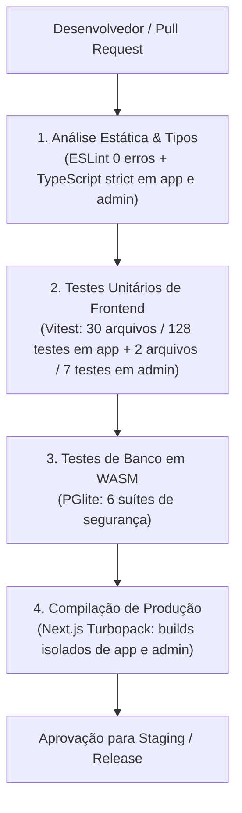

# 05.1 — Relatório de QA, Casos de Teste & Quality Gates

> **Documento:** Cobertura de Testes Automatizados, Quality Gates de CI/CD e Garantias Anti-Regressão  
> **MOC Principal:** [[DIYSpur - Master Index]]  
> **Tags:** `#qa` `#vitest` `#pglite` `#quality-gates` `#ci-cd` `#regressao`

---

## 1. Visão Geral da Estratégia de Qualidade

A garantia da qualidade do ecossistema DIYSpur opera em quatro níveis sucessivos de verificação:



---

## 2. Quality Gates Estritos

Para que qualquer código seja integrado ou publicado, todos os 5 gates devem apresentar **100% de aprovação sem nenhuma supressão (`@ts-ignore`, `@ts-nocheck` ou `eslint-disable`)**:

| Gate | Repositório | Ferramenta | Comando de Execução | Critério de Aceitação | Resultado Atual |
|---|---|---|---|---|:---:|
| **G1: Tipagem Estrita** | `app` + `admin` | TypeScript 5.8 | `npm run typecheck` | 0 erros em modo `strict: true`. | **APROVADO (0 erros)** |
| **G2: Estilo e Lints** | `app` + `admin` | ESLint 9 + Next Plugin | `npm run lint` | 0 erros, 0 avisos em todo o código. | **APROVADO (0 erros)** |
| **G3: Testes Leitor (`app`)**| `app` | Vitest | `npm test` | 100% dos testes unitários passando. | **APROVADO (132/132)** |
| **G3b: Testes Admin (`admin`)**| `admin` | Vitest | `npm test` | 100% dos testes unitários de retaguarda. | **APROVADO (7/7)** |
| **G4: Integridade do Banco**| `app` (`db/`) | PGlite (WASM) | `npm test` (security-smoke) | Todas as assertions de RLS e RPCs verdes. | **APROVADO (6/6 suítes)** |
| **G5: Build de Produção** | `app` + `admin` | Next.js 16 (Turbopack) | `npm run build` | Bundling completo sem quebras. | **APROVADO (Exit code 0)**|

---

## 3. Inventário dos Testes Unitários no Frontend (`app`)

A suíte da aplicação do leitor executada pelo Vitest cobre 31 arquivos de testes e 132 cenários unitários:

```
Test Files  31 passed (31)
     Tests  132 passed (132)
  Duration  2.94s
```

### 3.1 Categorias e Arquivos de Teste
1. **Discussões e Canais Canônicos:**
   - `tests/unit/discussion-contract.test.ts` (4 testes): Slugs canônicos `sem-spoilers` e `com-spoilers`, helper `groupEntryHref` e schemas de resolução.
   - `tests/unit/discussion-schemas.test.ts` (10 testes): Validação de mensagens de chat, tamanho máximo de texto, formatação de spoilers e payloads de canais.
   - `tests/unit/community-navigation.test.ts` (9 testes): Sanitização de caminhos internos (`sanitizeInternalHref`), bloqueio de Open Redirect e esquemas perigosos.
2. **Leitura Canônica e Metadados:**
   - `tests/unit/reading-state.test.ts` (9 testes): Máquina de estados de leitura, validação de transições válidas e rejeição de saltos proibidos.
   - `tests/unit/chapter-schemas.test.ts` (3 testes): Schemas de capítulos, limites de páginas e validação de URLs seguras do YouTube.
   - `tests/unit/chapter-label.test.ts` (4 testes): Formatação amigável de títulos e numeração de semanas.
3. **Encontros e Calendário:**
   - `tests/unit/calendar-links.test.ts` (5 testes): Geração de links para Google Agenda, Schema.org Event (`JsonLd`), escape de `.ics` RFC 5545 e validação de URLs HTTPS.
   - `tests/unit/meeting-context.test.ts` (5 testes): Associação correta de encontros com livros, capítulos e clubes anfitriões.
   - `tests/unit/meeting-state.test.ts` (4 testes): Estados de presença (RSVP: attending, maybe, declined).
   - `tests/unit/upcoming-meetings.test.ts` (2 testes): Filtragem e ordenação cronológica de encontros futuros.
4. **Notificações:**
   - `tests/unit/notification-presentation.test.ts` (5 testes): Mapeamento dos 15 tipos de notificação, ícones semânticos e labels em português (`pt-BR`).
5. **Clubes e Membresia:**
   - `tests/unit/clubs-schemas.test.ts` (6 testes): Validação de criação de clubes, slugs e regras de visibilidade (público vs privado).
   - `tests/unit/club-invites.test.ts` (4 testes): Ciclo de convites para outros leitores e tratamento de permissões.
6. **Segurança e Tratamento de Erros:**
   - `tests/unit/safe-redirect.test.ts` (11 testes): Bloqueio absoluto de Open Redirect no parâmetro `returnUrl` de login e autenticação.
   - `tests/unit/database-errors.test.ts` (5 testes): Tradução de códigos de erro do PostgreSQL para mensagens amigáveis ao usuário final.
   - `tests/unit/observability-logger.test.ts` (2 testes): Sanitização de logs estruturados sem vazamento de dados pessoais (PII).
7. **Gamificação, Metas e Engajamento:**
   - `tests/unit/goals-schemas.test.ts` (2 testes): Metas anuais e cálculos de progresso.
   - `tests/unit/goals-progress.test.ts` (2 testes): Projeção de conclusão de metas com base na velocidade média de leitura.
   - `tests/unit/polls.test.ts` (3 testes): Schemas de enquetes de votação do próximo livro.
   - `tests/unit/analytics-events.test.ts` (4 testes): Validação do contrato estrito de telemetria PostHog (`ProductEventMap`).
   - `tests/unit/analytics-consent.test.ts` (4 testes): Respeito ao opt-in do leitor antes de enviar eventos de telemetria.

### 3.2 Inventário dos Testes Unitários no Admin (`admin`)

O repositório independente [diyspur/admin](https://github.com/diyspur/admin) possui sua própria suíte de testes unitários isolada via Vitest:

```
Test Files  2 passed (2)
     Tests  7 passed (7)
  Duration  374ms
```

1. **Ações Editoriais e Gestão de Livros:**
   - `tests/unit/admin-book-actions.test.ts` (4 testes):
     - `createBookAction`: Rejeita inserção com dados vazios ou inválidos via schema Zod.
     - `createBookAction`: Rejeita URLs de capa não-HTTPS ou protocolos inseguros (`http://`, `javascript:`).
     - `createBookAction`: Normaliza slugs, trims e tags adequadamente.
     - `createBookAction`: Executa inserção com sucesso e registra log de auditoria editorial (`editorial_audit_log`).
2. **Manipulação Temporal e Datas ISO:**
   - `tests/unit/datetime-local.test.ts` (3 testes):
     - Conversão de timestamp ISO 8601 para formato `YYYY-MM-DDTHH:mm` aceito pelo input HTML5 `datetime-local`.
     - Tratamento defensivo de valores nulos, vazios ou indefinidos sem lançar exceções.
     - Preservação exata do fuso horário local e formatação com zero à esquerda.

---

## 4. Bateria de Testes em Banco de Dados (`db/scripts/security-smoke`)

O backend executa uma bateria em ambiente isolado utilizando PostgreSQL compilado em WebAssembly (PGlite):

1. **`test.mjs`:** Políticas de isolamento RLS, anonimização de spoilers para leitores elegíveis e bloqueio de consultas diretas a dados de outros usuários.
2. **`business-rules.mjs`:** Validação transacional de XP, contagem atômica de votos, descarte de respostas duplicadas de quizzes e idempotência de lembretes.
3. **`final-fixes.mjs`:** Concorrência otimista e verificação de bloqueios `SELECT ... FOR UPDATE`.
4. **`publication-visibility.mjs`:** Regras de visibilidade de capítulos: ocultação de semanas futuras para usuários anônimos e respeito ao cronograma editorial.
5. **`book-edition-metadata.mjs`:** Integração de edições de livros com cascata e sincronização de metadados.
6. **`community-discussions.mjs`:** Cobertura integral das migrações incrementais M01 a M12:
   - Invariantes de grupos oficiais do livro (`official_book_groups`).
   - Proteção de canais privados e verificação de consentimento de spoilers.
   - Bloqueio de respostas pai entre canais distintos (`cross_channel_parent_reply_denied`).
   - Concorrência otimista na edição de mensagens (`p_expected_version`).
   - Aplicação de sanções e banimentos de membros.
   - Transições estritas de leitura canônica (`trg_validate_book_reading_transition`).
   - Fila de outbox de notificações e isolamento do schema `private`.

---

## 5. Matriz de Garantia Anti-Regressão

| Área Funcional | Repositório | Teste Automatizado | Comportamento Assegurado |
|---|---|---|---|
| **Chat de Clubes** | `app` | `discussion-schemas.test.ts` + `community-discussions.mjs` | Mensagens mantêm integridade, versionamento otimista e isolamento entre canais. |
| **Status de Leitura** | `app` | `reading-state.test.ts` + `community-discussions.mjs` | Não é possível marcar livro como lido sem transitar pelo estado `reading`. |
| **Calendário** | `app` | `calendar-links.test.ts` + `meeting-context.test.ts` | Arquivos `.ics` seguem RFC 5545 e links externos exigem estritamente HTTPS. |
| **Notificações** | `app` | `notification-presentation.test.ts` + `community-discussions.mjs` | 15 tipos mapeados corretamente e processamento da outbox livre de concorrência destrutiva. |
| **Segurança Geral** | `app` | `safe-redirect.test.ts` + `test.mjs` | Zero brechas de Open Redirect, IDOR ou escalação de privilégios. |
| **Catálogo Editorial** | `admin` | `admin-book-actions.test.ts` | Exigência estrita de HTTPS nas capas, validação Zod e auditoria em `editorial_audit_log`. |
| **Cronogramas e Datas** | `admin` | `datetime-local.test.ts` | Formatação de input sem bugs de fuso horário na publicação de capítulos. |

---

## 6. Navegação Relacionada
- Consultar a auditoria de pentest e segurança: [[01.7 - Relatorio de Pentest, Seguranca Ofensiva e Matriz OWASP]]
- Verificar os procedimentos operacionais de staging: [[05.2 - Runbook de Operacao, Migracoes e Incidentes]]
- Voltar ao MOC central: [[DIYSpur - Master Index]]
