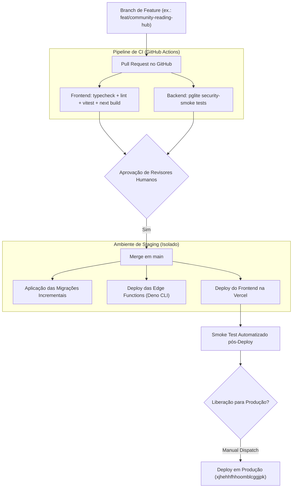

# 05.2 — Runbook de Operação, Migrações & Gestão de Incidentes

> **Documento:** Procedimentos Operacionais, Guia de Migrações do PostgreSQL, Deploy de Edge Functions e Resposta a Incidentes  
> **MOC Principal:** [[DIYSpur - Master Index]]  
> **Tags:** `#devops` `#runbook` `#migracoes` `#incidentes` `#deploy` `#observabilidade`

---

## 1. Princípios Operacionais e Segurança de Release

A sustentação do ecossistema DIYSpur segue diretrizes inegociáveis para garantir alta disponibilidade e integridade de dados:

1. **Imutabilidade do Histórico de Migrações:**  
   Arquivos históricos aplicados em produção nunca são editados retroativamente. Toda alteração estrutural no PostgreSQL é realizada via migrações estritamente incrementais e aditivas.
2. **Zero Comandos Destrutivos em Ambientes Compartilhados:**  
   Comandos como `supabase db reset`, `DROP DATABASE`, `TRUNCATE` ou deleções em massa sem cláusula `WHERE` são terminantemente proibidos em produção ou staging.
3. **Ambiente Read-Only de Demonstração:**  
   Em instâncias de homologação pública ou preview, a flag `DIYSPUR_READ_ONLY_PREVIEW=1` bloqueia mutações de dados no Supabase.

---

## 2. Fluxo de Release e Deploy Contínuo



---

## 3. Guia de Migrações do PostgreSQL

### 3.1 Nomenclatura Padrão
Toda nova migração deve seguir o formato de timestamp UTC:  
`YYYYMMDDHHMMSS_<descricao_semantica_em_snake_case>.sql`

### 3.2 Checklist de Verificação antes de Aplicar Migrações
- [ ] As políticas RLS utilizam subquery escalar `(SELECT auth.uid())` para ativação do InitPlan do otimizador.
- [ ] Todas as funções `SECURITY DEFINER` contêm `SET search_path = ''`.
- [ ] Nenhuma função do schema `private` foi concedida para `anon` ou `authenticated`.
- [ ] Índices cobrem chaves estrangeiras e campos de filtro frequente (ex.: `club_id`, `user_id`, `created_at`).
- [ ] Testes de regressão passam com 100% de sucesso no harness PGlite (`npm test` em `scripts/security-smoke`).

---

## 4. Gestão das 11 Edge Functions (Deno Runtime)

### 4.1 Configuração de Gateway em `supabase/config.toml`

```toml
# Funções protegidas com verificação obrigatória de JWT no gateway (padrão):
[functions.award-xp]
verify_jwt = true

[functions.quiz-validate]
verify_jwt = true

[functions.ai-recommendations]
verify_jwt = true

# Exceções estritas que validam sua própria autenticação no código:
[functions.stripe-webhook]
verify_jwt = false  # Autenticação via assinatura criptográfica HMAC do Stripe

[functions.scheduled-reminders]
verify_jwt = false  # Autenticação via header secreto de serviço em tempo constante

[functions.community-notification-worker]
verify_jwt = false  # Autenticação via secret de serviço para cron/scheduler interno
```

### 4.2 Agendamento de Crons e Workers
- **`scheduled-reminders`:** Invocado a cada 15 minutos via cron interno para processar lembretes de encontros com antecedência de 24h e 1h.
- **`community-notification-worker`:** Invocado a cada 1 minuto para drenar até 50 itens da fila `notification_outbox` usando `FOR UPDATE SKIP LOCKED`.

---

## 5. Resposta a Incidentes e Protocolos de Mitigação

### 5.1 Queda de Conectividade com o Supabase (Database Unreachable)
1. **Sintoma:** Next.js reporta erro de timeout ao conectar com o PostgREST ou chamadas retornam 503 Service Unavailable.
2. **Mitigação Imediata:**
   - O Next.js exibe telas de fallback graceful com o componente `EmptyState` informando indisponibilidade temporária.
   - Rotas estáticas continuam respondendo normalmente via cache de borda da Vercel.
3. **Procedimento de Recuperação:**
   - Consultar o status da infraestrutura em [status.supabase.com](https://status.supabase.com).
   - Verificar se o pool de conexões (PgBouncer / Supavisor) não atingiu o limite de saturação.

### 5.2 Erro 500 em Webhooks de Pagamento (Stripe)
1. **Sintoma:** O dashboard do Stripe registra falhas de entrega de webhook para `stripe-webhook`.
2. **Garantia Arquitetural:** O Stripe reenvia o webhook automaticamente com backoff exponencial por até 72 horas.
3. **Ação:**
   - Inspecionar a tabela `public.payment_events` no PostgreSQL para verificar se a linha foi inserida.
   - Conferir se o segredo `STRIPE_WEBHOOK_SECRET` confere com o configurado no painel do Stripe.

### 5.3 Sobrecarga ou Pico de Spoilers/Spam nos Clubes
1. **Sintoma:** Ataque coordenado de spammers enviando conteúdo inadequado nos canais públicos.
2. **Ação Rápida:**
   - Acionar a ferramenta administrativa em `/admin/moderation`.
   - Executar a ação de ocultar conteúdo em massa ou aplicar sanção de banimento direto no autor (`club_member_sanctions`).
   - Usuários banidos têm seus tokens de escrita revogados instantaneamente pela função `check_member_active_sanctions`.

---

## 6. Verificação de Saúde e Monitoramento (`/api/health`)

A aplicação disponibiliza um endpoint de health check em `/api/health` que valida:
- Conectividade ativa com o Supabase.
- Tempo de resposta da camada de dados ($< 150\text{ms}$).
- Versão do build e ambiente de execução.

---

## 7. Navegação Relacionada
- Consultar a arquitetura de observabilidade e métricas: [[01.6 - Observabilidade, Seguranca Web e Dicionario de Telemetria]]
- Consultar a cobertura de testes e quality gates: [[05.1 - Relatorio de QA, Casos de Teste e Quality Gates]]
- Voltar ao MOC central: [[DIYSpur - Master Index]]
