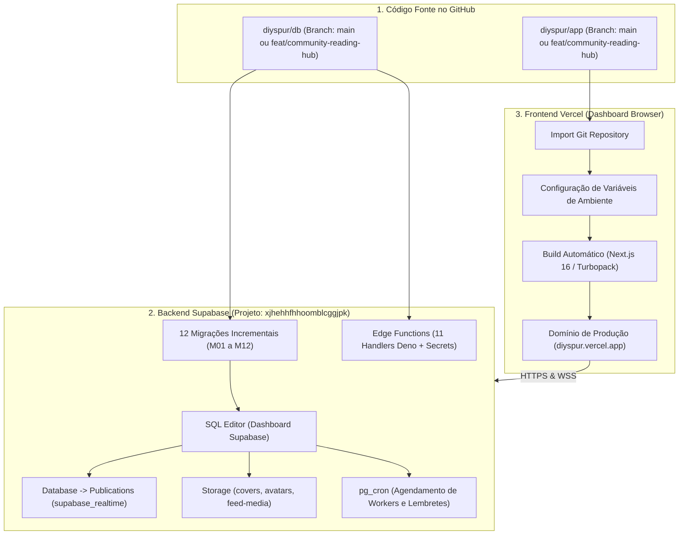

# 05.3 — Guia Completo de Deploy Vercel (Frontend) & Supabase (Backend)

> **Documento:** Procedimento Operacional Padrão (SOP) de Deploy via Browser na Vercel e no Supabase  
> **MOC Principal:** [[DIYSpur - Master Index]]  
> **Documento Pai:** [[05.2 - Runbook de Operacao, Migracoes e Incidentes]]  
> **Projeto Supabase:** `xjhehhfhhoomblcggjpk` (`https://xjhehhfhhoomblcggjpk.supabase.co`)  
> **Chave Pública Supabase:** `sb_publishable_c1sLn8rPxLg1z_DIAfc_Cg_J6UgGU1m`  
> **Tags:** `#deploy` `#vercel` `#supabase` `#producao` `#runbook` `#passo-a-passo`

---

## 1. Visão Geral da Arquitetura de Deploy

O ecossistema DIYSpur possui desacoplamento total entre o Frontend (Vercel Edge Network) e o Backend (Supabase PostgreSQL + Edge Runtime Deno):



---

## 2. PARTE 1: Deploy do Backend no Supabase

> [!IMPORTANT]
> **Regra de Ouro da Produção:** NUNCA execute `supabase db reset`, `DROP SCHEMA` ou comandos destrutivos. As migrações da Comunidade de Leitura são aditivas e incrementais (M01 a M12).

### 2.1 Acesso ao Painel do Supabase
1. Acesse o Supabase Dashboard: [supabase.com/dashboard](https://supabase.com/dashboard).
2. Selecione o projeto **`xjhehhfhhoomblcggjpk`** (ou acesse diretamente via URL do projeto).

---

### 2.2 Aplicação das 12 Migrações Incrementais via SQL Editor
No menu lateral esquerdo do Supabase, clique em **SQL Editor** (**New Query**).  
Execute os scripts na ordem estrita abaixo (arquivos localizados em `db/supabase/migrations/`):

1. **`20261017160100_official_book_groups.sql`** (M01):
   - Cria a tabela `official_book_groups`.
   - Adiciona triggers que auto-criam o clube oficial e canais ao cadastrar livros.
   - *Ação:* Cole o conteúdo no editor e clique em **Run**. Verifique `Success. No rows returned`.

2. **`20261017160200_club_discussions_schema.sql`** (M02):
   - Cria `club_channels`, `club_messages`, `club_message_reactions`, `channel_members_spoiler_consent`, `club_member_sanctions`.
   - *Ação:* Cole e execute (**Run**).

3. **`20261017160300_club_discussions_security.sql`** (M03):
   - Cria a função de segurança `private.is_channel_accessible(uuid)`.
   - Habilita RLS total nas tabelas de discussões com políticas de leitura e inserção restritas a membros.
   - *Ação:* Cole e execute (**Run**).

4. **`20261017160400_club_discussions_rpcs.sql`** (M04):
   - Implementa as RPCs transacionais: `post_club_message`, `edit_club_message` (com concorrência otimista `p_expected_version`), `delete_club_message`, `toggle_message_reaction` e `set_spoiler_consent`.
   - *Ação:* Cole e execute (**Run**).

5. **`20261017160500_canonical_book_readings.sql`** (M05):
   - Cria a tabela central `user_book_readings` e o enum `book_reading_status`.
   - Cria o trigger `trg_validate_book_reading_transition` que proíbe pular de `want_to_read` direto para `read`.
   - *Ação:* Cole e execute (**Run**).

6. **`20261017160600_book_reading_aggregates.sql`** (M06):
   - Cria as views públicas `v_book_community_stats`, `v_book_readers_leaderboard` e a view materializada `private.mv_book_community_stats`.
   - *Ação:* Cole e execute (**Run**).

7. **`20261017160700_book_scoped_meetings.sql`** (M07):
   - Adiciona colunas `book_id`, `chapter_id`, `duration_min` e `version` à tabela `meetings`.
   - Ajusta RLS para leitura pública em clubes abertos e escrita restrita a gestores/admins.
   - *Ação:* Cole e execute (**Run**).

8. **`20261017160800_notification_kinds_extension.sql`** (M08):
   - Adiciona com segurança os novos valores ao enum `notification_kind` (totalizando 15 tipos canônicos).
   - *Ação:* Cole e execute (**Run**).

9. **`20261017160900_notification_center_rpc.sql`** (M09):
   - Cria a RPC paginada `get_user_notifications_v2` e `mark_notifications_read`.
   - *Ação:* Cole e execute (**Run**).

10. **`20261017161000_community_notification_outbox.sql`** (M10):
    - Cria a tabela `notification_outbox` para desacoplamento assíncrono.
    - Cria RPCs `claim_notification_outbox` (com `FOR UPDATE SKIP LOCKED`) e `resolve_notification_outbox`.
    - *Ação:* Cole e execute (**Run**).

11. **`20261017161100_community_moderation_integration.sql`** (M11):
    - Cria o trigger que oculta automaticamente mensagens com 3 ou mais denúncias.
    - Cria a RPC `moderate_content_report` para moderadores/admins.
    - *Ação:* Cole e execute (**Run**).

12. **`20261017161200_community_jobs_and_release_guards.sql`** (M12):
    - Registra as proteções finais de integridade e constraints no banco.
    - *Ação:* Cole e execute (**Run**).

---

### 2.3 Ativação de Realtime CDC nas Novas Tabelas
No menu lateral, vá em **Database** $\to$ **Publications**:
1. Clique na publicação **`supabase_realtime`**.
2. Clique em **Edit tables**.
3. Certifique-se de que as seguintes tabelas estão marcadas para transmissão via WebSockets:
   - `comments`
   - `reactions`
   - `video_timed_comments`
   - `club_messages` *(Nova)*
   - `club_message_reactions` *(Nova)*
   - `notifications`
   - `meetings` *(Nova)*
   - `meeting_rsvps`
   - `feed_posts`
4. Clique em **Save**.

---

### 2.4 Configuração de Autenticação e Redirect URLs
No menu lateral, vá em **Authentication** $\to$ **URL Configuration**:
1. **Site URL:** Configure para o domínio oficial da Vercel (ex.: `https://diyspur.vercel.app`).
2. **Redirect URLs (Allow list):** Adicione as seguintes entradas:
   - `https://diyspur.vercel.app/**`
   - `https://diyspur.vercel.app/auth/callback`
   - `https://diyspur.vercel.app/atualizar-senha`
   - `http://localhost:3000/**` *(para testes locais caso necessário)*
3. Clique em **Save**.

---

### 2.5 Configuração de Secrets das Edge Functions
No menu lateral, vá em **Project Settings** $\to$ **Edge Functions**:
Adicione os segredos de ambiente que as funções utilizam:
- `SCHEDULED_REMINDERS_SECRET`: Gere uma string aleatória segura (ex.: `openssl rand -hex 32`) para autenticação de crons.
- `RESEND_API_KEY`: Chave da API do Resend para envio de e-mails.
- `RESEND_FROM_EMAIL`: E-mail remetente verificado (ex.: `contato@diyspur.com.br`).
- `STRIPE_SECRET_KEY` & `STRIPE_WEBHOOK_SECRET`: Credenciais do Stripe para pagamentos.
- `OPENAI_API_KEY`: Chave da OpenAI para geração de embeddings e recomendações.

---

### 2.6 Deploy das Edge Functions (CLI local ou GitHub Actions)
Caso execute o deploy das funções a partir do terminal local via Supabase CLI:
```bash
# Efetue login na CLI:
npx supabase login

# Vincule o projeto:
npx supabase link --project-ref xjhehhfhhoomblcggjpk

# Implante as 11 Edge Functions:
npx supabase functions deploy quiz-validate
npx supabase functions deploy award-xp
npx supabase functions deploy vote-next-book
npx supabase functions deploy scheduled-reminders --no-verify-jwt
npx supabase functions deploy community-notification-worker --no-verify-jwt
npx supabase functions deploy stripe-webhook --no-verify-jwt
npx supabase functions deploy newsletter-dispatch
npx supabase functions deploy ai-recommendations
npx supabase functions deploy ai-user-embeddings
npx supabase functions deploy match-readers
npx supabase functions deploy social-render-card
```

---

## 3. PARTE 2: Deploy do Frontend na Vercel (via Browser)

### 3.1 Criação do Projeto na Vercel
1. Acesse [vercel.com](https://vercel.com) e faça login na sua conta.
2. No painel de controle (Dashboard), clique em **Add New...** $\to$ **Project**.
3. Na seção **Import Git Repository**, localize o repositório do frontend:
   - Selecione **`diyspur/app`** (ou `diyspur-cloud/app`).
   - Clique em **Import**.

---

### 3.2 Configurações de Build e Diretório Raiz
Na tela de importação:
- **Project Name:** `diyspur` (ou o nome desejado).
- **Framework Preset:** `Next.js` (detectado automaticamente).
- **Root Directory:** `./` (deixe vazio ou padrão).
- **Build and Output Settings:** Deixe os valores padrão (`next build`, diretório `.next`).

---

### 3.3 Variáveis de Ambiente na Vercel (**Environment Variables**)
Expanda a seção **Environment Variables** e cadastre as variáveis abaixo:

| Nome da Variável | Valor Recomendado | Ambientes Selecionados |
|---|---|:---:|
| `NEXT_PUBLIC_SUPABASE_URL` | `https://xjhehhfhhoomblcggjpk.supabase.co` | Production, Preview, Development |
| `NEXT_PUBLIC_SUPABASE_PUBLISHABLE_KEY` | `sb_publishable_c1sLn8rPxLg1z_DIAfc_Cg_J6UgGU1m` | Production, Preview, Development |
| `NEXT_PUBLIC_SITE_URL` | `https://diyspur.vercel.app` *(ou sua URL da Vercel)* | Production, Preview, Development |
| `DIYSPUR_READ_ONLY_PREVIEW` | `0` *(Zero ativa mutações e escrita real em produção)* | Production |
| `NEXT_PUBLIC_READ_ONLY_PREVIEW` | `0` | Production |

*(Opcional: se utilizar Sentry ou PostHog em produção, adicione `NEXT_PUBLIC_SENTRY_DSN` e `NEXT_PUBLIC_POSTHOG_KEY`).*

---

### 3.4 Disparar o Deploy
1. Clique no botão azul **Deploy**.
2. A Vercel iniciará o pipeline:
   - Instalação de dependências (`npm install`).
   - Compilação com Turbopack (`next build`).
   - Geração das 27 páginas estáticas e otimização das rotas dinâmicas.
3. Aguarde o término (aproximadamente 1 a 2 minutos).
4. Ao concluir, você verá a tela de comemoração com o print do app e o botão **Continue to Dashboard** e a URL oficial (ex.: `https://diyspur.vercel.app`).

---

## 4. PARTE 3: Checklist de Smoke Test Pós-Deploy em Produção

Após concluir os dois deploys, execute esta checagem rápida no navegador acessando a URL pública da Vercel:

1. **Página Inicial (`/`):**
   - Acesse a Home. Verifique se o título, temporada ativa e cards carregam sem erros de console.
2. **Catálogo & Ficha da Obra (`/livros` e `/livros/verity`):**
   - Abra a página do livro.
   - Verifique se os componentes `BookReadingControl`, `BookReadingStats` e o atalho para o Clube Oficial estão visíveis.
3. **Autenticação:**
   - Faça login com uma conta de teste ou cadastre-se.
   - Altere o status de leitura para `Quero Ler` e depois para `Lendo` na página do livro.
4. **Discussões e Chat do Clube (`/clubes/clube-verity/canais/geral`):**
   - Acesse o canal `#geral` do clube oficial.
   - Envie uma mensagem de teste no chat. Verifique se ela aparece instantaneamente no feed.
   - Teste uma reação com emoji e uma resposta encadeada (*Reply*).
5. **Canal com Spoiler (`/clubes/clube-verity/canais/spoilers`):**
   - Acesse o canal de spoilers.
   - Verifique se a barreira modal de consentimento (`SpoilerConsent`) bloqueia o conteúdo até o clique em "Concordo".
6. **Calendário & Encontros (`/calendario` e `/eventos/[id]`):**
   - Abra a página de um encontro agendado.
   - Teste os botões de RSVP (*Confirmado*, *Talvez*).
   - Teste o botão "Google Agenda" (deve abrir o Google Calendar em nova aba com dados preenchidos).
   - Teste o botão de download `.ics` (deve baixar o arquivo `.ics` no seu computador).
7. **Ranking Comunitário (`/ranking`):**
   - Alterne entre as abas `tipo=xp` e `tipo=livros`.
8. **Central de Notificações (`/notificacoes`):**
   - Clique no ícone de sino no topo da página. O popover deve abrir.
   - Clique em "Ver todas as notificações". A página `/notificacoes` deve listar os eventos com opção de "Marcar todas como lidas".
9. **Exportação LGPD (`/api/account/export`):**
   - Acesse `/api/account/export` logado. Um arquivo `.json` com seu histórico completo deve ser baixado.

---

## 5. Matriz de Resolução de Problemas (Troubleshooting)

| Sintoma | Causa Mais Provável | Ação de Resolução |
|---|---|---|
| Erro `Supabase is not configured` no console | Variáveis de ambiente faltando na Vercel | Verifique em **Settings $\to$ Environment Variables** se `NEXT_PUBLIC_SUPABASE_URL` e `NEXT_PUBLIC_SUPABASE_PUBLISHABLE_KEY` foram salvas e faça um Redeploy. |
| Erro 403 / 401 ao enviar mensagens no chat | Migração de segurança M03 ou RPC M04 não aplicada | Abra o SQL Editor do Supabase e reaplique `20261017160300_club_discussions_security.sql` e `20261017160400_club_discussions_rpcs.sql`. |
| O chat não atualiza em tempo real sem recarregar a tela | Tabela `club_messages` não adicionada ao Realtime | Vá em **Database $\to$ Publications $\to$ supabase_realtime** e marque `club_messages`. |
| O botão de salvar ou marcar lido diz "Somente Leitura" | Flag `DIYSPUR_READ_ONLY_PREVIEW` configurada com `1` | Mude `DIYSPUR_READ_ONLY_PREVIEW=0` na Vercel para permitir gravações em produção. |
| O download do `.ics` falha ou dá erro 404 | Encontro com ID inexistente ou migração M07 pendente | Confirme se a migração M07 foi aplicada no Supabase e se o encontro existe na tabela `meetings`. |
