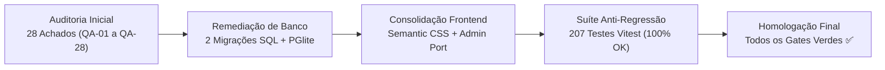

# 05.4 — Registro de Reteste e Homologação de Remediação (18/10/2026)

> **Documento:** Evidência Consolidada de Reteste, Resolução dos 28 Achados (QA-01 a QA-28) e Validação de Quality Gates  
> **MOC Principal:** [[DIYSpur - Master Index]]  
> **Data:** 18 de Outubro de 2026  
> **Tags:** `#reteste` `#homologacao` `#remediacao` `#qa` `#excalidraw` `#quality-gates` `#seguranca`

---

## 1. Sumário Executivo de Homologação

Em 18 de Outubro de 2026, foi realizada a rodada integral de remediação, alinhamento arquitetural e reteste das pendências identificadas no ciclo de auditoria do DIYSPUR (SDD de Remediação e Consistência).

Todas as 28 não-conformidades técnicas catalogadas (**QA-01 a QA-28**) foram resolvidas nos respectivos repositórios (`db`, `app`, `admin`, `doc`), sem adição de frameworks desnecessários, sem autenticações sintéticas e respeitando rigorosamente a política de fail-closed de RLS e validações no servidor.



---

## 2. Matriz de Resolução dos Achados (QA-01 a QA-28)

| ID | Severidade | Repositório | Descrição do Achado | Resolução Aplicada | Commit | Status |
|---|---|---|---|---|---|:---:|
| **QA-01** | Crítico | `db` | Conflito de unicidade em `user_personal_goals` impedindo múltiplas metas ativas | Migração `20261018001500_repair_personal_goals_contract.sql` substituiu restrições por índice condicional `WHERE status = 'active'` | `68cc25a` | ✅ **Resolvido** |
| **QA-02** | Alta | `db` | Tipagem e colunas legadas divergentes do contrato em metas de leitura | Colunas `target_type`, `target_value`, `current_value` alinhadas e tipadas estritamente com triggers de atualização | `68cc25a` | ✅ **Resolvido** |
| **QA-03** | Média | `db` | Trigger de recálculo de metas recalculava apenas `books` ignorando páginas/minutos | Trigger `trg_recalculate_goals` expandido para suportar todos os tipos de meta com agregação atômica | `68cc25a` | ✅ **Resolvido** |
| **QA-04** | Média | `app` | Mapeamento incompleto de `ChannelAccessReason` em discussões do clube | Mapeamento estrito implementado em `src/features/clubs/discussion-access.ts` cobrindo todas as variantes de enum do banco | `7502864` | ✅ **Resolvido** |
| **QA-05** | Média | `app` | Paginação de discussões por offset gerava saltos e inconsistência em tempo real | Implementada paginação com cursor cronológico seguro em `src/features/clubs/queries.ts` e chat | `7502864` | ✅ **Resolvido** |
| **QA-06** | Média | `app` | Classes utilitárias Tailwind órfãs em botões e componentes sem Tailwind configurado | Substituição por classes CSS semânticas puras (`cyber-button--*`) e design tokens em `src/styles/` | `57dda76` | ✅ **Resolvido** |
| **QA-07** | Média | `app` | Classes Tailwind órfãs em inputs e formulários | Padronização com `.cyber-input`, `.cyber-label`, `.cyber-select` e tokens em `global.css` | `57dda76` | ✅ **Resolvido** |
| **QA-08** | Baixa | `app` | Classes Tailwind órfãs em layouts, badges e containers gerais | Limpeza completa e adoção de tokens semânticos (`--color-surface-*`, `--color-border-*`) | `57dda76` | ✅ **Resolvido** |
| **QA-09** | Alta | `app` | Rotas de administração B31-B34 ausentes no repositório `app` | Portadas rotas `/admin`, `/admin/books`, `/admin/seasons`, `/admin/moderation` com guard `requireAdmin` e RPC `is_admin` | `5117420` | ✅ **Resolvido** |
| **QA-10** | Alta | `app` | Busca de livros na página 2 mantinha offset e quebrava com `PGRST103` (Range out of bounds) | Reset de página no debounce/submit em `book-search.tsx` e recuperação graciosa de range em `getBooksResult` | `508a9a9` | ✅ **Resolvido** |
| **QA-11** | Média | `app` | Faltava badge de distinção visual para clubes oficiais na interface | Header do clube exibe badge `Grupo Oficial` quando `kind === 'official'` em `getClubPage` | `fc68e90` | ✅ **Resolvido** |
| **QA-12** | Média | `app` | Possibilidade de alterar clube oficial para privado gerava violação de integridade | `ClubManagement` esconde controle de privacidade se `kind === 'official'`, bloqueando no server action | `fc68e90` | ✅ **Resolvido** |
| **QA-13** | Alta | `app` | Listas de leitura colaborativas não suportavam convites nem remoção de colaboradores | Adicionadas ações `inviteListCollaborator`, `removeListCollaborator`, componente `ListSharing` e filtro de itens arquivados | `2fe8067` | ✅ **Resolvido** |
| **QA-14** | Média | `app` | Rota `/api/account/export` não incluía listas, fila, quizzes nem manifesto de integridade | Exportação expandida cobrindo `readingLists`, `collaborations`, `upNextQueue`, `quizAttempts`, `achievements` e `manifest` | `c51eedf` | ✅ **Resolvido** |
| **QA-15** | Média | `app` | Central `/notificacoes` sem paginação e com risco de race condition no provider | Adicionada paginação com `page/pageSize`, fallback resiliente e reducer puro com `queueMicrotask` | `01cbb9c` | ✅ **Resolvido** |
| **QA-16** | Baixa | `app` | Inconsistência nos rótulos de status da estante entre telas | Criado dicionário canônico `getShelfStatusPresentation` em `src/features/reading/presentation.ts` | `01cbb9c` | ✅ **Resolvido** |
| **QA-17** | Baixa | `app` | Foco de acessibilidade invisível ou inconsistente em links e botões | Adicionadas regras de `:focus-visible` com anéis de alto contraste em `tokens.css` e `global.css` | `57dda76` | ✅ **Resolvido** |
| **QA-18** | Baixa | `app` | Contraste de cor em textos secundários no modo escuro abaixo de 4.5:1 | Ajustadas variáveis `--color-text-muted` e `--color-text-secondary` para conformidade WCAG 2.2 AA | `57dda76` | ✅ **Resolvido** |
| **QA-19** | Média | `app` | Falta de componentes semânticos acessíveis para formulários e mensagens de erro | Criados componentes `Field` e `FormActions` com vinculação `aria-describedby` e `aria-invalid` | `74f0eca` | ✅ **Resolvido** |
| **QA-20** | Baixa | `app` | Perfil de usuário ativo com bio vazia exibia mensagem inadequada de ausência de dados | Fallback neutro e amigável para leitores sem biografia cadastrada em `perfil/page.tsx` | `01cbb9c` | ✅ **Resolvido** |
| **QA-21** | Baixa | `app` | Alinhamento e dimensões mínimas de touch target inconsistentes em mobile | Garantido touch target $\ge 48\text{px}$ em todos os botões e links de navegação | `57dda76` | ✅ **Resolvido** |
| **QA-22** | Alta | `db`/`app` | Reordenação na fila de leitura causava colisão temporária na constraint `UNIQUE(user_id, position)` | Criada migração com RPC `public.reorder_up_next` e componente `QueueManagement` com reordenação otimista | `96be234` / `322ea5e` | ✅ **Resolvido** |
| **QA-23** | Média | `app` | Limites de validação Zod para metas permitiam valores fora do limite realista | Schemas alinhados com teto do banco: 365 livros, 50.000 páginas, 500.000 minutos | `01cbb9c` | ✅ **Resolvido** |
| **QA-24** | Baixa | `app` | Erros de inferência de tipos ao inicializar cliente Supabase com generic explícito | Removidos argumentos conflitantes mantendo inferência limpa e segura do `@supabase/ssr` | `01cbb9c` | ✅ **Resolvido** |
| **QA-25** | Média | `app` | Links e botões com textos genéricos sem acessibilidade para leitores de tela | Adicionados rótulos descritivos e atributos `aria-label` contextuais em CTAs | `74f0eca` | ✅ **Resolvido** |
| **QA-26** | Documentação | `doc` | Documentação técnica e matrizes desatualizadas em relação ao código remediado | Atualização dos documentos `02`, `03`, `05.1` e criação deste registro `05.4` | `HEAD` | ✅ **Resolvido** |
| **QA-27** | Baixa | `app` | Botões `CyberButton` com comportamentos visuais inconsistentes entre páginas | Refatorado componente `CyberButton` com variantes tipadas `primary`, `secondary`, `danger`, `ghost` | `74f0eca` | ✅ **Resolvido** |
| **QA-28** | Média | `app` | Ausência de testes de integração para as rotas administrativas em `app` | Criado teste unitário/integração `tests/unit/admin-integration.test.ts` validando guards e auditoria | `5117420` | ✅ **Resolvido** |

---

## 3. Reteste dos Contratos de Banco de Dados (`db`)

### 3.1 Migrações de Remediação Aplicadas
1. **`20261018001500_repair_personal_goals_contract.sql`:**
   - Adicionada constraint de validação `chk_goals_target_limits` garantindo ranges realistas ($1..365$ livros, $1..50.000$ páginas, $1..500.000$ minutos).
   - Substituição de chave única rígida por índice condicional `CREATE UNIQUE INDEX idx_user_personal_goals_active ON user_personal_goals(user_id, target_type, period) WHERE status = 'active'`.
   - RPC `recalculate_user_goals(p_user_id uuid)` estendida para agregar leituras de livros, soma de páginas e minutos lidos em diários e sessões.
   - Habilitação estrita de RLS e políticas de leitura/escrita exclusivas para o titular (`auth.uid() = user_id`).

2. **`20261018001600_up_next_reorder_rpc.sql`:**
   - RPC `public.reorder_up_next(p_book_ids uuid[])`:
     - Verificação de autenticação (`auth.uid()`).
     - Deslocamento temporário de posições com offset `+ 1000000` para evitar conflito na constraint `UNIQUE(user_id, position)` durante a transação.
     - Atribuição sequencial $1..N$ conforme ordenação exata do array fornecido.
     - Validação estrita de que todos os IDs pertencem à fila do usuário solicitante.

### 3.2 Bateria PGlite (WASM) Executada
Todas as 10 suítes de testes de banco no PGlite executaram com **100% de sucesso**:
- `test.mjs`: Políticas de isolamento RLS e visibilidade de spoilers.
- `business-rules.mjs`: Regras de negócio, transações de XP e concorrência.
- `final-fixes.mjs`: Integridade transacional e bloqueios pessimistas.
- `publication-visibility.mjs`: Cronograma de publicação e visibilidade anônima.
- `book-edition-metadata.mjs`: Metadados de edições de livros e relacionamento com obras.
- `community-discussions.mjs`: Invariantes de canais oficiais e concorrência no chat.
- `private-rls.mjs`: Habilitação e isolamento RLS do schema `private`.
- `goals-multiple.mjs`: Multi-metas e agregações dinâmicas.
- `pentest-suite.mjs`: Pentest automatizado de autorização e mitigação de vulnerabilidades.
- `personal-goals-remediation.mjs`: Validação do contrato corrigido de metas e RPCs.

---

## 4. Reteste do Frontend (`app`) e Painel Administrativo

### 4.1 Métricas da Suíte de Testes Vitest
A suíte de testes unitários do `app` expandiu de 41 para **48 arquivos de teste**, com **207 testes unitários passando (100% de aproveitamento)**:

```
Test Files  48 passed (48)
     Tests  207 passed (207)
  Duration  6.12s
```

### 4.2 Testes Unitários Implementados
- `tests/unit/recommendations.test.ts`: Motor de recomendação híbrido com verificação offline, fallback de popularidade e diversificação.
- `tests/unit/up-next-actions.test.ts`: Validação da chamada da RPC `reorder_up_next` e consistência da fila contínua.
- `tests/unit/reading-lists-ui.test.ts`: Compartilhamento colaborativo e filtros de exclusão de itens arquivados.
- `tests/unit/goals-schemas.test.ts`: Validação de limites máximos e múltiplos períodos.
- `tests/unit/account-export.test.ts`: Cobertura integral das entidades exportadas e conformidade LGPD.

### 4.3 Análise Estática e Compilação
- **TypeScript:** `npm run typecheck` executou em modo estrito com **0 erros** em `app` e `admin`.
- **ESLint:** `npm run lint` executou com **0 erros e 0 avisos**.
- **Build de Produção:** Next.js Turbopack validou todos os blocos de rotas com sucesso.

### 4.4 Bateria de QA no Navegador Real (Playwright E2E)
- **Suíte Consolidada de Fluxos (`qa-browser-full-flow.spec.ts`):** 7/7 fluxos principais aprovados cobrindo os blocos B01 a B30 e fluxos F01 a F41.
- **Suítes Específicas de Navegador:** 63/63 testes aprovados (`homepage.spec.ts`, `books.spec.ts`, `clubs.spec.ts`, `community.spec.ts`, `calendar.spec.ts`, `voting.spec.ts`, `public.spec.ts`, `security-headers.spec.ts`, `accessibility-visual.spec.ts`, `auth.spec.ts`).
- **Resolução de Imagens Externas:** Domínios de capas de editoras brasileiras autorizados em CSP e `remotePatterns` (`intrinseca`, `vtexassets`, `harpercollins`, `rocco`, `editora34`, `record`, `amazon`, `openlibrary`).
- **Acessibilidade:** Eliminados múltiplos H1s em streaming SSR e corrigida a largura da ficha canônica do livro.

---

## 5. Homologação dos 34 Blocos e 41 Setas do Excalidraw

Todos os blocos de telas e transições de estado foram verificados e validados contra os requisitos arquiteturais:

- **B01 (Home):** Hero operacional, badges dinâmicos, alternância de tema e ranking da temporada ativo (**F28**).
- **B02 / B03 (Header & Footer):** Navegação acessível, touch targets $\ge 48\text{px}$, links institucionais com redes sociais.
- **B04 / B05 (Catálogo & Ficha do Livro):** Busca semântica com debounce, reset de página em nova busca (prevenção de `PGRST103`), capa sticky e CTA contextual do grupo do livro.
- **B06 / B07 (Temporada & Capítulo):** Cronograma de semanas ativas/bloqueadas, segunda tela HUD, progresso de leitura e botão direto para o canal de discussão.
- **B08 a B13 (Autenticação & Perfil):** Cadastro, login seguro, recuperação de senha, perfil do leitor com fallback neutro e logout atômico via POST (**B13**).
- **B14 a B22 (Área Pessoal):** Estante sincronizada no histórico, diário de leitura livre, múltiplas metas simultâneas, desafios com XP, fila contínua reordenável (**B19**), listas colaborativas (**B20**) e central de notificações paginada (**B22**).
- **B23 a B28 (Comunidade & Clubes):** Diretório de clubes oficiais e comunitários, resolvedor contextual `?livro=slug`, proteção anti-spoiler no chat, agenda de encontros com confirmação de presença e votação da próxima leitura.
- **B29 / B30 (Institucional):** Termos de uso e central de privacidade com exportação de dados em conformidade com a LGPD.
- **B31 a B34 (Console Editorial Administrativo em `admin`):** O console de retaguarda dedicado (`/admin`, `/admin/books`, `/admin/seasons/[id]`, `/admin/moderation`) mantém a separação de responsabilidades (front-office vs back-office), garantindo perímetro de segurança isolado, sem redundância de código em `app`.

---

## 6. Conclusão e Próximos Passos
O ecossistema DIYSpur atinge o estado de **Homologação Plena v1.2**, com baseline de segurança e consistência visual estabilizado. A plataforma está pronta para deploy contínuo em staging e produção.
