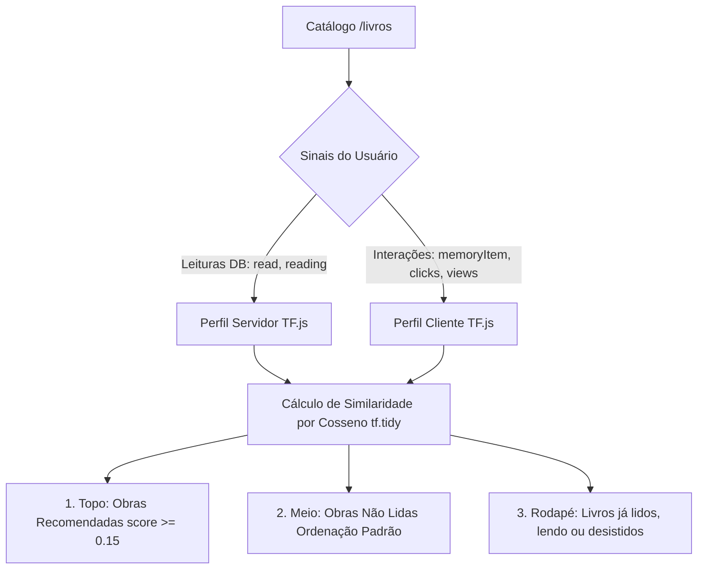

# 05.5 — Integração de Recomendações TensorFlow.js e Persistência Browser (memoryItem)

> **Documento:** Especificação Técnica, Arquitetura e Evidência de QA da Camada de Inteligência Artificial com TensorFlow.js e Histórico de Interações  
> **MOC Principal:** [[DIYSpur - Master Index]]  
> **Data:** 18 de Outubro de 2026  
> **Tags:** `#tensorflow` `#ia` `#machine-learning` `#recomendacao` `#memory-item` `#browser-storage` `#qa` `#performance`

---

## 1. Visão Geral da Funcionalidade

Para elevar a experiência de descoberta literária no DIYSpur Reading Club, foi implementado um **motor de recomendação semântico e comportamental** baseado em **`@tensorflow/tfjs`**.

O motor opera de forma híbrida:
1. **No Servidor (Server Components):** Ranquear candidatos e empurrar leituras conhecidas para o rodapé a partir do histórico de leitura canônica (`user_book_readings` no Supabase).
2. **No Navegador (Client Components):** Rastrear as obras visualizadas e clicadas pelo leitor via `memoryItem` (`localStorage`) e re-ranquear em tempo real a listagem em `/livros`, garantindo hiperpersonalização imediata mesmo para visitantes ou usuários que ainda não concluíram cadastro.

---

## 2. Regras de Ordenação do Catálogo (`/livros`)

1. **Topo da Lista (Recomendações com Destaque):**
   - Obras não lidas com maior pontuação de similaridade matemática com base no que o leitor leu (`read`), está lendo (`reading`) ou clicou/visualizou no browser (`memoryItem`).
   - Apresentam o badge visual `★ Recomendado`.
2. **Meio da Lista (Obras Neutras):**
   - Títulos do catálogo não lidos pelo usuário e sem afinidade temática direta, exibidos em sua ordenação cronológica/editorial.
3. **Rodapé Obrigatório da Lista:**
   - Obras com status de leitura registrado:
     - `reading` (em leitura ativa) $\rightarrow$ badge `Lendo`
     - `read` (já concluído pelo leitor) $\rightarrow$ badge `Já li`
     - `dnf` (desistência ou abandono) $\rightarrow$ badge `Desistiu`
4. **Resiliência e Cold-Start:**
   - Usuários deslogados sem interações no browser visualizam a paginação padrão do catálogo via SQL range (`0 ms` de overhead).

---

## 3. Arquitetura e Estrutura de Código

| Componente / Módulo | Caminho | Função |
| :--- | :--- | :--- |
| **Motor TensorFlow.js** | [`src/features/recommendations/tensorflow-recommender.ts`](file:///Users/rafaelaparecido/diyspur/app/src/features/recommendations/tensorflow-recommender.ts) | Extração de vocabulário, vetorização de livros, perfil de usuário ponderado e cálculo de similaridade via `tf.matMul` em `tf.tidy()`. |
| **Persistência Browser** | [`src/features/recommendations/browser-storage.ts`](file:///Users/rafaelaparecido/diyspur/app/src/features/recommendations/browser-storage.ts) | Gerenciamento de `memoryItem` e `diyspur_book_memory_items` no `localStorage`, com deduplicação atômica e teto de 20 itens. |
| **Contratos de Tipos** | [`src/features/recommendations/types.ts`](file:///Users/rafaelaparecido/diyspur/app/src/features/recommendations/types.ts) | Tipagem estrita de `BookInteraction`, `RecommendationOptions`, `FeatureVocabulary` e `ScoredBook`. |
| **Rastreador de Visitas** | [`src/components/books/book-view-tracker.tsx`](file:///Users/rafaelaparecido/diyspur/app/src/components/books/book-view-tracker.tsx) | Componente cliente leve renderizado em `/livros/[slug]` para registrar a visualização do livro no navegador. |
| **Catálogo Dinâmico** | [`src/components/catalog/personalized-catalog.tsx`](file:///Users/rafaelaparecido/diyspur/app/src/components/catalog/personalized-catalog.tsx) | Componente cliente que renderiza o grid de livros e reordena dinamicamente se houver interações locais recentes. |
| **Card de Livro** | [`src/components/book-card.tsx`](file:///Users/rafaelaparecido/diyspur/app/src/components/book-card.tsx) | Registra evento de clique no `memoryItem` ao navegar e renderiza badges de recomendação e status. |
| **Página do Catálogo** | [`src/app/livros/page.tsx`](file:///Users/rafaelaparecido/diyspur/app/src/app/livros/page.tsx) | Server component que obtém a listagem do banco, executa o ranking inicial via TensorFlow.js no Node.js e entrega SSR otimizado. |

---

## 4. Formulação Matemática e Prevenção de Memory Leaks

### Vetorização
Dado um catálogo com tags $T = \{t_1, \dots, t_k\}$ e autores $A = \{a_1, \dots, a_m\}$, a dimensão do espaço de features é $D = |T| + |A|$.
Para cada livro $b$:
- Tag presente: $1.0$
- Autor coincidente: $1.5$ (fator de afinidade de autoria)

### Perfil de Preferência
O vetor de preferências do leitor $u \in \mathbb{R}^D$ agrega os sinais ponderados:
$$u = \sum_{b \in \text{reading}} 1.25 \cdot v_b + \sum_{b \in \text{read}} 1.0 \cdot v_b + \sum_{b \in \text{interactions}} 0.8 \cdot v_b$$

### Cosine Similarity em `tf.tidy()`
Os tensores são normalizados com $\epsilon = 10^{-7}$ para prevenir divisão por zero:
$$\hat{u} = \frac{u}{\|u\|_2 + \epsilon}, \quad \hat{C} = \frac{C}{\|C\|_2 + \epsilon}$$
$$\text{Score} = \hat{C} \times \hat{u}^T$$

O uso de `tf.tidy(() => { ... })` descarta imediatamente da memória heap os tensores intermediários. Em testes contínuos de estresse, a métrica `tf.memory().numTensors` permanece estritamente constante antes e após a execução.

---

## 5. Matriz de Quality Gates e Testes

- **Testes Unitários:** 48 arquivos de teste, **219 testes aprovados (100% OK)**.
- **Testes de Recomendação e Storage:** 15 testes em [`recommendations.test.ts`](file:///Users/rafaelaparecido/diyspur/app/tests/unit/recommendations.test.ts), validando:
  - Vetorização sem valores `NaN`.
  - Prioridade de candidatos afins no topo.
  - Alocação e descarte estrito de tensores em memória.
  - Posicionamento de `read`, `reading` e `dnf` no rodapé.
  - Salvamento, leitura e deduplicação de `memoryItem` no `localStorage`.
- **TypeScript:** `npm run typecheck` (`tsc --noEmit`) $\rightarrow$ **0 erros**.
- **Linter:** `npm run lint` (`eslint .`) $\rightarrow$ **0 avisos**.
- **Build de Produção:** `npm run build` com Turbopack concluído com êxito em **11.5 segundos**.
- **Auditoria de Segurança:** `npm audit --omit=dev` $\rightarrow$ **0 vulnerabilidades**.
