# DIYSpur — Hub de Documentação Técnica e Arquitetural (MOC)

> **Projeto:** DIYSpur (Reading Club & Second Screen Platform)  
> **Status:** Produção / Staging / Homologado v1.1 (Fluxo Excalidraw 34 Blocos & 41 Setas, Comunidade Canônica Unificada)  
> **Repositórios:** [Frontend & Leitor](https://github.com/diyspur-cloud/app) | [Console Administrativo & Editorial](https://github.com/diyspur/admin) | [Backend & Database](https://github.com/diyspur-cloud/db) | [Documentação](https://github.com/diyspur/docs)  
> **Data de Consolidação:** Outubro de 2026 (Unificação Canônica de Clubes e Limpeza de Banco)  
> **Padrão de Documentação:** Obsidian Markdown com Links Bidirecionais (`[[...]]`)

---

## 🧭 Grafo de Conhecimento e Mapa de Navegação (MOC)

```mermaid
graph TD
    MOC["[[DIYSpur - Master Index]]"]
    
    %% Bloco 00: Visão Geral
    MOC --> VG["[[00 - Visao Geral do Projeto]]"]
    
    %% Bloco 01: Arquitetura & Engenharia de Dados
    MOC --> ARQ["[[01 - Arquitetura Frontend e Backend]]"]
    ARQ --> DB["[[01.1 - Modelo de Dados e Seguranca RLS]]"]
    ARQ --> IA["[[01.2 - Inteligencia Artificial e Recomendacao Semantica]]"]
    ARQ --> PERF["[[01.3 - Engenharia de Performance e Seguranca Avancada]]"]
    ARQ --> RT["[[01.4 - Arquitetura Realtime, CDC e Mensageria]]"]
    ARQ --> LGPD["[[01.5 - Governanca LGPD, Event Sourcing e Retencao de Dados]]"]
    ARQ --> OBS["[[01.6 - Observabilidade, Seguranca Web e Dicionario de Telemetria]]"]
    ARQ --> PENTEST["[[01.7 - Relatorio de Pentest, Seguranca Ofensiva e Matriz OWASP]]"]
    
    %% Bloco 02: Funcionalidades & Domínio Pedagógico
    MOC --> MAP["[[02 - Mapeamento de Funcionalidades]]"]
    MAP --> TAX["[[02.1 - Taxonomia Editorial, Moods e Content Warnings]]"]
    MAP --> GAME["[[02.2 - Gamificacao por Regras, Caderno Interativo e Materiais Extras]]"]
    MAP --> REV["[[02.3 - Avaliacoes Comunitarias, Spice Level e Metricas Agregadas]]"]
    MAP --> COM["[[02.4 - Comunidade de Leitura, Clubes e Canais de Discussao]]"]
    MAP --> CANON["[[02.5 - Leitura Canonica, Estante Pessoal e Rankings Comunitarios]]"]
    MAP --> NOTIF["[[02.6 - Central de Notificacoes, Outbox e Eventos de Calendario]]"]
    
    %% Bloco 03: Jornada do Usuário
    MOC --> FLX["[[03 - Jornada do Usuario e Fluxo de Telas]]"]
    
    %% Bloco 04: Mídias & Growth Loops
    MOC --> MID["[[04 - Estrategia de Conteudo e Redes Sociais]]"]
    MID --> UGC["[[04.1 - Motor de Compartilhamento Social e Viral Loops]]"]
    
    %% Bloco 05: QA & Operações
    MOC --> QA["[[05.1 - Relatorio de QA, Casos de Teste e Quality Gates]]"]
    MOC --> OPS["[[05.2 - Runbook de Operacao, Migracoes e Incidentes]]"]
    MOC --> DEPLOY["[[05.3 - Guia Completo de Deploy Vercel e Supabase]]"]
    MOC --> RETEST["[[05.4 - Registro de Reteste e Homologacao 2026-10-18]]"]
    MOC --> TF["[[05.5 - Integracao de Recomendacoes TensorFlow e Persistencia Browser]]"]
    
    %% Bloco 06: Referência Técnica & APIs
    MOC --> RPC["[[06.1 - Catalogo Completo de RPCs e Triggers PostgreSQL]]"]
    MOC --> API["[[06.2 - Contrato de APIs HTTP, Edge Functions e Webhooks]]"]
    MOC --> DS["[[06.3 - Dicionario de Telas, Componentes e Design Tokens Nimble]]"]

    %% Relações Cruzadas
    COM -.-> DB
    CANON -.-> DB
    NOTIF -.-> RT
    PENTEST -.-> DB
    QA -.-> ARQ
    FLX -.-> DS
    CANON -.-> FLX
```

---

## 📚 Estrutura Modular da Documentação no Vault

### Bloco 00: Visão Geral e Princípios
- **[[00 - Visao Geral do Projeto]]**: O conceito de *segunda tela* literária, o ecossistema omnicanal (Web + YouTube + TikTok + Instagram), governança de produto e Mobile-First.

### Bloco 01: Arquitetura, Dados e Engenharia de Sistemas
- **[[01 - Arquitetura Frontend e Backend]]**: Arquitetura desacoplada em múltiplos frontends: **`app`** (experiência do leitor com Design Engine Next-Gen, Glassmorphism e compensação OLED) e **`admin`** (console administrativo & editorial dedicado), Next.js 16 (App Router / Turbopack), React 19, TypeScript, Supabase SSR e Vercel.
- **[[01.1 - Modelo de Dados e Seguranca RLS]]**: 82 tabelas relacionais, 12 migrações incrementais M01–M12, invariantes RLS e views anti-spoiler.
- **[[01.2 - Inteligencia Artificial e Recomendacao Semantica]]**: Extensão `pgvector`, embeddings em 1536 dimensões, matching de leitores (*Reader Match*) e similaridade de cosseno.
- **[[01.3 - Engenharia de Performance e Seguranca Avancada]]**: Otimização com RLS InitPlans `(SELECT auth.uid())`, concorrência otimista com `version`, aceleração por GPU (60fps P99), eficiência energética OLED e matriz de segurança das 11 Edge Functions Deno.
- **[[01.4 - Arquitetura Realtime, CDC e Mensageria]]**: Change Data Capture (CDC), WebSockets e canais de atualização instantânea para chats, reações e votações ao vivo.
- **[[01.5 - Governanca LGPD, Event Sourcing e Retencao de Dados]]**: Ciclo de vida de dados, exclusão física vs anonimização de comentários, sucessão de clubes comunitários, event sourcing no Stripe e auditoria de afiliados com hash de IP.
- **[[01.6 - Observabilidade, Seguranca Web e Dicionario de Telemetria]]**: Contrato tipado de eventos PostHog (`ProductEventMap`), logs estruturados JSON, Content Security Policy restritivo, mitigação de Open Redirects e Schema.org RFC 5545.
- **[[01.7 - Relatorio de Pentest, Seguranca Ofensiva e Matriz OWASP]]**: Auditoria completa de segurança ofensiva, matriz de mitigação OWASP ASVS 4.0 e testes automatizados de RLS.

### Bloco 02: Matriz Funcional, Avaliações e Domínio Editorial
- **[[02 - Mapeamento de Funcionalidades]]**: Matriz completa das 72 capacidades catalogadas no Excalidraw distribuídas em 6 pilares.
- **[[02.1 - Taxonomia Editorial, Moods e Content Warnings]]**: Avisos de conteúdo democráticos com recálculo de consenso, mood stats JSONB, métrica *plot-vs-character* e estudo de caso real de *Verity* (Colleen Hoover).
- **[[02.2 - Gamificacao por Regras, Caderno Interativo e Materiais Extras]]**: Motor de conquistas declarativas baseadas em regras JSONB, caderno interativo reflexivo e repositório de anexos de capítulos.
- **[[02.3 - Avaliacoes Comunitarias, Spice Level e Metricas Agregadas]]**: Subsistema `book_reviews`, escala de intensidade sensual ("Spice Level" 0–5) alinhada ao BookTok/BookTube, agregações anônimas de audiência por capítulo e Design System Nimble.
- **[[02.4 - Comunidade de Leitura, Clubes e Canais de Discussao]]**: Clubes oficiais vinculados a livros, diretório de canais (`#geral`, `#spoilers`, `#capitulos`), chat em tempo real, replies encadeados, consentimento de spoiler e moderação.
- **[[02.5 - Leitura Canonica, Estante Pessoal e Rankings Comunitarios]]**: Controle de leitura em `user_book_readings`, transições estritas, vinculação de edição específica (`book_editions`), estante no histórico e ranking duplo de temporada e livros mais lidos.
- **[[02.6 - Central de Notificacoes, Outbox e Eventos de Calendario]]**: 15 tipos de notificação, popover e página `/notificacoes`, fila assíncrona outbox com worker Deno, agendamento de encontros, integração Google Agenda e exportação `.ics` RFC 5545.

### Bloco 03: Experiência e Jornada do Leitor
- **[[03 - Jornada do Usuario e Fluxo de Telas]]**: Decomposição tela a tela (da Landing com Hero futurista e Radar ativo até o Player multimídia com chat sincronizado por segundos, Quizzes, Clubes e Calendário).

### Bloco 04: Estratégia de Conteúdo e Growth Loops
- **[[04 - Estrategia de Conteudo e Redes Sociais]]**: Alinhamento com YouTube (long-form/lives com timestamps no banco), TikTok (cortes rápidos e quizzes) e Instagram (avisos de conteúdo e enquetes).
- **[[04.1 - Motor de Compartilhamento Social e Viral Loops]]**: Renderização assíncrona de cartões visuais para Instagram Stories e TikTok (`social_render_jobs`), Web Share API nativa e flywheel orgânico de UGC.

### Bloco 05: Qualidade, QA e Operação
- **[[05.1 - Relatorio de QA, Casos de Teste e Quality Gates]]**: Suítes de testes automatizados: 48 arquivos e 207 testes unitários no `app`, 4 arquivos e 15 testes no `admin`, cobertura de build Next.js Turbopack e 10 suítes PGlite de testes de banco.
- **[[05.2 - Runbook de Operacao, Migracoes e Incidentes]]**: Procedimentos de release, boas práticas de migrações aditivas, configuração de crons e resposta a incidentes.
- **[[05.3 - Guia Completo de Deploy Vercel e Supabase]]**: Procedimento Operacional Padrão (SOP) para deploy via browser na Vercel e no Supabase (projeto `xjhehhfhhoomblcggjpk`), ordem de migrações e checklist de smoke test.
- **[[05.4 - Registro de Reteste e Homologacao 2026-10-18]]**: Registro de reteste, resolução técnica dos 28 achados (QA-01 a QA-28), contratos de banco e evidências de conformidade dos 34 blocos e 41 setas.

### Bloco 06: Referência Técnica e APIs
- **[[06.1 - Catalogo Completo de RPCs e Triggers PostgreSQL]]**: Especificação de todas as Stored Procedures, parâmetros, permissões, contexto de segurança e triggers de integridade.
- **[[06.2 - Contrato de APIs HTTP, Edge Functions e Webhooks]]**: Contrato das rotas de API do Next.js App Router e das 11 Edge Functions do Supabase.
- **[[06.3 - Dicionario de Telas, Componentes e Design Tokens Nimble]]**: Catálogo de componentes (`GlassCard`, `CyberButton`, `CyberSkeleton`), design tokens semânticos, iluminação especular, compensação ótica OLED, modos de densidade/acessibilidade e áreas de toque $\ge 48\text{px}$.

### Apêndices: Manuais e Diretrizes Específicas por Repositório
- **[[app-docs/manual/00-overview|Manual do Leitor e Catálogo de Telas (app-docs)]]**: Decomposição tela a tela e fluxos de navegação da aplicação leitor.
- **[[app-docs/design-system|Especificação Detalhada do Design System (app-docs)]]**: Especificação canônica dos tokens e componentes CSS Nimble.
- **[[app-docs/AGENTS|Instruções para Agentes e IAs — Frontend (app-docs)]]**: Diretrizes, escopo e comandos do repositório `app`.
- **[[app-docs/CLAUDE|Guia de Estilo e Boas Práticas — Frontend (app-docs)]]**: Padrões de código, acessibilidade e convenções de interface.
- **[[db-docs/supabase-reference|Referência de Banco e Schema Supabase (db-docs)]]**: Dicionário de dados, tabelas e relacionamentos do PostgreSQL.
- **[[db-docs/AGENTS|Instruções para Agentes e IAs — Backend (db-docs)]]**: Invariantes de autorização RLS e convenções de migrations.
- **[[db-docs/CLAUDE|Guia de Arquitetura e Segurança de Banco (db-docs)]]**: Regras de banco, `search_path`, funções `private` e RPCs.
- **[[db-docs/SDDBD2|Especificação Consolidada do Banco (SDDBD2)]]**: Especificação executável de banco de dados.

---

## 🏷️ Tags Gerais para Obsidian
`#diyspur` `#software-architecture` `#nextjs` `#supabase` `#postgresql` `#rls` `#pgvector` `#realtime` `#lgpd` `#gamification` `#telemetria` `#booktok` `#excalidraw` `#documentation` `#pentest` `#qa` `#nimble`

