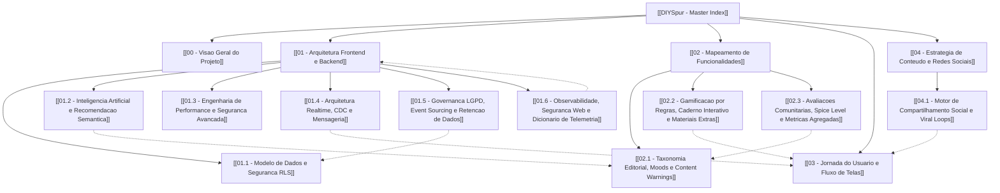

# DIYSpur — Hub de Documentação Técnica e Arquitetural (MOC)

> **Projeto:** DIYSpur (Reading Club & Second Screen Platform)  
> **Status:** Produção / Staging / Evolução Contínua  
> **Ambiente Web:** [diyspur.vercel.app](https://diyspur.vercel.app)  
> **Repositórios:** [Frontend & App](https://github.com/diyspur-cloud/app) | [Backend & Database](https://github.com/diyspur-cloud/db)  
> **Data de Consolidação:** Outubro de 2026  
> **Padrão de Documentação:** Obsidian Markdown com Links Bidirecionais (`[[...]]`)

---

## 🧭 Grafo de Conhecimento e Mapa de Navegação (MOC)

---

## 📚 Estrutura Modular da Documentação no Vault

### Bloco 00: Visão Geral e Princípios
- **[[00 - Visao Geral do Projeto]]**: O conceito de *segunda tela* literária, o ecossistema omnicanal (Web + YouTube + TikTok + Instagram), governança de produto e Mobile-First.

### Bloco 01: Arquitetura, Dados e Engenharia de Sistemas
- **[[01 - Arquitetura Frontend e Backend]]**: Next.js 16 (App Router), React 19, TypeScript, Supabase, Vercel, Sentry, PostHog e pipeline de CI/CD.
- **[[01.1 - Modelo de Dados e Seguranca RLS]]**: 82 tabelas no PostgreSQL, invariantes de RLS, views anti-spoiler e RPCs transacionais.
- **[[01.2 - Inteligencia Artificial e Recomendacao Semantica]]**: Extensão `pgvector`, embeddings em 1536 dimensões, matching de leitores (*Reader Match*) e similaridade de cosseno.
- **[[01.3 - Engenharia de Performance e Seguranca Avancada]]**: Otimização com RLS InitPlans `(SELECT auth.uid())`, concorrência otimista com `FOR UPDATE`, e matriz de segurança das 11 Edge Functions Deno.
- **[[01.4 - Arquitetura Realtime, CDC e Mensageria]]**: Change Data Capture (CDC), WebSockets e canais de atualização instantânea para chats, reações e votações ao vivo.
- **[[01.5 - Governanca LGPD, Event Sourcing e Retencao de Dados]]**: Ciclo de vida de dados, exclusão física vs anonimização de comentários, sucessão de clubes comunitários, event sourcing no Stripe e auditoria de afiliados com hash de IP.
- **[[01.6 - Observabilidade, Seguranca Web e Dicionario de Telemetria]]**: Contrato tipado de eventos PostHog (`ProductEventMap`), logs estruturados JSON, Content Security Policy restritivo, mitigação de Open Redirects e Schema.org RFC 5545.

### Bloco 02: Matriz Funcional, Avaliações e Domínio Editorial
- **[[02 - Mapeamento de Funcionalidades]]**: Matriz completa das 72 capacidades catalogadas no Excalidraw distribuídas em 6 pilares.
- **[[02.1 - Taxonomia Editorial, Moods e Content Warnings]]**: Avisos de conteúdo democráticos com recálculo de consenso, mood stats JSONB, métrica *plot-vs-character* e estudo de caso real de *Verity* (Colleen Hoover).
- **[[02.2 - Gamificacao por Regras, Caderno Interativo e Materiais Extras]]**: Motor de conquistas declarativas baseadas em regras JSONB, caderno interativo reflexivo e repositório de anexos de capítulos.
- **[[02.3 - Avaliacoes Comunitarias, Spice Level e Metricas Agregadas]]**: Subsistema `book_reviews`, escala de intensidade sensual ("Spice Level" 0–5) alinhada ao BookTok/BookTube, agregações anônimas de audiência por capítulo e Design System Nimble.

### Bloco 03: Experiência e Jornada do Leitor
- **[[03 - Jornada do Usuario e Fluxo de Telas]]**: Decomposição tela a tela (da Landing até o Player multimídia com chat sincronizado por segundos, Quizzes e Clubes).

### Bloco 04: Estratégia de Conteúdo e Growth Loops
- **[[04 - Estrategia de Conteudo e Redes Sociais]]**: Alinhamento com YouTube (long-form/lives com timestamps no banco), TikTok (cortes rápidos e quizzes) e Instagram (avisos de conteúdo e enquetes).
- **[[04.1 - Motor de Compartilhamento Social e Viral Loops]]**: Renderização assíncrona de cartões visuais para Instagram Stories e TikTok (`social_render_jobs`), Web Share API nativa e flywheel orgânico de UGC.

---

## 🏷️ Tags Gerais para Obsidian
`#diyspur` `#software-architecture` `#nextjs` `#supabase` `#postgresql` `#rls` `#pgvector` `#realtime` `#lgpd` `#gamification` `#telemetria` `#booktok` `#excalidraw` `#documentation`
