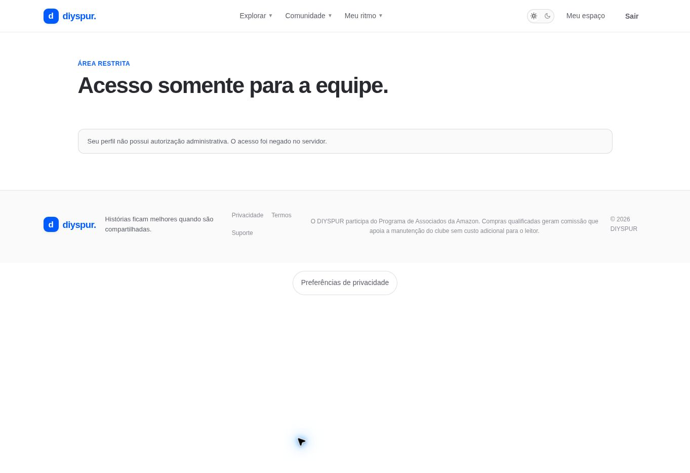

# Painel administrativo / `/admin`

## 1. Overview & Purpose

- **URL Path:** `/admin`
- **Access Level:** Admin
- **Core Purpose:** Concentrar os caminhos de operação editorial e moderação.
- **Repositório:** [diyspur/admin](https://github.com/diyspur/admin) *(Desacoplado da aplicação leitor `diyspur/app`)*

> [!NOTE]
> **Migração para Repositório Dedicado:**  
> Esta tela agora é mantida no repositório independente `https://github.com/diyspur/admin`, contando com auto-login por sessão segura (`diyspur_admin_session`), menu persistente clicável e isolamento de dependências.

## 2. Prerequisites & Access

Sessão com autorização is_admin confirmada no servidor ou cookie administrativo emitido via auto-login (`/entrar`).

## 3. UI Components & Layout

Quando autorizado: Cards com estatísticas operacionais (Total de Livros, Temporadas Cadastradas, Moderação Pendente), atalhos rápidos e barra superior de navegação (`AdminNav`) com menu clicável para todas as rotas.

*Captura real do estado histórico na aplicação legada. No repositório independente `diyspur/admin`, a tela possui cabeçalho de navegação interativo e auto-login habilitado.*

## 4. Step-by-Step User Flow

1. **Step 1:** Acesse a raiz (`/`), que redireciona automaticamente para `/admin`.
2. **Step 2:** Se não autenticado, acesse `/entrar`. O componente `AutoAuth` autentica automaticamente o operador em 1-clique.
3. **Step 3:** Navegue pelo menu superior persistente clicável:
   - **Livros & Capas:** `/admin/books`
   - **Temporadas:** `/admin/seasons`
   - **Moderação:** `/admin/moderation`
4. **Step 4:** Acompanhe os indicadores no dashboard e acesse a fila de pendências diretamente.

### Interação com o backend

auth.getClaims e RPC is_admin, com suporte a sessão administrativa via cookie `diyspur_admin_session`.

### Referência de implementação (Repositório `diyspur/admin`)

- Repositório: [github.com/diyspur/admin](https://github.com/diyspur/admin)
- Código fonte da página: `src/app/admin/page.tsx`
- Componente de navegação: `src/components/admin/admin-nav.tsx`
- Server actions: `src/app/admin/actions.ts`

[Índice do manual](../00-overview.md) · [Primeiros passos](../01-getting-started.md) · [Referência técnica](../02-technical-reference.md)
