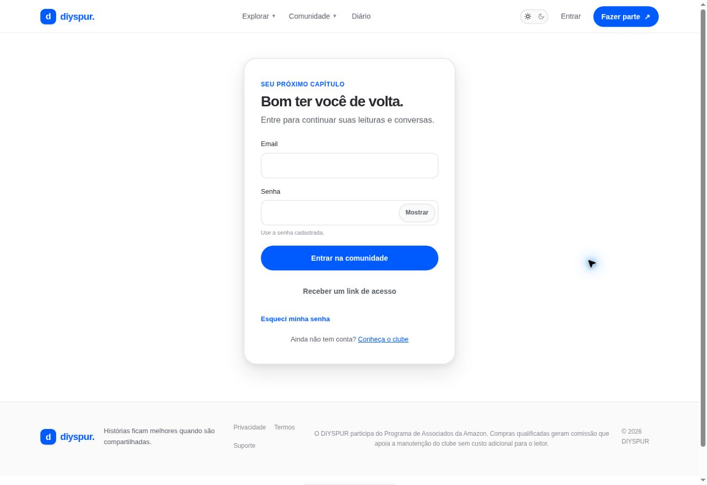

# Metas anuais / `/metas`

## 1. Overview & Purpose

- **URL Path:** `/metas`
- **Access Level:** Authenticated
- **Core Purpose:** Definir múltiplos objetivos personalizados de leitura (livros, páginas e tempo) e acompanhar o progresso (Excalidraw B16: *"o usuário pode ter mais de uma meta"*).

## 2. Prerequisites & Access

Sessão ativa; objetivos para o ano exibido. Diário e conclusões alimentam o progresso.

## 3. UI Components & Layout

Ano; campos de livros, páginas e minutos; Salvar meta; três indicadores de progresso; link para diário.

### Campos e regras

| Campo | Regra | Como usar |
|---|---|---|
| Livros | 1–365 na interface | Inteiro |
| Páginas | 1–50.000 na interface | Inteiro |
| Minutos | 1–500.000 na interface | Inteiro |

*Captura desktop sem sessão. A imagem mostra o redirecionamento para login; a interface autenticada foi observada antes do logout, mas sua captura não ficou disponível.*

## 4. Step-by-Step User Flow

1. **Step 1:** Abra **Metas do ano** na área pessoal e confira o ano mostrado.
2. **Step 2:** Informe uma ou mais metas. O leitor pode manter múltiplos planos ativos em paralelo.
3. **Step 3:** Use **Salvar meta** e aguarde confirmação de persistência.
4. **Step 4:** Registre sessões no diário e conclua suas leituras; retorne para acompanhar progresso.
5. **Step 5:** Para ajustar a meta, altere o número e salve.

### Interação com o backend

A migração `20261018000500_multiple_personal_reading_goals.sql` removeu o limite de unicidade estrita por ano em `reading_goals` e adicionou `title`, `version` e `archived_at`, viabilizando múltiplas metas simultâneas por usuário com histórico. `getUserReadingGoal` consulta `reading_goal_progress` por `goal_id`.

Os passos de salvamento acima descrevem o contrato implementado. Confirme a mensagem de sucesso antes de considerar uma operação persistida; sua execução nesta rodada está indicada abaixo.

## 5. Error Handling & Edge Cases

No HTML, limites são 365 livros, 50.000 páginas e 500.000 minutos. A action aceita até 1.000 livros e 1.000.000 páginas/minutos: divergência de contrato registrada. Números negativos/zero não são metas válidas. Sem meta mostra convite a definir objetivo.

### Evidência e limite desta rodada

Ano 2026 e três dimensões sem meta observados; sem sessão redirecionou. Salvamento não executado.

Falhas de rede forçadas, comparação entre duas contas e matriz mobile/tablet não executadas nesta sessão. Layout responsivo foi revisado no CSS, sem certificação visual desses tamanhos. Consulte [cobertura QA](../03-qa-coverage.md).

### Referência de implementação

- [src/app/metas/page.tsx](../../../src/app/metas/page.tsx)
- [src/components/goals/goal-form.tsx](../../../src/components/goals/goal-form.tsx)
- [src/features/goals/actions.ts](../../../src/features/goals/actions.ts)
- [src/features/goals/queries.ts](../../../src/features/goals/queries.ts)

[Índice do manual](../00-overview.md) · [Primeiros passos](../01-getting-started.md) · [Referência técnica](../02-technical-reference.md)
