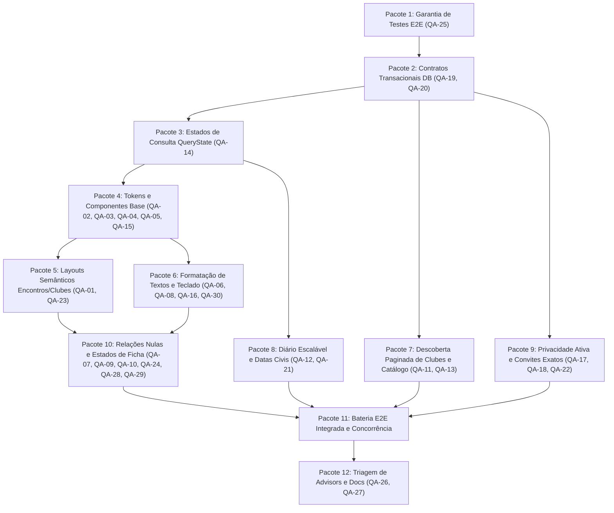

# Plano Abrangente de Desenvolvimento, QA e Evolução Visual — DIYSPUR

> **For agentic workers:** REQUIRED SUB-SKILL: Use superpowers:subagent-driven-development (recommended) or superpowers:executing-plans to implement this plan task-by-task. Steps use checkbox (`- [ ]`) syntax for tracking.

**Goal:** Implementar de ponta a ponta as correções e evoluções especificadas no SDD de auditoria (achados QA-01 a QA-30 e pacotes 1 a 12), sanando falhas contratuais e de concorrência no PostgreSQL/Supabase, eliminando classes órfãs e problemas de contraste no CSS semântico, blindando a garantia dos testes automatizados e conectando os fluxos do leitor no aplicativo público.

**Architecture:** Next.js 16 (App Router, Server Actions, Server Components e Client Components onde interatividade é necessária) integrado ao Supabase (PostgreSQL 17 com RLS obrigatória e separação estrita de schemas `public` e `private`). CSS semântico puro com design tokens centralizados em `src/styles/tokens.css` e `src/styles/global.css`, sem dependência de classes Tailwind inexistentes. Mutações críticas serializadas via advisory locks transacionais e optimistic concurrency versionada.

**Tech Stack:** Next.js 16, React 19, TypeScript 5.9, Supabase JS / SSR, PostgreSQL 17 (com PGlite / WASM para testes locais), Vitest, Playwright.

**Spec / Referência:** "SDD de QA, consistência funcional e evolução visual — DIYSPUR" (18/10/2026), achados QA-01 a QA-30, pacotes de implementação 1 a 12 e inventário de controles JSX (C001 a C408).

---

## Global Constraints

- **Segurança Fail-Closed e Autenticação Server-Side:** Nenhuma Server Action, API route ou RPC pode confiar em identidades fornecidas pelo cliente ou user_metadata. Toda permissão deriva estritamente de `auth.uid()` validado pelo Supabase Auth. Falhas de sessão ou permissão retornam `42501` / `unauthenticated` / `forbidden`.
- **Integridade de Schemas e search_path:** Todas as funções com `SECURITY DEFINER` e `SECURITY INVOKER` devem declarar explicitamente `SET search_path = ''`. Tabelas no schema `private` permanecem bloqueadas para o PostgREST. Migrations históricas são imutáveis; novas alterações ocorrem exclusivamente via novas migrations idempotentes.
- **Resiliência e Erros Honestos:** Consultas e mutations utilizam uniões discriminadas tipadas (`QueryResult<T>`). Falhas de rede ou banco nunca devem ser mascaradas como "zero itens", "lista vazia", "404" ou liberar acessos indevidamente (`can_open: true`).
- **Acessibilidade e Layout Responsivo (WCAG 2.2 AA):** Contraste mínimo de 4,5:1 em textos normais e controles em ambos os temas (claro e escuro). Alvos de toque com dimensão mínima de 48px (`--control-hit-size: 3rem`). Suporte de 375px a 1440px sem overflow horizontal no viewport.
- **Padronização Visual sem Frameworks Externos:** Preservar o design system baseado em CSS puro (tokens semânticos e classes globais canônicas). Proibida a introdução de Tailwind ou classes utilitárias sem implementação.

---

## Review Focus (Pontos Críticos de Falha)

1. **Reordenação Concorrente da Fila (QA-19):** Submissão de array parcial, IDs duplicados ou IDs que não pertencem ao usuário deve disparar erro transacional atômico (`40900`), sem corromper a ordenação sequencial contígua `1..N`.
2. **Edição e Concorrência de Metas de Leitura (QA-20):** Tentativa de editar meta com versão divergente (`conflict`), editar meta arquivada (`goal_archived`), ID inexistente (`P0002`), ou alterar o ano da meta deve falhar fechado sem criar registros fantasmas.
3. **Lookup de Convites por Nome de Usuário (QA-18):** Pesquisa com caracteres especiais SQL (`_` ou `%`) ou formatações inconsistentes não pode resolver identidades ambíguas via `ilike`; a busca deve ser estrita e exata por `@username` normalizado.
4. **Idempotência de Agendamento em Falhas de Rede (QA-22):** Retentativas automáticas ou manuais após timeout de rede não podem gerar reuniões duplicadas no banco; a chave `requestId` deve ser estável por payload lógico.
5. **Acesso Protegido em Indisponibilidade de Rede (QA-14):** Quando a RPC de verificação de acesso ao capítulo falhar, o cliente não pode cair no fallback `can_open: true`, impedindo vazamento de conteúdo protegido.

---

## Plano de Implementação Passo a Passo



---

### Task 1: P01 — Blindagem da Garantia de Testes e Fixtures Determinísticas (QA-25)

**Arquivos:**
- Modificar: `app/tests/e2e/qa-browser-full-flow.spec.ts`
- Modificar: `app/tests/e2e/auth.spec.ts`
- Modificar: `app/playwright.config.ts`

**Interfaces:**
- Consumes: Testes E2E do Playwright e variáveis de ambiente `QA_SEASON_SLUG`, `QA_BOOK_SLUG`.
- Produces: Testes determinísticos sem branches condicionais `if` que silenciam falhas.

- [ ] **Passo 1.1: Identificar pontos de bypass silencioso em `qa-browser-full-flow.spec.ts` e `auth.spec.ts`**
  Inspecionar testes que utilizam `if (await element.isVisible())` ou que aceitam status 404 em temporadas como sucesso.
- [ ] **Passo 1.2: Escrever teste que falha quando o controle de tema não é acionado**
  Em `app/tests/e2e/qa-browser-full-flow.spec.ts`, substituir a busca por `role="button"` pelo seletor acessível correto:
  ```typescript
  test('alternância de tema claro/escuro é determinística', async ({ page }) => {
    await page.goto('/');
    const toggle = page.getByRole('switch', { name: /Alternar tema/ });
    await expect(toggle).toBeVisible();
    const originalTheme = await page.locator('html').getAttribute('data-theme');
    await toggle.click();
    await expect.poll(() => page.locator('html').getAttribute('data-theme')).not.toBe(originalTheme);
    await toggle.click();
    await expect(page.locator('html')).toHaveAttribute('data-theme', originalTheme ?? 'light');
  });
  ```
- [ ] **Passo 1.3: Eliminar navegação para `/temporadas` sem slug e exigir fixture**
  Atualizar o teste de temporada para consumir obrigatoriamente a rota canônica `/temporadas/${process.env.QA_SEASON_SLUG || 'verity'}`. Se a página retornar erro, o teste deve falhar explicitamente.
- [ ] **Passo 1.4: Reforçar validação pós-login contra Open Redirect em `auth.spec.ts`**
  No teste de redirecionamento, substituir a verificação superficial de campos por asserção da URL final:
  ```typescript
  await expect(page).toHaveURL(new RegExp(`^${origin}/perfil`));
  ```
- [ ] **Passo 1.5: Executar testes Playwright em modo headless e verificar execução estrita**
  Executar: `(cd app && npx playwright test tests/e2e/auth.spec.ts --project=chromium)`
  Esperado: Execução sem skips condicionais não registrados.
- [ ] **Passo 1.6: Commit das correções de testes**
  Executar: `git -C app commit -am "test(e2e): eliminate silent condition skips and enforce deterministic fixtures (QA-25)"`

---

### Task 2: P02 — Contratos Transacionais de Backend para Fila e Metas (QA-19, QA-20)

**Arquivos:**
- Criar: `db/supabase/migrations/20261018001700_strict_up_next_and_goals.sql`
- Modificar: `db/scripts/security-smoke/goals-multiple.mjs`
- Criar: `db/scripts/security-smoke/up-next-strict.mjs`
- Modificar: `app/src/features/up-next/actions.ts`
- Modificar: `app/src/features/goals/actions.ts`
- Modificar: `app/src/features/goals/schemas.ts`

**Interfaces:**
- Consumes: `auth.uid()`, `public.user_up_next`, `public.reading_goals`.
- Produces:
  - `public.reorder_up_next(p_book_ids uuid[]) -> boolean` com validação de conjunto exato.
  - `public.remove_from_up_next_atomic(p_book uuid) -> boolean` com advisory lock.
  - `public.set_personal_reading_goal(...) -> jsonb` com versionamento estrito e sem auto-insert em ID inexistente.

- [ ] **Passo 2.1: Criar teste que reproduz reordenação de conjunto incompleto e inserção de ID inexistente**
  Criar `db/scripts/security-smoke/up-next-strict.mjs` testando:
  1. Envio de array com ID que não existe na fila do usuário -> esperado erro `40900`.
  2. Envio de array com tamanho inferior ao total de itens da fila -> esperado erro `40900`.
  3. Chamada de `set_personal_reading_goal` com `p_id` randômico não existente -> esperado erro `P0002`.
  4. Chamada de `set_personal_reading_goal` com meta arquivada -> esperado erro `40900`.
- [ ] **Passo 2.2: Executar teste e verificar falha esperada**
  Executar: `(cd db/scripts/security-smoke && node up-next-strict.mjs)`
  Esperado: FAIL pois as RPCs atuais aceitam arrays incompletos e inserem metas com ID arbitrário.
- [ ] **Passo 2.3: Criar migração SQL `20261018001700_strict_up_next_and_goals.sql`**
  Implementar:
  ```sql
  -- 1. Reordenação exata de fila com validação estrita de conjunto (QA-19)
  CREATE OR REPLACE FUNCTION public.reorder_up_next(p_book_ids uuid[])
  RETURNS boolean LANGUAGE plpgsql SECURITY INVOKER SET search_path = '' AS $$
  DECLARE
    v_user uuid := (SELECT auth.uid());
    v_count integer;
    v_max bigint;
    v_offset bigint;
  BEGIN
    IF v_user IS NULL THEN
      RAISE EXCEPTION 'authentication_required' USING ERRCODE = '42501';
    END IF;
    IF p_book_ids IS NULL THEN
      RAISE EXCEPTION 'invalid_order' USING ERRCODE = '22023';
    END IF;
    IF cardinality(p_book_ids) > 0 AND array_ndims(p_book_ids) <> 1 THEN
      RAISE EXCEPTION 'invalid_order_dimension' USING ERRCODE = '22023';
    END IF;
    PERFORM pg_catalog.pg_advisory_xact_lock(pg_catalog.hashtextextended(v_user::text, 0));

    SELECT count(*), coalesce(max(position), 0)
      INTO v_count, v_max FROM public.user_up_next WHERE user_id = v_user;

    IF cardinality(p_book_ids) <> v_count
       OR (SELECT count(DISTINCT x) FROM unnest(p_book_ids) AS x) <> v_count
       OR EXISTS (
         SELECT 1 FROM unnest(p_book_ids) AS ids(book_id)
         WHERE ids.book_id IS NULL OR NOT EXISTS (
           SELECT 1 FROM public.user_up_next q
           WHERE q.user_id = v_user AND q.book_id = ids.book_id
         )
       ) THEN
      RAISE EXCEPTION 'queue_changed_or_invalid_order' USING ERRCODE = '40900';
    END IF;
    IF v_count = 0 THEN RETURN true; END IF;

    v_offset := v_max + v_count + 1;
    IF v_max + v_offset > 2147483647 THEN
      RAISE EXCEPTION 'queue_position_capacity' USING ERRCODE = '22003';
    END IF;
    UPDATE public.user_up_next SET position = position + v_offset::integer
     WHERE user_id = v_user;

    UPDATE public.user_up_next AS q SET position = ordered.pos::integer
      FROM unnest(p_book_ids) WITH ORDINALITY AS ordered(book_id, pos)
     WHERE q.user_id = v_user AND q.book_id = ordered.book_id;
    RETURN true;
  END;
  $$;

  -- 2. Remoção atômica de fila sob o mesmo lock
  CREATE OR REPLACE FUNCTION public.remove_from_up_next_atomic(p_book uuid)
  RETURNS boolean LANGUAGE plpgsql SECURITY INVOKER SET search_path = '' AS $$
  DECLARE
    v_user uuid := (SELECT auth.uid());
    v_old_pos integer;
  BEGIN
    IF v_user IS NULL THEN RAISE EXCEPTION 'unauthenticated' USING errcode = '42501'; END IF;
    IF p_book IS NULL THEN RAISE EXCEPTION 'invalid_book' USING errcode = '22023'; END IF;
    PERFORM pg_catalog.pg_advisory_xact_lock(pg_catalog.hashtextextended(v_user::text, 0));

    DELETE FROM public.user_up_next
     WHERE user_id = v_user AND book_id = p_book
    RETURNING position INTO v_old_pos;

    IF FOUND THEN
      UPDATE public.user_up_next
         SET position = position - 1
       WHERE user_id = v_user AND position > v_old_pos;
      RETURN true;
    END IF;
    RETURN false;
  END;
  $$;

  -- 3. Atualização estrita de metas com bloqueio FOR UPDATE e validação de versão (QA-20)
  CREATE OR REPLACE FUNCTION public.set_personal_reading_goal(
    p_id uuid,
    p_title text,
    p_year integer,
    p_books integer,
    p_pages integer,
    p_minutes integer,
    p_version bigint
  ) RETURNS jsonb LANGUAGE plpgsql SECURITY DEFINER SET search_path = '' AS $$
  DECLARE
    v_user uuid := (SELECT auth.uid());
    v_goal public.reading_goals%ROWTYPE;
    v_title text := btrim(COALESCE(p_title, 'Minha meta de leitura'));
    v_target_id uuid;
    v_target_version bigint;
  BEGIN
    IF v_user IS NULL THEN RAISE EXCEPTION 'unauthenticated' USING errcode = '42501'; END IF;
    IF p_year IS NULL OR p_year < 2020 OR p_year > 2050 THEN RAISE EXCEPTION 'invalid_year' USING errcode = '22023'; END IF;
    IF length(v_title) < 1 OR length(v_title) > 120 THEN RAISE EXCEPTION 'invalid_title' USING errcode = '22023'; END IF;

    IF (p_books IS NOT NULL AND (p_books < 1 OR p_books > 365))
       OR (p_pages IS NOT NULL AND (p_pages < 1 OR p_pages > 50000))
       OR (p_minutes IS NOT NULL AND (p_minutes < 1 OR p_minutes > 500000)) THEN
      RAISE EXCEPTION 'invalid_target' USING errcode = '22023';
    END IF;
    IF p_books IS NULL AND p_pages IS NULL AND p_minutes IS NULL THEN
      RAISE EXCEPTION 'at_least_one_target_required' USING errcode = '22023';
    END IF;

    IF p_id IS NOT NULL THEN
      SELECT * INTO v_goal FROM public.reading_goals WHERE id = p_id FOR UPDATE;
      IF NOT FOUND THEN RAISE EXCEPTION 'not_found' USING errcode = 'P0002'; END IF;
      IF v_goal.user_id <> v_user THEN RAISE EXCEPTION 'forbidden' USING errcode = '42501'; END IF;
      IF v_goal.archived_at IS NOT NULL THEN RAISE EXCEPTION 'goal_archived' USING errcode = '40900'; END IF;
      IF p_version IS NULL OR v_goal.version <> p_version THEN RAISE EXCEPTION 'conflict' USING errcode = '40900'; END IF;
      IF p_year <> v_goal.year THEN RAISE EXCEPTION 'goal_year_is_immutable' USING errcode = '22023'; END IF;

      UPDATE public.reading_goals
         SET title = v_title,
             target_books = p_books,
             target_pages = p_pages,
             target_minutes = p_minutes,
             version = v_goal.version + 1,
             updated_at = now()
       WHERE id = v_goal.id
       RETURNING id, version INTO v_target_id, v_target_version;
    ELSE
      v_target_id := gen_random_uuid();
      v_target_version := 1;
      INSERT INTO public.reading_goals (
        id, user_id, title, year, target_books, target_pages, target_minutes, version, created_at, updated_at
      ) VALUES (
        v_target_id, v_user, v_title, p_year, p_books, p_pages, p_minutes, v_target_version, now(), now()
      );
    END IF;

    PERFORM private.recalculate_reading_goals_for_user_year(v_user, p_year);

    RETURN jsonb_build_object(
      'id', v_target_id,
      'title', v_title,
      'year', p_year,
      'targetBooks', p_books,
      'targetPages', p_pages,
      'targetMinutes', p_minutes,
      'version', v_target_version
    );
  END;
  $$;
  ```
- [ ] **Passo 2.4: Atualizar Actions do frontend em `app/src/features/up-next/actions.ts`**
  Trocar o delete direto em `removeFromUpNext` pela chamada `remove_from_up_next_atomic`, e mapear o código `40900` para "Sua fila foi modificada em outra janela. Recarregue para atualizar."
- [ ] **Passo 2.5: Atualizar Action e Schema de Metas em `app/src/features/goals/`**
  No `goalSchema`, exigir que números fornecidos sejam positivos (`min(1)`). Em `setReadingGoal`, passar a versão obrigatória para atualizações.
- [ ] **Passo 2.6: Executar suíte de fumo do banco**
  Executar: `(cd db/scripts/security-smoke && node up-next-strict.mjs && node goals-multiple.mjs)`
  Esperado: PASS.
- [ ] **Passo 2.7: Commit das migrações e actions transacionais**
  Executar: `git -C db add supabase/migrations/20261018001700_strict_up_next_and_goals.sql scripts/security-smoke/ && git -C db commit -m "fix(db): enforce strict atomic queue reordering and goal concurrency contracts (QA-19, QA-20)"`
  Executar: `git -C app commit -am "fix(goals,up-next): connect frontend actions to strict transaction contracts (QA-19, QA-20)"`

---

### Task 3: P03 — Resiliência de Estados de Consulta e Componente QueryState (QA-14)

**Arquivos:**
- Criar: `app/src/components/query-state.tsx`
- Modificar: `app/src/features/up-next/queries.ts`
- Modificar: `app/src/features/catalog/queries.ts`
- Modificar: `app/src/app/minha-fila/page.tsx`
- Modificar: `app/src/app/temporadas/[slug]/page.tsx`
- Criar: `app/tests/unit/query-state.test.tsx`

**Interfaces:**
- Consumes: `QueryResult<T>` de `app/src/lib/queries/result.ts`.
- Produces: Componente `<QueryState result={...} onRetry={...}>` e queries tipadas que nunca degradam falha em falso vazio ou acesso liberado.

- [ ] **Passo 3.1: Escrever teste de unidade para o componente `<QueryState>`**
  Em `app/tests/unit/query-state.test.tsx`, testar:
  1. Renderização de mensagem de erro e botão "Tentar novamente" quando `result.ok === false`.
  2. Diferenciação visual entre falha de autenticação (`code: 'unauthenticated'`) e indisponibilidade de serviço (`code: 'unavailable'`).
  3. Renderização de `EmptyState` apenas quando `result.ok === true` e dados forem uma lista vazia.
- [ ] **Passo 3.2: Executar teste e verificar falha**
  Executar: `(cd app && npm test tests/unit/query-state.test.tsx)`
  Esperado: FAIL pois `query-state.tsx` ainda não existe.
- [ ] **Passo 3.3: Implementar `app/src/components/query-state.tsx`**
  ```tsx
  'use client';
  import React from 'react';
  import { QueryResult } from '@/lib/queries/result';

  type QueryStateProps<T> = {
    result: QueryResult<T>;
    onRetry?: () => void;
    children: (data: T) => React.ReactNode;
    emptyPredicate?: (data: T) => boolean;
    emptyFallback?: React.ReactNode;
  };

  export function QueryState<T>({ result, onRetry, children, emptyPredicate, emptyFallback }: QueryStateProps<T>) {
    if (!result.ok) {
      return (
        <div className="card notice-banner" role="alert">
          <h3>Não foi possível carregar as informações</h3>
          <p>{result.message || 'Ocorreu uma instabilidade na consulta. Seus dados estão seguros.'}</p>
          {onRetry && (
            <button type="button" className="button button-small" onClick={onRetry}>
              Tentar novamente
            </button>
          )}
        </div>
      );
    }
    if (emptyPredicate && emptyPredicate(result.data)) {
      return emptyFallback ?? null;
    }
    return <>{children(result.data)}</>;
  }
  ```
- [ ] **Passo 3.4: Refatorar `getUserUpNextResult` em `app/src/features/up-next/queries.ts`**
  Alterar para retornar `Promise<QueryResult<UpNextItem[]>>` em vez de engolir o erro e retornar array vazio.
- [ ] **Passo 3.5: Refatorar `getSeason` em `app/src/features/catalog/queries.ts` para blindar `can_open`**
  Garantir que, se a chamada à RPC `can_open_chapter` falhar, o capítulo seja marcado com `can_open: false` e `reason: 'access_check_unavailable'`, impedindo vazamento indevido.
- [ ] **Passo 3.6: Atualizar páginas consumidoras (`minha-fila` e `temporadas/[slug]`)**
  Substituir checagens manuais por `<QueryState>`.
- [ ] **Passo 3.7: Executar suíte de testes unitários**
  Executar: `(cd app && npm test tests/unit/query-state.test.tsx)`
  Esperado: PASS.
- [ ] **Passo 3.8: Commit das correções de resiliência**
  Executar: `git -C app commit -am "feat(queries): add QueryState component and enforce fail-closed query error contracts (QA-14)"`

---

### Task 4: P04 — Tokens de Design, Acessibilidade de Contraste e Componentes Base (QA-02, QA-03, QA-04, QA-05, QA-15)

**Arquivos:**
- Modificar: `app/src/styles/tokens.css`
- Modificar: `app/src/styles/global.css`
- Modificar: `app/src/components/forms/field.tsx`
- Modificar: `app/src/components/ui/cyber-button.tsx`
- Modificar: `app/tests/unit/field.test.ts`

**Interfaces:**
- Consumes: Variáveis CSS em `:root` e atributos ARIA em formulários.
- Produces:
  - Tokens WCAG AA (`--text-tertiary: #626873`, `--button-bg: #005bff`, `--button-fg: #ffffff`).
  - Alvo de toque de 48px (`--control-hit-size: 3rem`).
  - `Field` com desassociação íntegra de `aria-describedby` e suporte a hint concomitante com erro.

- [ ] **Passo 4.1: Escrever teste de unidade para o componente `Field` com hint e error simultâneos**
  Em `app/tests/unit/field.test.ts`, adicionar teste verificando que, quando `hint` e `error` são passados:
  1. Ambos os elementos `<span>` com `${id}-hint` e `${id}-error` existem no DOM.
  2. `aria-describedby` do input referencia ambos os IDs sem quebras.
  3. Propriedades externas `aria-describedby` em `rest` são mescladas e não sobrescrevem a validação do componente.
- [ ] **Passo 4.2: Executar teste e verificar falha**
  Executar: `(cd app && npm test tests/unit/field.test.ts)`
  Esperado: FAIL pois o `Field` atual esconde o hint quando há erro e sobrescreve `aria-describedby`.
- [ ] **Passo 4.3: Atualizar tokens em `app/src/styles/tokens.css`**
  ```css
  :root {
    --control-hit-size: 3rem;
    --weight-bold: 700;
  }
  :root, :root[data-theme="light"], [data-theme="light"] {
    --text-tertiary: #626873; /* Contraste >= 4.5:1 sobre branco */
    --button-bg: #005bff;
    --button-fg: #ffffff;
    --border-subtle: var(--border);
    --danger: var(--negative-text);
  }
  :root[data-theme="dark"], [data-theme="dark"] {
    --button-bg: #005bff; /* Contraste >= 4.5:1 com texto branco */
    --button-fg: #ffffff;
    --border-subtle: var(--border);
    --danger: var(--negative-text);
  }
  ```
- [ ] **Passo 4.4: Corrigir `app/src/components/forms/field.tsx`**
  Implementar a separação limpa de props e mesclagem de `describedBy`:
  ```tsx
  export function Field(props: FieldProps) {
    const {
      id, label, hint, error, as = 'input', className = '', children,
      'aria-describedby': externalDescribedBy,
      'aria-invalid': externalInvalid,
      ...rest
    } = props;

    const describedBy = [
      ...(externalDescribedBy?.split(/\s+/).filter(Boolean) ?? []),
      ...(hint ? [`${id}-hint`] : []),
      ...(error ? [`${id}-error`] : []),
    ].join(' ') || undefined;

    const invalid = error ? true : externalInvalid;
    const fieldClass = `field ${className}`.trim();

    return (
      <div className="field-group">
        <label htmlFor={id} className="field-label">{label}</label>
        {as === 'textarea' ? (
          <textarea id={id} className={fieldClass} {...(rest as React.TextareaHTMLAttributes<HTMLTextAreaElement>)} aria-invalid={invalid} aria-describedby={describedBy} />
        ) : as === 'select' ? (
          <select id={id} className={fieldClass} {...(rest as React.SelectHTMLAttributes<HTMLSelectElement>)} aria-invalid={invalid} aria-describedby={describedBy}>{children}</select>
        ) : (
          <input id={id} className={fieldClass} {...(rest as React.InputHTMLAttributes<HTMLInputElement>)} aria-invalid={invalid} aria-describedby={describedBy} />
        )}
        {hint && <span id={`${id}-hint`} className="field-hint">{hint}</span>}
        {error && <span id={`${id}-error`} className="field-error" role="alert">{error}</span>}
      </div>
    );
  }
  ```
- [ ] **Passo 4.5: Padronizar dimensões de toque em `app/src/styles/global.css` e `cyber-button.tsx`**
  Definir `min-block-size: var(--control-hit-size)` para todos os botões e inputs nativos e classes `.button`, `.btn`, `.button-small`, `.btn-sm`.
- [ ] **Passo 4.6: Executar testes de unidade de componentes de formulário**
  Executar: `(cd app && npm test tests/unit/field.test.ts)`
  Esperado: PASS.
- [ ] **Passo 4.7: Commit das correções de tokens e formulários**
  Executar: `git -C app commit -am "fix(design-tokens,a11y): repair text contrast, touch targets and field aria associations (QA-02, QA-03, QA-04, QA-05, QA-15)"`

---

### Task 5: P05 — Layouts Semânticos de Encontro, Hub de Clube e Ações de Gestão (QA-01, QA-23)

**Arquivos:**
- Modificar: `app/src/styles/global.css`
- Modificar: `app/src/app/calendario/page.tsx`
- Modificar: `app/src/app/eventos/[id]/page.tsx`
- Modificar: `app/src/components/calendar/meeting-manage-actions.tsx`
- Modificar: `app/src/app/clubes/[slug]/page.tsx`
- Modificar: `app/src/app/clubes/[slug]/configuracoes/page.tsx`

**Interfaces:**
- Consumes: Classes CSS semânticas em substituição a utilitários Tailwind órfãos.
- Produces: Layouts de encontros e clubes com grids puros responsivos e hierarquia semântica de cabeçalhos (`<h1>` único).

- [ ] **Passo 5.1: Escrever teste de unidade ou inspeção de classes em `meeting-context.test.ts`**
  Verificar que os componentes de encontro renderizam sem referenciar classes Tailwind ausentes (`md:grid-cols-3`, `gap-2`, `space-y-6`).
- [ ] **Passo 5.2: Adicionar classes semânticas em `app/src/styles/global.css`**
  ```css
  .meeting-detail-layout {
    display: grid;
    gap: var(--space-6);
    margin-block: var(--space-6);
  }
  .meeting-meta, .meeting-context-tags, .meeting-links,
  .club-header-actions, .meeting-management-actions {
    display: flex;
    flex-wrap: wrap;
    align-items: center;
    gap: var(--space-3);
  }
  .meeting-management, .meeting-detail-card {
    padding: var(--space-card-p);
    background: var(--surface-1);
    border: 1px solid var(--border);
    border-radius: var(--radius-card);
  }
  .meeting-details-body { min-width: 0; }
  .meeting-detail-card a, .meeting-detail-card p {
    overflow-wrap: anywhere;
  }
  @media (min-width: 860px) {
    .meeting-detail-layout { grid-template-columns: minmax(0, 2fr) minmax(16rem, 1fr); }
  }
  @media (max-width: 640px) {
    .meeting-links > .button, .form-actions > .button { width: 100%; }
  }
  ```
- [ ] **Passo 5.3: Substituir classes utilitárias em `app/src/app/eventos/[id]/page.tsx` e `calendario/page.tsx`**
  Substituir `grid grid-cols-1 md:grid-cols-3 gap-6 my-6` por `meeting-detail-layout`, e os agrupamentos de botões por `meeting-links`.
- [ ] **Passo 5.4: Inserir `<h1>` semântico em `app/src/app/clubes/[slug]/configuracoes/page.tsx` (QA-23)**
  Adicionar cabeçalho de página:
  ```tsx
  <header className="page-intro">
    <span className="eyebrow">Gestão do clube</span>
    <h1>Configurações de {club.name}</h1>
  </header>
  ```
- [ ] **Passo 5.5: Executar testes de formatação e tipagem**
  Executar: `(cd app && npm run typecheck && npm test tests/unit/upcoming-meetings.test.ts)`
  Esperado: Exit 0 e todos os testes aprovados.
- [ ] **Passo 5.6: Commit dos layouts semânticos**
  Executar: `git -C app commit -am "fix(styles): replace orphan tailwind utilities with semantic css and add missing club h1 (QA-01, QA-23)"`

---

### Task 6: P06 — Formatação Canônica de Textos, Status de Leitura e Navegação Teclado (QA-06, QA-08, QA-16, QA-30)

**Arquivos:**
- Modificar: `app/src/components/calendar/meeting-form.tsx`
- Modificar: `app/src/app/clubes/novo/page.tsx`
- Modificar: `app/src/app/historico/page.tsx`
- Modificar: `app/src/features/reading/presentation.ts`
- Modificar: `app/src/components/desktop-nav.tsx`
- Modificar: `app/src/components/notifications/notification-center.tsx`
- Modificar: `app/src/components/catalog/personalized-catalog.tsx`

**Interfaces:**
- Consumes: `chapterLabel()` de `app/src/lib/chapter-label.ts`.
- Produces:
  - Labels de capítulo sem prefixos duplicados.
  - Terminologia unificada de leitura (`dnf` -> "Abandonei/Não concluído").
  - Menus e filtros de notificações totalmente navegáveis via teclado.
  - Pluralização correta em contadores.

- [ ] **Passo 6.1: Escrever teste de unidade para desduplicação de label de capítulo**
  Em `app/tests/unit/chapter-label.test.ts`, adicionar caso para títulos brutos que já contêm `Capítulo 1 — O Início`, garantindo retorno `Capítulo 1 · O Início`.
- [ ] **Passo 6.2: Aplicar `chapterLabel` em `meeting-form.tsx` e `clubes/novo/page.tsx`**
  No `<select id="meeting-chapter">`:
  ```tsx
  <option key={ch.id} value={ch.id}>
    {chapterLabel(ch.title, ch.number)}
  </option>
  ```
- [ ] **Passo 6.3: Unificar semântica de DNF em `app/src/features/reading/presentation.ts` e `historico/page.tsx`**
  Definir rótulo de exibição de `dnf` como `'Abandonei/Não concluído'` de forma consistente em todas as telas, eliminando a confusão entre abandono e pausa.
- [ ] **Passo 6.4: Corrigir semântica acessível em `app/src/components/desktop-nav.tsx` (QA-16)**
  Substituir `role="menu"` e `role="menuitem"` por um padrão de disclosure nativo com links semânticos e controle de `aria-expanded`, preservando Tab/Shift+Tab e fechamento por Escape.
- [ ] **Passo 6.5: Adicionar `aria-pressed` nas abas de `notification-center.tsx`**
  Configurar os botões "Todas" e "Não lidas" com `aria-pressed={!unreadOnly}` e `aria-pressed={unreadOnly}`.
- [ ] **Passo 6.6: Corrigir pluralização no catálogo e temporada redundante em histórico (QA-30)**
  Em `personalized-catalog.tsx`: `${books.length === 1 ? '1 livro exibido' : `${books.length} livros exibidos`}`.
  Em `historico/page.tsx`: se o título da temporada for idêntico ao do livro, exibir `Temporada ${item.season.number}`.
- [ ] **Passo 6.7: Executar suíte de testes de apresentação e navegação**
  Executar: `(cd app && npm test tests/unit/chapter-label.test.ts tests/unit/reading-state.test.ts tests/unit/member-navigation.test.ts)`
  Esperado: PASS.
- [ ] **Passo 6.8: Commit das correções de texto e navegação**
  Executar: `git -C app commit -am "fix(ui,a11y): deduplicate chapter labels, unify DNF status, fix keyboard nav and pluralization (QA-06, QA-08, QA-16, QA-30)"`

---

### Task 7: P07 — Descoberta Paginada de Clubes e Catálogo Escalável (QA-11, QA-13)

**Arquivos:**
- Modificar: `app/src/features/clubs/queries.ts`
- Modificar: `app/src/app/clubes/page.tsx`
- Criar: `app/src/components/clubs/club-search.tsx`
- Modificar: `app/src/features/catalog/queries.ts`
- Modificar: `app/src/components/catalog/personalized-catalog.tsx`
- Criar: `app/tests/unit/clubs-pagination.test.ts`

**Interfaces:**
- Consumes: Filtros de busca e paginação de clubes e livros via Supabase PostgREST.
- Produces: Listagens escaláveis que alcançam 100% dos registros cadastrados sem limite arbitrário de 24 clubes ou 500 livros.

- [ ] **Passo 7.1: Escrever teste de paginação e busca para clubes**
  Em `app/tests/unit/clubs-pagination.test.ts`, testar:
  1. Ordenação estável `(created_at DESC, id DESC)`.
  2. Filtro case-insensitive de busca por nome de clube.
  3. Cursor pagination garantindo que o 25º clube seja carregado na segunda página.
- [ ] **Passo 7.2: Implementar query paginada em `app/src/features/clubs/queries.ts`**
  ```typescript
  export async function getVisibleClubsPaginated(options?: {
    search?: string;
    cursor?: string;
    limit?: number;
  }): Promise<{ clubs: ClubSummary[]; nextCursor: string | null }>
  ```
- [ ] **Passo 7.3: Criar componente `app/src/components/clubs/club-search.tsx`**
  Implementar campo de busca com debounce, botão de limpar e botão "Carregar mais clubes".
- [ ] **Passo 7.4: Corrigir cálculo e paginação de catálogo acima de 500 livros (QA-13)**
  Em `app/src/features/catalog/queries.ts`, desacoplar a paginação canônica global da lista de candidatos recomendados, preservando ordenação determinística no banco e evitando páginas vazias intermediárias.
- [ ] **Passo 7.5: Executar testes de unidade de paginação**
  Executar: `(cd app && npm test tests/unit/clubs-pagination.test.ts tests/unit/catalog-pagination.test.ts)`
  Esperado: PASS.
- [ ] **Passo 7.6: Commit da paginação escalável**
  Executar: `git -C app commit -am "feat(clubs,catalog): implement paginated club discovery and scalable book catalog navigation (QA-11, QA-13)"`

---

### Task 8: P08 — Diário Escalável e Gestão de Datas Civis (QA-12, QA-21)

**Arquivos:**
- Criar: `app/src/lib/reading-date.ts`
- Modificar: `app/src/components/journal/journal-entry-form.tsx`
- Modificar: `app/src/app/diario/page.tsx`
- Modificar: `app/src/features/journal/queries.ts`
- Criar: `app/tests/unit/reading-date.test.ts`

**Interfaces:**
- Consumes: `Date` do cliente e banco de dados.
- Produces:
  - `localDateInputValue(date?: Date): string` gerando data civil no formato `YYYY-MM-DD`.
  - Resolução dinâmica de títulos de livros por ID no diário sem limite rígido de 100 títulos.

- [ ] **Passo 8.1: Escrever teste de unidade para data civil local**
  Em `app/tests/unit/reading-date.test.ts`, simular horário de Brasília às 22h30 do dia 31/10 (onde UTC já é 01/11) e garantir que a data retornada seja `2026-10-31`.
- [ ] **Passo 8.2: Implementar `app/src/lib/reading-date.ts`**
  ```typescript
  export function localDateInputValue(date = new Date()): string {
    const part = (value: number) => String(value).padStart(2, '0');
    return `${date.getFullYear()}-${part(date.getMonth() + 1)}-${part(date.getDate())}`;
  }

  export function readingYearInSaoPaulo(date = new Date()): number {
    return Number(
      new Intl.DateTimeFormat('en', {
        year: 'numeric',
        timeZone: 'America/Sao_Paulo',
      }).format(date)
    );
  }
  ```
- [ ] **Passo 8.3: Aplicar `localDateInputValue` em `journal-entry-form.tsx`**
  Inicializar o valor do campo de data via `localDateInputValue()` após a montagem do componente no cliente.
- [ ] **Passo 8.4: Desacoplar dicionário de livros em `app/src/app/diario/page.tsx` (QA-12)**
  Consultar os títulos dos livros especificamente utilizados nas notas da página atual através de `getBooksByIds(referencedBookIds)`, garantindo título correto mesmo para obras além da 100ª posição.
- [ ] **Passo 8.5: Executar testes de unidade de data e diário**
  Executar: `(cd app && npm test tests/unit/reading-date.test.ts tests/unit/journal-actions.test.ts)`
  Esperado: PASS.
- [ ] **Passo 8.6: Commit do diário escalável e datas civis**
  Executar: `git -C app commit -am "fix(journal): resolve local civil reading dates and decouple book dictionary from 100-limit (QA-12, QA-21)"`

---

### Task 9: P09 — Gestão de Privacidade de Analytics e Convites Estritos (QA-17, QA-18, QA-22)

**Arquivos:**
- Criar: `app/src/components/analytics/analytics-preferences.tsx`
- Modificar: `app/src/app/privacidade/page.tsx`
- Modificar: `app/src/features/lists/schemas.ts`
- Modificar: `app/src/features/lists/actions.ts`
- Modificar: `app/src/components/calendar/meeting-form.tsx`
- Modificar: `app/tests/unit/list-sharing.test.ts`

**Interfaces:**
- Consumes: `readAnalyticsConsent`, `saveAnalyticsConsent`, `inviteCollaboratorSchema`.
- Produces:
  - Controle autônomo de revogação de consentimento de analytics.
  - Validação canônica de `@username` com busca por igualdade exata `.eq('username', ...)`.
  - Idempotência com chave estável por fingerprint de payload no agendamento.

- [ ] **Passo 9.1: Escrever teste de unidade para convite exato de colaboradores**
  Em `app/tests/unit/list-sharing.test.ts`, validar que `inviteCollaboratorSchema` rejeita strings com `%`, espaços e caracteres especiais, normalizando `@usuario` para `usuario` em minúsculas.
- [ ] **Passo 9.2: Criar `app/src/components/analytics/analytics-preferences.tsx` (QA-17)**
  Permitir que o usuário visualize a decisão atual e alterne entre "Permitir analytics" e "Recusar ou revogar" a qualquer momento, desabilitando o rastreamento em tempo real.
- [ ] **Passo 9.3: Adicionar a seção de preferências em `app/src/app/privacidade/page.tsx`**
  Renderizar `<AnalyticsPreferences />` na página de privacidade.
- [ ] **Passo 9.4: Corrigir lookup em `app/src/features/lists/actions.ts` (QA-18)**
  Substituir `.ilike('username', cleanUsername)` por `.eq('username', parsed.data.username)`.
- [ ] **Passo 9.5: Implementar fingerprint estável em `app/src/components/calendar/meeting-form.tsx` (QA-22)**
  Reaproveitar o `requestId` em retentativas através de `useRef`, gerando novo identificador apenas quando o conteúdo dos campos for alterado.
- [ ] **Passo 9.6: Executar testes de unidade de convites e analytics**
  Executar: `(cd app && npm test tests/unit/list-sharing.test.ts tests/unit/analytics-consent.test.ts)`
  Esperado: PASS.
- [ ] **Passo 9.7: Commit de privacidade e convites estritos**
  Executar: `git -C app commit -am "feat(privacy,lists,meetings): add consent manager, exact username invite lookup, and stable meeting idempotency (QA-17, QA-18, QA-22)"`

---

### Task 10: P10 — Tratamento de Relações Nulas e Estados de Ficha/Temporada (QA-07, QA-09, QA-10, QA-24, QA-28, QA-29)

**Arquivos:**
- Modificar: `app/src/app/livros/[slug]/page.tsx`
- Modificar: `app/src/app/temporadas/[slug]/page.tsx`
- Modificar: `app/src/app/listas/[slug]/page.tsx`
- Modificar: `app/src/components/up-next/queue-management.tsx`
- Modificar: `app/src/app/comunidade/page.tsx`
- Modificar: `app/src/app/clubes/[slug]/page.tsx`

**Interfaces:**
- Consumes: Metadados editoriais de livros, temporadas e itens de listas.
- Produces:
  - Ficha de livro com badges normalizados e CTA principal prioritário.
  - Temporada com contadores claros: capítulos da edição vs capítulos disponíveis.
  - Cards de indisponibilidade graciosa para relações de livros nulas.
  - Links de atalho contextuais entre comunidade, clubes e calendário.

- [ ] **Passo 10.1: Normalizar badges e CTAs em `app/src/app/livros/[slug]/page.tsx` (QA-07)**
  Remover badges duplicados de faixa etária (manter apenas uma representação "18 anos"), mover indicadores de ranking para área secundária e destacar "Continuar leitura" quando houver progresso ativo.
- [ ] **Passo 10.2: Ajustar rótulos e contadores na temporada em `temporadas/[slug]/page.tsx` (QA-09, QA-10)**
  Exibir "Continuar leitura" no capítulo atual em vez de sempre "Começar leitura". Diferenciar no texto: `X capítulos na edição impressa · Y capítulos liberados no cronograma`.
- [ ] **Passo 10.3: Tratar livro nulo em listas e fila (QA-24)**
  Em `app/src/app/listas/[slug]/page.tsx` e `queue-management.tsx`: renderizar card `"Este livro não está disponível no momento"` com opção de remoção, sem criar link vazio `<a href="/livros/">`.
- [ ] **Passo 10.4: Adicionar links contextuais de navegação (QA-28)**
  Em `app/src/app/comunidade/page.tsx`, adicionar link proeminente "Explorar todos os clubes →". Em `app/src/app/clubes/[slug]/page.tsx`, adicionar link "Agenda deste clube →" com filtro `?clube=slug`.
- [ ] **Passo 10.5: Executar testes de regressão de catálogo e estante**
  Executar: `(cd app && npm test tests/unit/reading-lists-ui.test.ts tests/unit/book-detail-queue.test.ts)`
  Esperado: PASS.
- [ ] **Passo 10.6: Commit das melhorias de navegação e estados nulos**
  Executar: `git -C app commit -am "fix(books,seasons,lists): normalize book badges, dynamic season chapter CTAs, and graceful null book handling (QA-07, QA-09, QA-10, QA-24, QA-28)"`

---

### Task 11: P11 — Bateria de Testes E2E Integrada e Testes de Concorrência

**Arquivos:**
- Criar: `db/scripts/security-smoke/concurrency-tests.mjs`
- Criar: `app/tests/e2e/member-journey.spec.ts`
- Criar: `app/tests/e2e/privacy-and-lists.spec.ts`
- Criar: `app/tests/e2e/meetings-and-clubs.spec.ts`

**Interfaces:**
- Consumes: Servidor web local Next.js e banco PostgreSQL local/remoto com usuários de teste A e B.
- Produces: Validação ponta a ponta dos fluxos do usuário (F04 a F41 do SDD).

- [ ] **Passo 11.1: Implementar script de concorrência em `db/scripts/security-smoke/concurrency-tests.mjs`**
  Testar simultaneamente via `Promise.all`:
  1. Duas sessões tentando reordenar a fila com permutações diferentes.
  2. Duas sessões tentando atualizar a mesma meta de leitura com versão 1.
  Verificar que exatamente uma transação obtém sucesso e a outra recebe erro de conflito `40900`.
- [ ] **Passo 11.2: Executar teste de concorrência no banco**
  Executar: `(cd db/scripts/security-smoke && node concurrency-tests.mjs)`
  Esperado: PASS com uma vitória e uma rejeição controlada por concorrência.
- [ ] **Passo 11.3: Implementar `app/tests/e2e/member-journey.spec.ts`**
  Cobrir a jornada completa:
  1. Login do usuário.
  2. Acesso à ficha de livro -> adição à fila Up Next.
  3. Navegação ao capítulo -> registro de progresso.
  4. Criação de nota no diário com data civil correta.
  5. Criação de meta de leitura anual.
- [ ] **Passo 11.4: Implementar `app/tests/e2e/privacy-and-lists.spec.ts`**
  Cobrir:
  1. Criação de lista privada e tentativa de acesso deslogado (esperado 404/redirecionamento).
  2. Convite de colaborador via `@username` estrito.
  3. Revogação de consentimento de analytics na página de privacidade.
- [ ] **Passo 11.5: Implementar `app/tests/e2e/meetings-and-clubs.spec.ts`**
  Cobrir:
  1. Acesso ao hub de clube e canais de discussão.
  2. Barreira de spoilers com aceite de consentimento.
  3. Agendamento de encontro e validação de exibição na agenda com classes semânticas.
- [ ] **Passo 11.6: Executar suíte completa E2E com Playwright**
  Executar: `(cd app && npx playwright test tests/e2e/member-journey.spec.ts tests/e2e/privacy-and-lists.spec.ts tests/e2e/meetings-and-clubs.spec.ts --project=chromium)`
  Esperado: Todos os testes aprovados.
- [ ] **Passo 11.7: Commit da suíte E2E integrada**
  Executar: `git -C app add tests/e2e/ && git -C app commit -m "test(e2e): add comprehensive multi-user member journey and concurrency test suites"`

---

### Task 12: P12 — Triagem Operacional de Advisors, Acessibilidade e Documentação (QA-26, QA-27)

**Arquivos:**
- Criar: `db/supabase/migrations/20261018001800_triaged_advisor_optimizations.sql`
- Modificar: `doc/03 - Fluxos e Telas/`
- Modificar: `doc/05 - Qualidade, QA e Operacao/05.4 - Testes e Cobertura.md`
- Modificar: `doc/06 - Referencia Tecnica e APIs/`
- Modificar: `doc/app-docs/qa/`

**Interfaces:**
- Consumes: Relatórios de advisors do Supabase e contratos finais de implementação.
- Produces:
  - Otimizações de banco (índices em foreign keys sem cobertura e isolamento de `auth.uid()`).
  - Documentação alinhada aos testes reais e aos contratos canônicos vigentes.

- [ ] **Passo 12.1: Criar migração `20261018001800_triaged_advisor_optimizations.sql`**
  1. Adicionar índices cobridores para chaves estrangeiras sem índice identificadas no advisor.
  2. Ajustar policy de leitura em `user_club_members` para isolar `(SELECT auth.uid())`, evitando avaliação por linha.
  ```sql
  -- Índices cobridores de Foreign Keys identificadas
  CREATE INDEX IF NOT EXISTS idx_user_club_members_user_id ON public.user_club_members(user_id);
  CREATE INDEX IF NOT EXISTS idx_reading_goals_user_year ON public.reading_goals(user_id, year);

  -- Otimização de policy para evitar execução de auth.uid() por linha
  DROP POLICY IF EXISTS uclub_members_read_visible ON public.user_club_members;
  CREATE POLICY uclub_members_read_visible ON public.user_club_members
    FOR SELECT TO authenticated
    USING (
      user_id = (SELECT auth.uid())
      OR club_id IN (
        SELECT id FROM public.user_clubs WHERE is_private = false
      )
    );
  ```
- [ ] **Passo 12.2: Executar testes de fumo do banco com a nova migração**
  Executar: `(cd db/scripts/security-smoke && npm test)`
  Esperado: Todos os 9 programas passam com exit 0.
- [ ] **Passo 12.3: Atualizar referências desatualizadas na documentação (QA-26)**
  Em `doc/05.4 - Testes e Cobertura.md` e `doc/app-docs/qa/`:
  - Corrigir referências a tabelas descontinuadas (`user_personal_goals` -> `reading_goals`).
  - Atualizar a contagem oficial de testes para refletir a baseline real pós-implementação.
  - Registrar explicitamente as pendências de homologação de produção (ex: envio de e-mails em staging).
- [ ] **Passo 12.4: Executar gates finais de qualidade em todos os repositórios**
  1. `(cd app && npm run typecheck && npm run lint && npm test)`
  2. `(cd db/scripts/security-smoke && npm test)`
  Esperado: 100% de sucesso sem avisos impeditivos.
- [ ] **Passo 12.5: Commit das otimizações de banco e atualização de documentação**
  Executar: `git -C db add supabase/migrations/20261018001800_triaged_advisor_optimizations.sql && git -C db commit -m "perf(db): add covering foreign key indexes and optimize rls auth evaluation (QA-27)"`
  Executar: `git -C doc commit -am "docs: reconcile test counts, reading_goals contract, and qa status (QA-26)"`

---

## Matriz de Rastreabilidade (Achado -> Tarefa)

| Achado SDD | Prioridade | Descrição Resumida | Tarefa de Implementação |
|---|---|---|---|
| QA-01 | P1 | Classes Tailwind inexistentes em encontros e clubes | **Tarefa 5** (Layouts Semânticos) |
| QA-02 | P2 | Contraste insuficiente `--text-tertiary` no tema claro | **Tarefa 4** (Tokens e Acessibilidade) |
| QA-03 | P2 | Contraste de botão primário no tema escuro | **Tarefa 4** (Tokens e Acessibilidade) |
| QA-04 | P2 | Tokens CSS inexistentes (`--weight-bold`, etc.) | **Tarefa 4** (Tokens e Acessibilidade) |
| QA-05 | P2 | Alvos de toque inferiores a 48px | **Tarefa 4** (Tokens e Acessibilidade) |
| QA-06 | P2 | Prefixo de capítulo duplicado em formulários | **Tarefa 6** (Formatação de Textos) |
| QA-07 | P2 | Excesso e duplicação de badges na ficha de livro | **Tarefa 10** (Estados de Ficha) |
| QA-08 | P2 | Inconsistência de semântica DNF / Pausado | **Tarefa 6** (Formatação de Textos) |
| QA-09 | P3 | Temporada exibe 'Começar' para capítulo concluído | **Tarefa 10** (Estados de Ficha) |
| QA-10 | P2 | Confusão entre total editorial e capítulos no cronograma | **Tarefa 10** (Estados de Ficha) |
| QA-11 | P1 | Descoberta de clubes limitada a 24 sem busca/cursor | **Tarefa 7** (Descoberta Paginada) |
| QA-12 | P2 | Diário limita seletor e dicionário a 100 livros | **Tarefa 8** (Diário Escalável) |
| QA-13 | P1 | Catálogo personalizado pode omitir livros > 500 | **Tarefa 7** (Descoberta Paginada) |
| QA-14 | P1 | Erros de rede mascarados como falso vazio ou acesso liberado | **Tarefa 3** (Estados de Consulta) |
| QA-15 | P2 | `Field` com referência quebrada em `aria-describedby` | **Tarefa 4** (Tokens e Acessibilidade) |
| QA-16 | P2 | Falsa semântica de menu/tab sem navegação por teclado | **Tarefa 6** (Formatação de Textos) |
| QA-17 | P1 | Ausência de UI autônoma para revogar analytics | **Tarefa 9** (Privacidade e Convites) |
| QA-18 | P1 | Convite com busca ambígua `ilike` em username | **Tarefa 9** (Privacidade e Convites) |
| QA-19 | P1 | Reordenação da fila aceita array incompleto/inválido | **Tarefa 2** (Contratos Transacionais) |
| QA-20 | P1/P2 | Metas aceitam edição sem versão e ID inexistente cria meta | **Tarefa 2** (Contratos Transacionais) |
| QA-21 | P2 | Data padrão do diário gera desvio por fuso UTC | **Tarefa 8** (Diário Escalável) |
| QA-22 | P2 | Agendamento gera novo requestId em retentativas | **Tarefa 9** (Privacidade e Convites) |
| QA-23 | P2 | Configurações do clube sem cabeçalho `<h1>` | **Tarefa 5** (Layouts Semânticos) |
| QA-24 | P2 | Relação nula de livro gera link vazio `/livros/` | **Tarefa 10** (Estados de Ficha) |
| QA-25 | P1 | Suíte de testes E2E com branches `if` que pulam validações | **Tarefa 1** (Garantia de Testes) |
| QA-26 | P2 | Documentação com contratos e contagens defasados | **Tarefa 12** (Triagem e Docs) |
| QA-27 | P1/P2 | Alertas de advisors (FKs sem índice, auth por linha) | **Tarefa 12** (Triagem e Docs) |
| QA-28 | P2 | Navegação desconectada entre comunidade e agenda de clube | **Tarefa 10** (Estados de Ficha) |
| QA-29 | P3 | Estados vazios sem temporada precisam orientar próxima ação | **Tarefa 10** (Estados de Ficha) |
| QA-30 | P3 | Pluralização e títulos redundantes na interface | **Tarefa 6** (Formatação de Textos) |
